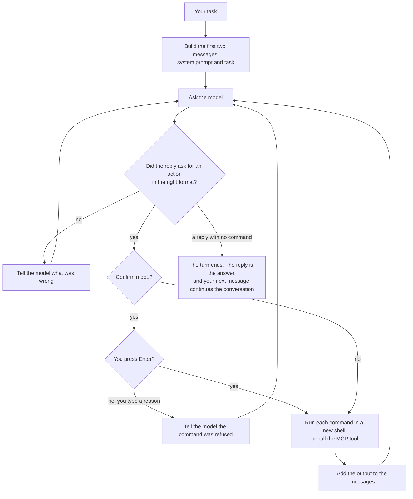
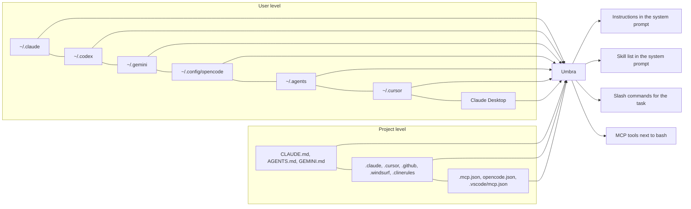

# Umbra

Umbra is a small coding agent for the terminal, written in Rust. You give it a task, it asks a
model what to do, runs the commands the model asks for, shows the model what happened, and repeats
until the model says it is finished.

Its loop is a port of [mini-swe-agent](https://github.com/swe-agent/mini-swe-agent): one shell
tool, a new shell for every command, and one plain list of messages. Umbra adds the things a coding
agent needs on a real machine. It reads the instruction files, skills, slash commands and MCP
servers you already set up for Claude Code, Codex, Gemini CLI, opencode, Cursor, Copilot, Windsurf
and Cline, so it works with your existing setup on the first run.

Umbra also speaks the [Agent Client Protocol](https://agentclientprotocol.com) (ACP), so editors
such as Zed, the JetBrains IDEs and Unluminous can run it in their own agent panel with
`umbra acp`.

```text
$ umbra -m anthropic/claude-haiku-5-5 "add a --verbose flag to the CLI and test it"
```

## Contents

- [Install](#install)
- [Quick start](#quick-start)
- [Use Umbra in an editor (ACP)](#use-umbra-in-an-editor-acp)
- [How it works](#how-it-works)
- [Choosing a model](#choosing-a-model)
- [What Umbra reads from other tools](#what-umbra-reads-from-other-tools)
- [Modes: confirm, yolo and human](#modes-confirm-yolo-and-human)
- [The fullscreen view](#the-fullscreen-view)
- [Ctrl+C, images and resuming a session](#ctrlc-images-and-resuming-a-session)
- [Features: what is included and what is not](#features-what-is-included-and-what-is-not)
- [Commands](#commands)
- [Project layout](#project-layout)
- More detail: [architecture](docs/architecture.md), [configuration](docs/configuration.md),
  [where files are found](docs/discovery.md), [MCP](docs/mcp.md), [models](docs/providers.md),
  [editors and ACP](docs/acp.md), [releases](docs/releasing.md),
  [design document](tasks/umbra-harness-tdd.md), [ACP and distribution design](tasks/umbra-acp-distribution-tdd.md), [compaction design](tasks/umbra-compaction-tdd.md),
  [images, resume and Ctrl+C design](tasks/umbra-images-resume-interrupt-tdd.md), [fixes part 5 design](tasks/umbra-fixes-part-5-tdd.md),
  [structured terminal UI design](tasks/umbra-improvements-v2-tdd.md)

## Install

**macOS and Linux**

```sh
curl -fsSL https://raw.githubusercontent.com/Black-Rainbow-Labs/umbra/main/install.sh | sh
```

**Windows**, in PowerShell or Command Prompt

```bat
powershell -ExecutionPolicy ByPass -c "irm https://raw.githubusercontent.com/Black-Rainbow-Labs/umbra/main/install.ps1 | iex"
```

Both scripts download the build for your machine from the
[latest GitHub release](https://github.com/Black-Rainbow-Labs/umbra/releases/latest), check it
against the release's `SHA256SUMS`, and install it into your home folder (`~/.local/bin`, or
`%LOCALAPPDATA%\Programs\umbra` on Windows). Neither needs administrator rights. On Windows, Umbra
runs commands with Git Bash, so install [Git for Windows](https://gitforwindows.org) too.

**Other ways**

| How | Command |
|---|---|
| Homebrew (macOS and Linux) | `brew install black-rainbow-labs/umbra/umbra` |
| cargo, from source | `cargo install --git https://github.com/Black-Rainbow-Labs/umbra --locked` |
| A download | the `.tar.gz` or `.zip` for your machine from the [releases page](https://github.com/Black-Rainbow-Labs/umbra/releases/latest): macOS (Apple silicon and Intel), Linux (x86_64 and arm64, static binaries) and Windows (x86_64 and arm64) |
| An editor | pick Umbra from the editor's ACP agent list, or see [editors](docs/acp.md) |

Then choose a model. `umbra setup` asks which provider and model to use and saves it in
`~/.umbra/config.toml`:

```sh
umbra setup
```

**To have a coding agent install it for you**, paste this to the agent:

```text
Install Umbra, the coding agent from https://github.com/Black-Rainbow-Labs/umbra.
On macOS or Linux run: curl -fsSL https://raw.githubusercontent.com/Black-Rainbow-Labs/umbra/main/install.sh | sh
On Windows run in PowerShell: irm https://raw.githubusercontent.com/Black-Rainbow-Labs/umbra/main/install.ps1 | iex
On Windows, check that Git for Windows is installed, because Umbra runs commands with Git Bash.
Then run `umbra --version` to check it is on the PATH, and run
`umbra setup --model anthropic/claude-haiku-5-5 --no-test` (or another provider/model I name) to save the model.
To add it to an editor that speaks ACP, the command is `umbra` with the argument `acp`.
```

## Quick start

Run a task with Claude. If you are signed in to Claude Code, Umbra uses that login. Otherwise set
`ANTHROPIC_API_KEY`.

```bash
umbra -m anthropic/claude-haiku-5-5 "create sum.py that prints the sum of 1 to 100, run it, and tell me the result"
```

Run the same task with a local model served by llama.cpp's `llama-server` on port 8080:

```bash
umbra -m local/qwen "create sum.py that prints the sum of 1 to 100, run it, and tell me the result"
```

Umbra shows each command before it runs and waits for you to press Enter. Add `-y` to run
commands without asking. Each run's full record is saved as a session journal in
`~/.umbra/trajectories/`. `umbra export <id>` writes it as a trajectory JSON file, and `-o <file>`
writes that file during the run.

To build from a checkout instead, you need Rust 1.85 or newer: `cargo install --path .`.

See what Umbra found on your machine before you run anything:

```bash
umbra instructions    # instruction files, in the order the model reads them
umbra skills          # every skill and where it came from
umbra mcp --connect   # MCP servers and their tools
umbra prompt "fix the failing test"   # the exact prompt a task would get
```

## Use Umbra in an editor (ACP)

`umbra acp` runs Umbra as an [Agent Client Protocol](https://agentclientprotocol.com) agent: the
editor starts it and talks to it on stdin and stdout. The editor shows Umbra's messages, each
command as a tool call with its output, and asks you before a command runs.

| Editor | How to add Umbra |
|---|---|
| Zed | In `settings.json`: `"agent_servers": { "Umbra": { "type": "custom", "command": "umbra", "args": ["acp"] } }` |
| JetBrains IDEs | In `~/.jetbrains/acp.json`: `{ "agent_servers": { "Umbra": { "command": "umbra", "args": ["acp"] } } }` |
| Unluminous | `settings acp-add umbra`, or an `acp` endpoint with the command `umbra` and the argument `acp` |
| Any ACP client | The command `umbra` with the argument `acp`. Add `-m provider/model` to pick the model. |

What the editor gets:

| ACP feature | What Umbra does |
|---|---|
| Modes | `confirm` asks the editor before each command; `yolo` runs them without asking. **Always allow** remembers the program for the rest of the session. |
| Model picker | The configured model plus every model in `models` in `~/.umbra/config.toml`, a list of `provider/model` strings or `[models.<name>]` tables |
| Sessions | Saved after every step. `session/load`, `session/resume` and `session/list` use the same sessions as `umbra --resume`, so a session started in the editor can be continued in the terminal and the other way round. |
| Stop | `session/cancel` stops the running command or model call, the way Ctrl+C does |
| Images and files | Image blocks go to the model; attached files are added to the task |
| MCP servers | The editor's servers are added to the ones Umbra finds in your other tools' config |
| Slash commands | Your slash commands and skills are offered as the editor's commands |
| Sign in | With no model set, a session asks the editor to sign in, which runs `umbra acp --setup` |

The details, and every message Umbra sends, are in [editors and ACP](docs/acp.md).

## How it works



A few rules shape everything else:

- **The model has one tool: `bash`.** It reads files with `cat`, edits them with `sed` or a
  heredoc, and runs tests the same way you would. MCP tools are added next to it.
- **Every command runs in a new shell.** `cd` and `export` do not carry over to the next command,
  so the model writes `cd src && make` in one command. This keeps each step simple to repeat.
- **The history is one list.** What you see in the trajectory file is exactly what the model saw.
- **Long runs are compacted.** Near 80% of the context window, old command outputs are replaced
  by a short placeholder, and if that is not enough the model summarizes the middle of the session.
  Every compaction is recorded in the trajectory with the messages it removed. See
  [compaction](docs/architecture.md#compaction).
- **A turn ends when the model replies without a command**, as in Claude Code. What it does
  depends on the message: "Hello" gets a one line reply and no commands, a question about the code
  gets read and answered, and a change request is carried out, checked and then reported. Your
  next message continues the same conversation. A step, cost or time limit also ends a turn.
- **`finish = "submit"`** (or `--finish submit`) keeps mini-swe-agent's behavior for benchmark
  runs: the task is framed as an issue to solve, every reply must run a command, and the run ends
  when a command prints `COMPLETE_TASK_AND_SUBMIT_FINAL_OUTPUT` as its first line and exits with
  code 0. A mini-swe-agent YAML config passed with `-c` sets it. In the default style that command
  still ends a turn, so old habits keep working.
- **Large MCP tool sets are deferred.** When the MCP tool definitions would take more than a tenth
  of the context window, the model gets only their names and a `tool_search` tool that loads the
  definitions it needs, the way Claude Code does it. On the machine Umbra was built on, every MCP
  server together is 229 tools and 124,715 tokens of definitions; with deferral a "Hello" is
  31,905 input tokens instead of 214,611. `[mcp] defer_tools = "always"` or `"never"` overrides it.

There are two ways for the model to ask for a command:

| | Tool mode (the default) | Text mode (`--text`) |
|---|---|---|
| How the model asks | A native tool call: `bash` with a `command` | A fenced block: ```` ```umbra_bash ```` |
| Best for | Current models with tool calling | Any model, including ones without tool calling |
| Commands per reply | One or more | Exactly one |

## Choosing a model

Pass `-m provider/model`, or set `model` in `~/.umbra/config.toml`.

| Provider | Example | What it talks to | Credential |
|---|---|---|---|
| `anthropic` | `anthropic/claude-haiku-5-5` | Anthropic Messages API | `ANTHROPIC_API_KEY`, or your Claude Code login |
| `local` | `local/qwen` | `http://localhost:8080/v1` (llama.cpp) | none |
| `ollama` | `ollama/llama3` | `http://localhost:11434/v1` | none |
| `openai` | `openai/gpt-5` | OpenAI | `OPENAI_API_KEY` |
| `openrouter` | `openrouter/anthropic/claude-sonnet-5-5` | OpenRouter | `OPENROUTER_API_KEY` |

Any other OpenAI compatible server can be added in the config. A model can have a short name in a
`[models.<name>]` table, and `-m <name>` uses it. See [models](docs/providers.md).

## What Umbra reads from other tools

Umbra looks in the places each tool keeps its files. You can see the result with the listing
commands above, and turn any tool off with `--no-source <name>`.



| What | Examples of where Umbra looks | How it is used |
|---|---|---|
| Instruction files | `~/.claude/CLAUDE.md`, `AGENTS.md`, `CLAUDE.md`, `CLAUDE.local.md`, `GEMINI.md`, `.cursor/rules/*.mdc`, `.github/copilot-instructions.md`, `.windsurfrules`, `.clinerules` | Added to the system prompt, most general first. `@path` imports are followed. |
| Skills | `~/.claude/skills`, installed Claude Code plugins, `~/.codex/skills`, `~/.agents/skills`, `.claude/skills`, `.agents/skills`, `.opencode/skills` | The name, description and path go into the system prompt. The model reads the SKILL.md when a task matches. |
| Slash commands | `.claude/commands/*.md`, `~/.codex/prompts/*.md`, `.gemini/commands/*.toml`, opencode's `command/*.md` | A task that starts with `/name` is replaced by that command's prompt. `/skill-name` works too. |
| MCP servers | `~/.claude.json`, `.mcp.json`, Claude Desktop, `~/.codex/config.toml`, `~/.gemini/settings.json`, `opencode.json`, `.cursor/mcp.json`, `.vscode/mcp.json` | Started in the background when Umbra starts. Their tools are offered to the model as each server becomes ready. |

The full list, the order, and the rules for duplicates are in [where files are found](docs/discovery.md).

## Modes: confirm, yolo and human

| Mode | Flag | What happens |
|---|---|---|
| Confirm | default | Umbra shows each command and waits. Press Enter to run it, or type a reason to refuse it; the reason is sent to the model. |
| Yolo | `-y` | Commands run without asking. Use it in a container (`--docker <image>`) or a throwaway checkout. |
| Human | `--mode human` | You type the commands. The model sees them when you switch back with `/c` or `/y`. |

At the confirm prompt, `/y` switches to yolo, `/u` to human mode and `/h` shows help. When a
turn ends in a terminal, Umbra waits for your next message; `--exit-immediately` exits instead.
With `--quiet` and `--exit-immediately`, `umbra -q -t "<question>"` prints only the answer, like
`claude -p`.
At that prompt, `/compact` or `/compact <what to keep>` summarizes the session before the next task.
If stdin is not a terminal, Umbra refuses to start in confirm mode and asks for `-y`, so it never
waits for an answer nobody can give.

## The fullscreen view

In a terminal Umbra opens on the alternate screen, the way `vim`, `less` and Claude Code's
fullscreen mode do. The session starts on a clean screen, scrolling up shows the conversation and
never the shell's earlier output, and when Umbra exits the shell's screen comes back as it was,
with the `trajectory <path>` line printed under it. `--no-fullscreen`, `fullscreen = false` or
`UMBRA_FULLSCREEN=0` prints inline below the shell prompt instead, which is what a pipe, `--quiet`
and `TERM=dumb` always get.

The screen has four parts, from top to bottom: the transcript, a popup or a picker when one is
open, an input line that is always there, so a message can be typed while the agent works, and the
status bar on the last row.

Code in a reply's fenced code blocks is colored by its language (`syntax_highlight = false` turns
that off). When Umbra finds a newer release, a prompt above the input line offers to install it and
restart into the same session; see `updates.check` in [configuration](docs/configuration.md).

**The header** is the first block of the transcript and scrolls with it. It shows the umbra logo,
the version, and these rows:

| Row | What it shows |
|---|---|
| `model` | The model of this session. A click on the row, or `/model`, opens the model picker. |
| `folder` | The folder Umbra works in. |
| `mode` | `confirm`, `yolo` or `human`, and nothing else. |
| `skills` | How many skills were found. |
| `mcp` | `starting 2 of 5` with a spinner while the servers start, then `5 running`, `4 running · 1 failed`, `3 running · 2 off`, `none` or `off`. A click on the row, or `/mcp`, opens the MCP panel. See [MCP](docs/mcp.md#starting-the-servers). |

The logo's cream letters show first and its green, yellow, orange, red and blue stripes appear one
at a time over about 1.4 seconds. The input line accepts typing during that time.
`UMBRA_BANNER_ANIMATION=0` shows the finished logo at once and `banner = false` leaves the header
out. The logo goes beside the text when both fit, above the text when only the logo fits, and is
left out in a terminal narrower than about 64 columns.

**Commands.** Typing `/` as the first character opens a list of commands above the input line, up
to 8 rows, each with its name, its kind (`command`, `custom` or `skill`) and a short description.
Matching is by prefix first, then by any part of the name. Up and Down move in the list, Tab or
Enter completes the name and adds a space, Enter on a name that is already complete runs it, and
Esc closes the list and keeps the text. A command works on the first prompt, on a follow up prompt,
and while the agent works. A command that only changes the screen (`/config`, `/mcp`, `/model`,
`/help`) runs at once while the agent works. A command that needs the agent to be idle is refused
with a one line notice.

| Command | What it does |
|---|---|
| `/config` | Opens the configuration modal. |
| `/model [name]` | Opens the model picker, or switches to the named model. |
| `/mcp` | Opens the MCP panel: the servers and their state, with a toggle for each. |
| `/mode [confirm, yolo, human]` | Switches the mode, or opens a picker. |
| `/clear` | Saves this session and starts a new one with an empty history. The old session stays in the resume list. |
| `/compact [focus]` | Summarizes the history now. |
| `/resume` | Opens the session picker. |
| `/skills` | Opens a picker of skills. Enter puts `/<skill> ` in the input line. |
| `/update` | Installs the newest release and restarts into this session. Typed while the agent works, it runs when the turn ends. |
| `/help` | Lists the commands and the keys. |
| `/quit` | Ends the session. |

The list also holds your custom commands and your skills. A built in name wins when a custom
command or a skill has the same name. The short commands inside the confirm, human and interrupt
prompts (`/y`, `/u`, `/c`, `/q`, `/h`) keep working.

**Keys**

| Key | What it does |
|---|---|
| PageUp, PageDown | Scroll the transcript a screen at a time |
| Mouse wheel | Scroll three lines |
| Ctrl+Home, Ctrl+End, Esc | Jump to the top, or back to the newest output |
| Tab, Shift+Tab | Move focus through the clickable parts of the transcript, the header rows and the status bar boxes. The focused part has a `›` marker. |
| Enter or Space on a focused part | Does what a click does. Esc or typing a character gives focus back to the input line. |
| Up, Down | Earlier prompts, when the cursor is on the first or last row of the input line. Otherwise Up and Down scroll one line. |
| Left, Right, Home, End, Backspace, Delete | Edit the input line |
| Ctrl+A, Ctrl+E, Ctrl+K, Ctrl+W, Ctrl+U | Start of the line, end of the line, delete to the end, delete the last word, delete to the start |
| Alt+Left, Alt+Right | Move by a word |
| Enter | Send the line; a paste keeps its line breaks |
| Ctrl+D on an empty line | End the session |
| Ctrl+C | Interrupt, as inline |

Every part that can be clicked can also be used from the keyboard. While the view is scrolled up,
new output does not move it, and a line under the transcript says how many rows are below.

**Replies and shell commands.** A reply is drawn from its markdown: headings, bold, italic,
strikethrough, inline code, fenced code, lists, quotes, tables, links and rules. Consecutive shell
commands are one collapsed row, `Ran 3 shell commands · 0:42`, with a spinner and `Running` while a
command runs, and `1 failed` when a command failed. The time is the total of the commands, as
`m:ss`. A click on the row, or Enter on it, shows one row for each command with its time and exit
code. Expanding a command shows the whole command and its output. A reply that has text between
two commands closes the group, so the order on the screen matches the order of events. Warnings
are yellow with `▲` and failures red with `✖`. Other routine events are one dim line: `↻` for a
compaction that freed space, `↺` for a reply with no usable command that was sent back to the
model, `+` for an attached image. When the system prompt, the instruction files and the tool
definitions fill most of the window, Umbra makes no summary and says once how many tokens the fixed
part takes. A turn that ends normally prints no summary line. A turn that stops for another reason
prints one line that says why, such as `▲ Interrupted` or a step or cost limit. `--verbose` (or
`verbose = true`) shows every detail.

**Selecting and copying text.** With the mouse on, a plain drag selects text, a double click selects
a word and a triple click selects a row. The selection is drawn in reverse video and follows the
text when the view scrolls. A drag past the top or bottom edge scrolls. When the button is
released Umbra copies the text to the clipboard, with wrapped rows of one line joined, and the
status bar says how many characters were copied for two seconds. Any key or click clears the
selection. The terminal's own selection still works with its modifier key held (Shift in Windows
Terminal and most Linux terminals, Option in iTerm2, Fn in Terminal.app).

`mouse = false`, `--no-mouse` or `UMBRA_MOUSE=0` turns mouse reporting off anywhere. The terminal
then selects text itself and everything is done with the keyboard. In a classic Windows console
window (conhost, a visible console window), the mouse is off by default and quick edit stays on, so
a drag selects text with the console's own selection. `UMBRA_MOUSE=1` turns the mouse on there.
Windows Terminal and other pseudoconsole terminals get the mouse.

**Pickers.** `/model`, `/mode`, `/resume` and `/skills` open a list above the status bar. Up and Down
move, Enter chooses, typing filters the list and Esc closes it. The model picker lists the models
from `[models.<name>]` and `models = [...]`, marks the current one, and ends with `Other...` for a
`provider/model` typed by hand. A model whose credential is missing shows the error and the model
does not change. A model chosen while the agent works applies from the next model call. The choice
lasts for the session and is not written to the config file.

**The configuration modal.** `/config` opens a modal with sections on the left and the fields of the
selected section on the right. Up and Down move, Tab switches between the two panes, Enter or
Space edits a field, Ctrl+S saves with the comments in the file kept, Ctrl+T switches between the
user file `~/.umbra/config.toml` and the project file `<project>/.umbra/config.toml`, and Esc
closes the modal, after asking whether to save or discard when there are unsaved changes. Each
provider has a Test button that checks the credentials, checks that the server answers and asks for
a "Say hello." completion. See [configuration](docs/configuration.md#editing-settings-in-the-terminal).

**The status bar** sits under the transcript, and in the inline view under the output. It is drawn
again after every line Umbra prints and once a second while the agent works:

```text
 context ████████░░░░░░░░░░░┊░░░░  33% · 42.6k / 128k │ ⠋ 3:07 │ $0.43 │ qwen-3.8 │ week ███░░░ 23%                     ▲ 1 MCP error
```

| Part | What it shows |
|---|---|
| context bar | How full the context window is. The bar fills in eighths of a cell, and `┊` marks where compaction starts. It is green while the request is under 60% of the compaction point, yellow under 85%, and red past that. The label reads `compacting` during a compaction. |
| `33% · 42.6k / 128k` | The estimated size of the next request, as a share of the window and in tokens. This is the number compaction is decided on. |
| `3:07` | The agent time as `m:ss` (`h:mm:ss` from one hour). It counts only while the agent works, so it does not move while Umbra waits for you, and it adds up across turns and across `--resume`. A spinner shows while the agent works. |
| `$0.43` | The cost of the session. Left out for a free local model. |
| model | The model's short name. |
| `week ███░░░ 23%` | The share of the weekly limit used, for a Claude login only. Green below 70%, yellow below 90%, red from 90%, dim when the last poll was refused. Left out for an API key or a local server. See [models](docs/providers.md#claude). `usage.enabled = false` turns it off. |
| `▲ 1 MCP error` | At the right edge, in red, only when an MCP server failed to start. A click on it, or Enter on it, lists each failed server with its error and its log file. |

When the terminal is narrow, the parts shorten or are left out in this order: the weekly usage
shrinks to the percent, the context bar gets shorter, the model is left out, the cost is left out.
The agent time and the MCP error box stay. The bar is only drawn when stdout is a terminal and the
run is not `--quiet`. `--no-status-bar`, `status_bar = false` in the config, or
`UMBRA_STATUS_BAR=0` turns it off; `UMBRA_STATUS_BAR=1` draws it even into a pipe, which is how the
tests read it.

**Resuming a session.** Umbra does not print a resume command during a session or when it exits.
`umbra resume` and `/resume` open a picker of saved sessions instead. Each session takes two rows:
its title with the age, model and number of model calls, and under it a one sentence summary. Up
and Down move, Enter resumes, typing filters, Esc cancels. `umbra resume <id>` resumes a session
directly, and `umbra resume --all` lists the sessions of every folder. After a resume the
transcript shows the earlier prompts, replies and collapsed command groups. Without a terminal,
`umbra resume` prints the list the way `umbra sessions` does and asks for an id. The title of a
session is the first line of the first prompt. After the first turn Umbra makes one small request
to the session's model for a title and a one sentence summary, only in a terminal, and a
compaction summary replaces the summary. `sessions.auto_title = false` turns the request off. In
quiet mode an interrupted run still prints `umbra: interrupted. Resume with: umbra --resume <id>`
on stderr, because a script has no other way to learn the id.

## Ctrl+C, images and resuming a session

**Ctrl+C** stops what Umbra is doing and asks what to do next, the way mini-swe-agent does:

```text
Interrupted. Type a comment/command (/h for available commands)
>
```

| Umbra was | What Ctrl+C does |
|---|---|
| waiting for the model | Stops waiting. A streamed reply from a local server is dropped, which closes the connection, so the server stops generating. Nothing from that reply is kept. |
| running a command | Kills the command and everything it started. The model gets the output so far and `The user interrupted this command (Ctrl+C) after N seconds`. |
| calling an MCP tool | Stops waiting and tells the server the call is cancelled. The server keeps running. |
| asking you to confirm | The commands are not run. |

What you type next goes to the model as `Interrupted by user: <your text>` and the run carries on.
Enter alone carries on with `Temporary interruption caught.`. `/y`, `/c` and `/u` switch the
mode, `/compact` compacts the history, and `/q` or a second Ctrl+C ends the run with exit code
130. Commands and MCP servers run in their own process group, so the key press reaches Umbra and
not them. Without a terminal, Ctrl+C ends the run straight away. If Umbra ever stops responding,
a third Ctrl+C exits.

**Typing while the agent works.** A line you type and send with Enter while Umbra is working is
queued. Before its next model call Umbra adds it to the conversation as `The user sent this
message while you were working: <your text>` and shows it under a `message from the user`
heading, so the agent sees it without the run having to finish. To have it read at once, press
Ctrl+C after sending it: the current command or model call stops, and the queued line becomes the
comment (`Interrupted by user: <your text>`). This is how the Tasks board in AI Service delivers a
comment to an Umbra agent that is in the middle of a task.

**`--keep-open`**, for a session another program types into: an empty line or a Ctrl+C at the
task prompt or the follow up prompt asks again instead of ending the run, and a second Ctrl+C at
the comment prompt carries on instead of ending it. Only `/q`, the end of input or a third
unhandled Ctrl+C ends such a run.

**Images** go to the model with the task:

```bash
umbra -m anthropic/claude-haiku-5-5 -i screenshot.png "why does this dialog cut off its last button?"
umbra -m local/qwen "compare @before.png with @after.png"
```

`-i` / `--image` attaches a file. A PNG, JPEG, GIF or WebP path typed in a task, a follow up task or
a comment is attached too, with or without `@`, so you can drag a file into the terminal. Images
over 1568 pixels on the long edge are scaled down. Images that MCP tools return, such as a browser
screenshot, reach the model as images. A local model needs a vision projector loaded to read them.

**Sessions** are saved after every step, so any run can be continued, including one that was
interrupted or crashed:

```bash
umbra sessions                       # this folder's sessions, newest first
umbra --continue "now add a test"    # the newest session in this folder
umbra --resume 1794185509287 "and update the docs"
umbra resume                         # pick one from a list with a title and a summary
umbra resume 17941855                # resume one directly
umbra --resume                       # the same picker
umbra --resume 17941855 --fork "try it a different way"   # copy it, leave the original alone
```

A resumed session continues in its own folder, with its own model unless `-m` says otherwise, and
in the same trajectory file. The model sees the whole history, the images included, and the next task
arrives the way a follow up task does. The step and cost limits count from the resume.

## Features: what is included and what is not

"Umbra" is what this version does. The other columns are for comparison and come from each
project's documentation as of November 2026.

| Feature | Umbra | mini-swe-agent | Claude Code | Codex CLI | opencode |
|---|---|---|---|---|---|
| Native tool calling | yes | yes | yes | yes | yes |
| Text actions for models without tool calling | yes (`--text`) | yes | no | no | no |
| Fresh shell for every command | yes | yes | no | no | no |
| Dedicated file read and edit tools | no, the model uses bash | no | yes | yes | yes |
| Run commands in Docker | yes (`--docker`) | yes | sandboxing | sandboxing | no |
| Confirm before each command | yes | yes | yes | yes | yes |
| Human mode (you type the commands) | yes | yes | no | no | no |
| Step, cost and time limits | yes | yes | turn limit | not documented | not documented |
| Cost tracking | yes | yes | yes | yes | yes |
| Trajectory file of every run | yes, mini-swe-agent format | yes | transcripts | session logs | yes |
| Reads mini-swe-agent YAML configs | yes | yes | no | no | no |
| Anthropic models | yes | yes, through LiteLLM | yes | no | yes |
| OpenAI compatible servers (llama.cpp, Ollama, vLLM) | yes | yes, through LiteLLM | no | yes | yes |
| Prompt caching | yes, Anthropic | yes | yes | yes | yes |
| Retries with backoff | yes | yes | yes | yes | yes |
| CLAUDE.md, AGENTS.md, GEMINI.md and rule files | yes, all of them | no | CLAUDE.md, AGENTS.md | AGENTS.md | AGENTS.md, CLAUDE.md |
| `@path` imports in instruction files | yes | no | yes | no | no |
| Agent Skills (SKILL.md) | yes, from every tool's folders | no | yes | yes | yes |
| Custom slash commands | yes, from every tool's folders | no | yes | yes | yes |
| MCP over stdio | yes | no | yes | yes | yes |
| MCP over HTTP and SSE | yes | no | yes | yes | yes |
| MCP 2026-07-28 (no handshake) | yes | no | not documented | not documented | optional |
| MCP config from other tools' files | yes | no | no | no | no |
| MCP OAuth sign in | no | no | yes | yes | yes |
| Rules that apply only to some file paths | no, only rules for every file | no | yes | no | no |
| Context compaction | yes: mask old outputs, then summarize | no | yes | yes | yes |
| Subagents | no | no | yes | yes | yes |
| Hooks | no | no | yes | yes | yes |
| Plan mode | no | no | yes | not documented | yes |
| Todo list tool | no | no | yes | yes | yes |
| Web fetch and web search | no | no | yes | yes | yes |
| Image input | yes (`-i`, typed paths, MCP images) | optional | yes | yes | yes |
| Paste an image from the clipboard | no | no | yes | yes | yes |
| Resume a past session | yes (`--resume`, `--continue`, `--fork`) | no | yes | yes | yes |
| Ctrl+C stops the current step and asks for a comment | yes | yes | yes, with Esc | yes, with Esc | yes, with Esc |
| Full screen terminal interface | yes | no | yes | yes | yes |
| Agent Client Protocol, for editors | yes (`umbra acp`) | no | through an adapter | through an adapter | yes |
| Git checkpoints and undo | no | no | yes | not documented | yes |

The items marked "no" for Umbra are left out on purpose for this version, to keep the loop as
small and easy to follow as mini-swe-agent's. MCP servers can supply several of them, such as web
search or a browser.

## Commands

| Command | What it does |
|---|---|
| `umbra [options] <task>` | Runs a task. `umbra run` is the same. |
| `umbra prompt <task>` | Prints the system prompt and first message the task would get. |
| `umbra instructions` | Lists the instruction files in prompt order, with sizes. |
| `umbra skills` | Lists the skills and where each came from. |
| `umbra commands` | Lists the slash commands. |
| `umbra mcp [--connect]` | Lists MCP servers with `on` or `off` for each; with `--connect` starts them and lists their tools. |
| `umbra mcp enable <name>`, `umbra mcp disable <name>` | Lets a server start in every session, or stops it. `--project` changes the project's config file. |
| `umbra config` | Prints the merged configuration. |
| `umbra config list\|get\|set\|unset\|path` | Reads and changes one setting. See [configuration](docs/configuration.md#editing-settings-from-the-command-line). |
| `umbra models` | Lists the default model, the named models and the known models. |
| `umbra session status\|model\|mode\|mcp\|compact\|quit` | Controls a running session. A command the agent runs reaches its own session; from another terminal, name it with `--session <id>` (`umbra session list` lists them). |
| `umbra update [--check]` | Checks for a newer release and installs it. |
| `umbra sessions [--all]` | Lists saved sessions, newest first. |
| `umbra resume [id] [--all]` | Opens a picker of saved sessions, or resumes the session with that id or the start of its id. `--all` lists every folder's sessions. |
| `umbra export <id> [-o file]` | Writes a saved session as a trajectory JSON file in the mini-swe-agent-1.1 format, next to its journal or to the `-o` file. |
| `umbra acp` | Runs as an ACP agent on stdin and stdout, for an editor. Takes `-m`, `--yolo`, `--mode`, `-l` and `--step-limit`. |
| `umbra setup` | Asks for a provider and model, saves it in `~/.umbra/config.toml`, and checks that the model answers. |

The listing commands take `--json`. The options used most:

| Option | Meaning |
|---|---|
| `-m, --model provider/model` | Which model to use |
| `-y, --yolo` | Run commands without asking |
| `--text` | Text mode instead of tool calls |
| `-l, --cost-limit <dollars>` | Stop at this cost (default 0, which means no limit) |
| `--step-limit <n>` | Stop after this many model calls |
| `--cwd <folder>` | Work in this folder |
| `--docker <image>` | Run every command in a new container |
| `-c, --config <file>` | Another config file, TOML or mini-swe-agent YAML |
| `--no-mcp`, `--mcp a,b` | No MCP servers, or only these |
| `--no-skills`, `--no-instructions` | Leave skills or instructions out |
| `--no-source claude,codex,...` | Ignore one tool's files |
| `-o, --output <file>` | Where to write the trajectory |
| `--exit-immediately` | Exit when the turn ends instead of waiting for the next message |
| `--finish reply\|submit` | How a turn ends: a reply with no command (default), or the submit command |
| `-q, --quiet` | Print only the final answer |
| `--no-fullscreen` | Print inline below the shell prompt instead of on the alternate screen |
| `--no-mouse` | Do not turn on mouse reporting in the fullscreen view. The terminal selects text itself. |
| `--no-status-bar` | Do not draw the status bar under the output |
| `--verbose` | Print every detail: step costs, whole command outputs, full format errors |
| `--no-compact` | Never compact the history |
| `--context-window <tokens>` | The model's context window, for compaction |
| `-i, --image <file>` | Attach an image to the task. Repeatable. |
| `-r, --resume [session]` | Continue a saved session: its id, the start of its id, or a trajectory file |
| `--continue` | Continue the newest session in this folder |
| `--fork` | With `--resume` or `--continue`: continue a copy of the session |

On Windows, Git Bash rewrites an argument that starts with `/` into a Windows path. To run a slash
command from Git Bash, write `MSYS_NO_PATHCONV=1 umbra /review`. PowerShell and cmd do not do this.

## Project layout

```text
src/
  main.rs, cli.rs        command line
  models/                plain data: messages, actions, config, context, trajectory
  repositories/          reading and writing files: config, instructions, skills,
                         commands, MCP config, trajectories
  services/              the agent loop, model providers, environments, MCP client,
                         prompt templates, the confirm prompt, the setup wizard
  services/acp/          the ACP server: JSON-RPC, sessions, session updates
  templates/             the Jinja prompt templates
  ui/                    the fullscreen view: blocks, frame, markdown, header, overlays, selection
  utils/                 paths, frontmatter, variable expansion, HTTP, terminal output, status bar
tests/                   integration tests that run the real binary
docs/                    the documents linked above
tasks/                   the design documents
packaging/               the release script, the Homebrew formula and the ACP registry entry
install.sh, install.ps1  the install scripts
.github/workflows/       tests on every push, release builds on every tag
```

Run the tests with `cargo test`. The integration tests use a fake home folder and never read your
real configuration. Two more sets are left out of a plain `cargo test` and run with `--ignored`:

```bash
cargo test --test live_local -- --ignored --test-threads 1       # against the model on localhost:8080
cargo test --test console_windows -- --ignored --test-threads 1  # a real Ctrl+C in a console window
```

`UMBRA_LIVE_MODEL` picks the model for the live tests, and `UMBRA_LIVE_EVIDENCE=<folder>` keeps their
trajectories.
