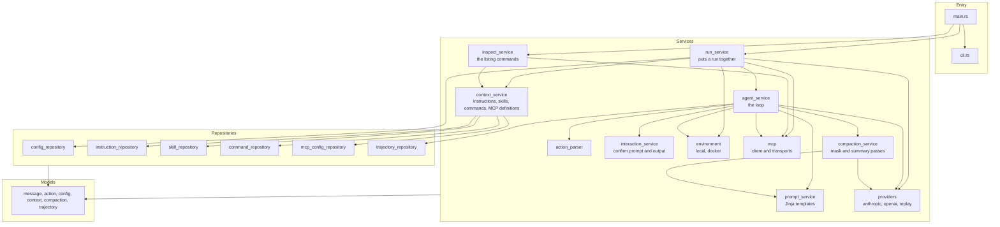
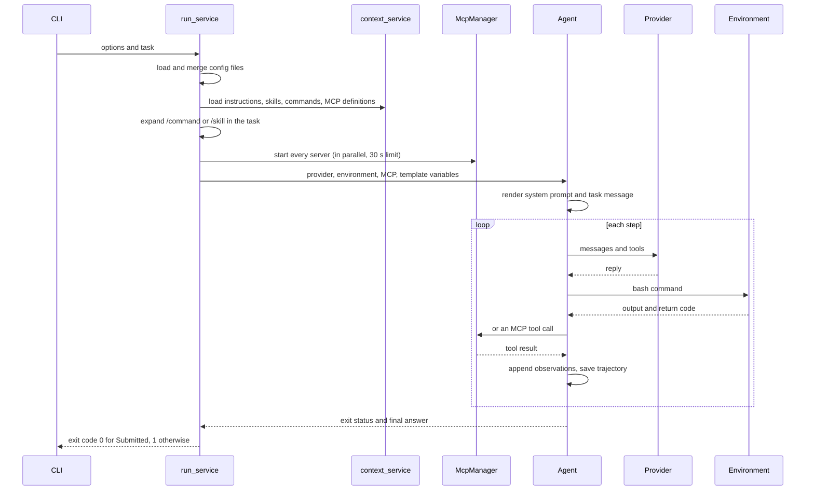
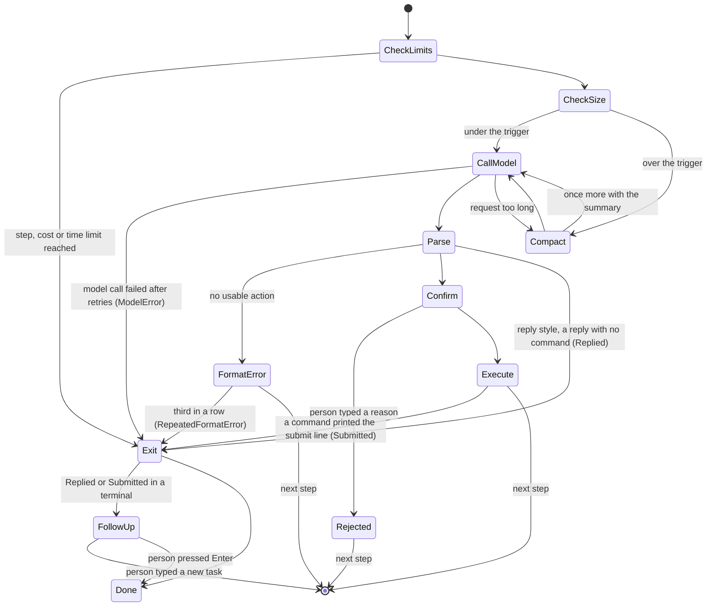
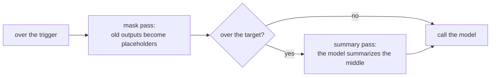
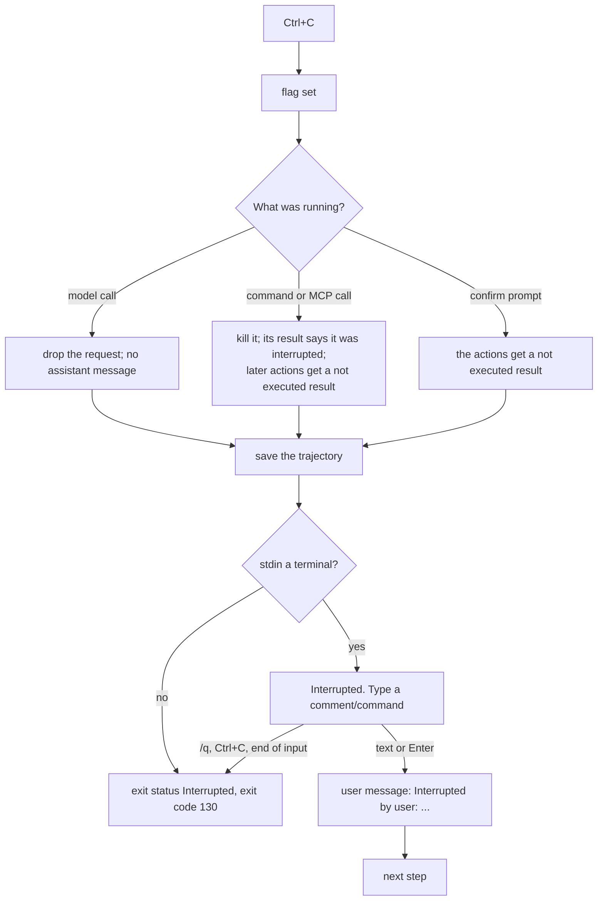

# Architecture

Umbra is one binary. The code is split into four layers, and each layer only calls the layers
below it.



| Layer | Folder | What lives there |
|---|---|---|
| Models | `src/models` | Plain data with no behavior: `Message`, `Action`, `Observation`, `UmbraConfig`, `Skill`, `InstructionFile`, `McpServerDefinition`, `Trajectory`. |
| Repositories | `src/repositories` | Everything that reads or writes files. Each loader takes a `DiscoveryContext` (home folder, working folder, project root, enabled sources) and returns models. |
| Services | `src/services` | The agent loop and everything it talks to: models, shells, MCP servers, templates, the person at the keyboard. |
| Utils | `src/utils` | Small helpers with no knowledge of the agent: paths, frontmatter, variable expansion, HTTP, terminal output. |

## One run, start to finish



## The message list

Umbra keeps one list of `Message` values. Each has a `role` (`system`, `user`, `assistant`,
`tool` or `exit`), its text, any tool calls, and an `extra` object that only the trajectory file
uses. `exit` is a local marker that ends the loop and is never sent to a model.

Each provider converts the list into its own format just before sending it:

- **Anthropic**: system messages become the `system` field. Tool results become `tool_result`
  blocks in a user message. Messages with the same role in a row are joined. An assistant
  message is sent with the exact content blocks the API returned (kept in
  `extra.anthropic_content`), because current Claude models reject thinking blocks that were
  changed.
- **OpenAI compatible**: each message maps to one chat message. Tool call arguments are sent as
  JSON text.

## How a step ends



## Compaction

Before each model call Umbra estimates the size of the request: the size the provider reported for
the last call, plus four bytes per token for the messages added since. When there is no reported
size, as right after a compaction, the whole history is estimated the same way. When the estimate
passes `trigger_ratio` of the context window (80% by default), Umbra compacts in two steps.



1. **Mask pass.** Old command outputs are replaced by a one line placeholder that gives the size
   and return code and says to run the command again if it is needed. The command, the model's
   reasoning and the Anthropic content blocks are not touched, and `extra.raw_output` still holds
   the full output. The newest outputs the model has seen are kept (`protect_recent_*`), and the
   outputs of the newest reply are always kept, because the model has not been shown them yet.
   Short outputs and SKILL.md reads are kept too. A pass that would free less than
   `min_reclaim_*` masks nothing, because changing an earlier message makes the provider's prompt
   cache miss from that message on.
2. **Summary pass.** When masking leaves the estimate above `target_ratio`, the model is sent the
   history with the `compact_summary` prompt and the same tools, and writes a summary under fixed
   headings. The new history is the system prompt, the task, any follow up tasks the person typed,
   the summary (a user message from `compact_resume`), and the newest turns worth
   `keep_recent_ratio` of the window. The kept turns always start at an assistant message, so every
   tool result still follows its tool call. The summary call's cost is added to the run and it does
   not count as a step.

   A summary only replaces conversation. The system prompt, the instruction files and the tool
   definitions stay, so a summary at the trigger runs only when the history it would remove is
   worth at least `min_reclaim_*`. When it is not, the fixed part is what fills the window, and a
   summary before every call would cost a model call each time and free almost nothing. Umbra
   then makes none and warns once with the fixed part's size, scaled to the provider's own token
   count. This is what happened on a 200k window with every MCP server on: 124,715 tokens of tool
   definitions put the very first request past the trigger. Deferring the MCP tools behind
   `tool_search` (`mcp.defer_tools`) is the fix for that case.

When a provider refuses a request as too long (Anthropic's "prompt is too long", llama.cpp's
"exceeds the available context size", OpenAI's `context_length_exceeded`), Umbra runs a summary
pass and sends the request once more. At the follow up prompt after a run finishes, `/compact` or
`/compact <what to keep>` runs a summary pass by hand.

The window comes from `compaction.context_window`, then the provider (llama.cpp and NInfer report
`n_ctx` at `/props`, vLLM, llama.cpp and OpenRouter list a size per model at `/models`), then a
table (Claude models 200,000, or 1,000,000 for an id ending in `[1m]`), then 128,000.

The design, the research behind it and the measurements are in
[the compaction design document](../tasks/umbra-compaction-tdd.md).

## Commands and their output

The local environment runs each command as `bash -c "exec 2>&1\n<command>"`, so stdout and stderr
arrive in their original order as one stream, the way mini-swe-agent merges them. Stdin is closed,
so a command that waits for input ends instead of hanging. Two threads read the pipes, so a large
output never blocks the command. After `environment.timeout` seconds (30 by default), or when you
press Ctrl+C, everything the command started is killed. On Linux and macOS that is the command's
process group. On Windows each command runs in a job object, and the job is terminated, followed
by `taskkill /F /T`. The job is needed because Git Bash starts a program such as `sleep.exe` from
a process outside bash's own process tree, so `taskkill /T` alone left it running. The model sees
return code -1 and a message saying the command timed out or was interrupted, with the output so
far. Commands and MCP servers start in their own process group (`CREATE_NEW_PROCESS_GROUP` on
Windows), so a Ctrl+C typed in Umbra's terminal reaches Umbra and not them.

On Windows, Umbra uses Git for Windows' `bash.exe`. It never uses `C:\Windows\System32\bash.exe`,
which would run the command inside WSL instead of on Windows. When no bash is found it falls back to
`cmd /C`.

The Docker environment starts `docker run -d <image> sleep 2h` once, runs each command with
`docker exec -w <cwd> <container> bash -lc`, and removes the container at the end of the run.

## Ctrl+C

The Ctrl+C handler only sets a flag. Each place Umbra waits checks it every 100 ms: the model call
(on a worker thread), the retry backoff, a running command, a stdio MCP call, and every prompt. Stdin
is read by one background thread, so a prompt can stop waiting too.



Every tool call still gets a result, so the history stays valid for the Anthropic API, which refuses a
`tool_use` without its `tool_result`. A third Ctrl+C that Umbra has not handled exits the process at
once, in case the main thread is stuck somewhere that does not check the flag.

## Sessions

A session is one trajectory file, identified by its start time in milliseconds. After every step
Umbra writes the trajectory and a small index entry, `~/.umbra/sessions/<id>.json`, that holds the
folder, model, first task, status, call count and cost, so `umbra sessions` can list sessions
without reading trajectories that may hold large images.

Resuming reads the trajectory back: the messages, `info.model_stats`, `info.compactions` and
`info.session`. The exit marker is removed, and any tool call with no result gets one saying it was
not run, which is what a session interrupted in the middle of a step needs. The original system
prompt is kept, so the model sees the same start and the provider's prompt cache still matches. The
next task is added the way a follow up task is: the person's words as they typed them, or with
`finish = "submit"`, `The user added a new task: <task>`.
Each resume is recorded in `info.session.resumes`; with `--fork` the history goes to a new session
and the old file is not touched.

## The trajectory file

The file is rewritten after every step, through a temporary file, so a crash leaves a complete
record up to the last step. Its shape follows mini-swe-agent's `mini-swe-agent-1.1` format:

```json
{
  "info": {
    "model_stats": { "instance_cost": 0.0037, "api_calls": 2, "input_tokens": 51293, "output_tokens": 427, "compactions": 0 },
    "config": { "agent": {}, "model": {}, "environment": {}, "mcp_servers": [], "skills": 42, "instruction_files": [] },
    "umbra_version": "0.1.0",
    "exit_status": "Submitted",
    "submission": "5050\n",
    "compactions": [],
    "session": { "id": "1794185509287", "cwd": "C:/work/app", "model": "anthropic/claude-haiku-5-5", "task": "...", "started_at": 1794185509.2, "resumes": [] }
  },
  "messages": [
    { "role": "system", "content": "..." },
    { "role": "user", "content": "Please solve this issue: ..." },
    { "role": "assistant", "content": "...", "tool_calls": [], "extra": { "actions": [], "cost": 0.0033, "usage": {} } },
    { "role": "tool", "tool_call_id": "...", "content": "{ \"returncode\": 0, \"output\": \"5050\" }", "extra": { "raw_output": "5050\n", "returncode": 0 } },
    { "role": "exit", "content": "5050\n", "extra": { "exit_status": "Submitted", "submission": "5050\n" } }
  ],
  "trajectory_format": "mini-swe-agent-1.1"
}
```

`messages` is always what the model was sent on the last call. Each entry in `info.compactions`
records one compaction: `kind` (`mask` or `summary`), `reason` (`threshold`, `overflow` or
`manual`), the step, the estimate before and after, the window, the masked positions, and for a
summary the summary text, its cost and every message it replaced, in full.

A message with images has an `images` list: `media_type`, `data` (base64), `width`, `height` and
`source`, the file path or `mcp:<server>.<tool>`. The data is kept so a resumed session can send the
same pictures. When the mask pass removes an output with images, they move to
`extra.masked_images`, where they are kept but no longer sent.
