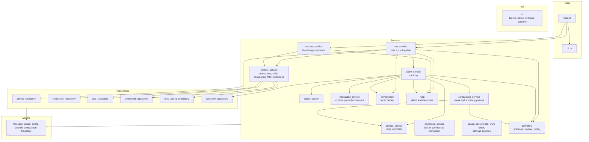
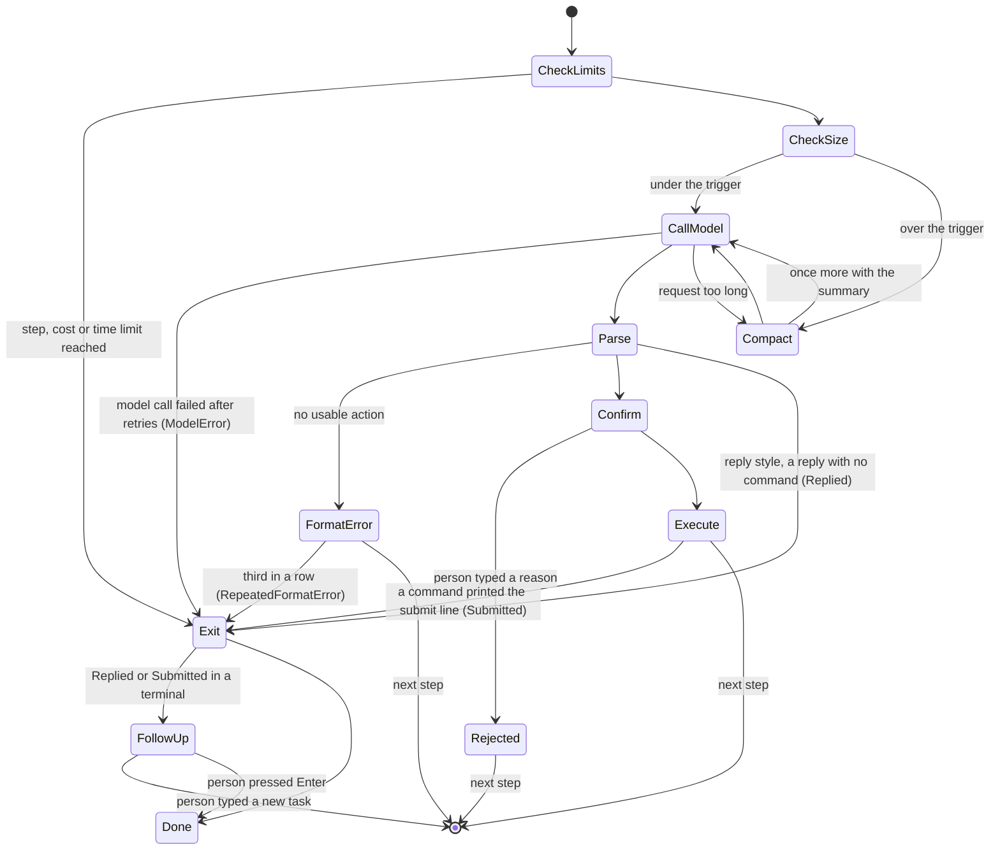
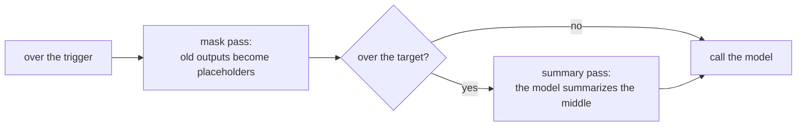
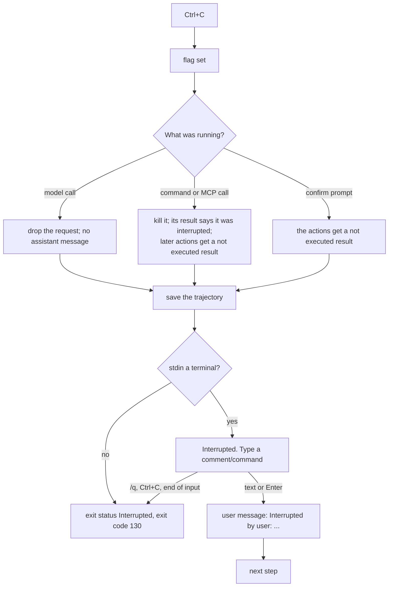

# Architecture

Umbra is one binary. The code is split into four layers, and each layer only calls the layers
below it.



| Layer | Folder | What lives there |
|---|---|---|
| UI | `src/ui` | The fullscreen view: the list of blocks, the frame and its hit map, markdown, the header, the overlays (command popup, pickers, MCP panel, configuration modal) and text selection. It reads state from the services and sends events and commands back to them. |
| Models | `src/models` | Plain data with no behavior: `Message`, `Action`, `Observation`, `UmbraConfig`, `Skill`, `InstructionFile`, `McpServerDefinition`, `Trajectory`. |
| Repositories | `src/repositories` | Everything that reads or writes files. Each loader takes a `DiscoveryContext` (home folder, working folder, project root, enabled sources) and returns models. |
| Services | `src/services` | The agent loop and everything it talks to: models, shells, MCP servers, templates, the person at the keyboard. |
| Utils | `src/utils` | Small helpers with no knowledge of the agent: paths, frontmatter, variable expansion, HTTP, terminal output. |

## One run, start to finish

```mermaid
sequenceDiagram
    participant CLI
    participant Run as run_service
    participant Ctx as context_service
    participant MCP as McpManager
    participant Agent
    participant Model as Provider
    participant Shell as Environment
    CLI->>Run: options and task
    Run->>Run: load and merge config files
    Run->>Ctx: load instructions, skills, commands, MCP definitions
    Run->>Run: expand /command or /skill in the task
    Run->>MCP: start every server on its own thread (30 s limit)
    Note over Run,MCP: at a terminal Umbra does not wait;<br/>with no terminal it waits until the servers settle
    Run->>Agent: provider, environment, MCP, template variables
    Agent->>Agent: render system prompt and task message
    loop each step
        Agent->>Model: messages and tools
        Model-->>Agent: reply
        Agent->>Shell: bash command
        Shell-->>Agent: output and return code
        Agent->>MCP: or an MCP tool call
        MCP-->>Agent: tool result
        Agent->>Agent: append observations, save trajectory
    end
    Agent-->>Run: exit status and final answer
    Run-->>CLI: exit code 0 for Submitted, 1 otherwise
```

## The fullscreen view

The fullscreen view in `src/ui` keeps the transcript as a list of typed blocks and not as printed
lines: the header, a user prompt, a reply (kept as markdown source), a group of commands, a notice,
and plain text. Each block lays itself out again when the width changes, and the layout is cached
for each block and width. Each frame is a full repaint that also builds a hit map from screen cells
to targets, so a click can open a command group, a header row, a status bar box or an item of an
overlay. The input thread decodes keys, bracketed paste and SGR mouse reports and sends them to the
topmost overlay, or to the focused element, or to the input line.

- **Redraw ticker.** A thread wakes every 100 ms and redraws only while something changes with
  time: a command is running, the agent is working, an MCP server is starting or the logo is being
  revealed. Otherwise it waits and uses no CPU.
- **Agent events.** The agent loop sends `action_started`, `action_finished` and `action_not_run`
  events to the view. Each `Observation` has `started_at` and `duration_ms`, which the trajectory
  keeps in the message `extra` and an old trajectory can leave out. Consecutive commands form one
  group with the header `Ran N shell commands` and the time as `m:ss`. A reply with text closes the
  open group.
- **Mouse and selection.** With mouse reporting on, a plain drag selects text. Umbra draws the
  selection in reverse video, keeps it in transcript coordinates so it survives scrolling, and
  copies it on release with an OSC 52 write and the system clipboard (the Windows clipboard API,
  `pbcopy`, or `wl-copy`, `xclip` or `xsel`). A double click selects a word and a triple click a
  row. `mouse = false`, `--no-mouse` and `UMBRA_MOUSE=0` send no mouse modes. In a classic Windows
  console window (conhost) `src/utils/terminal_mode.rs` detects the visible console window with
  `in_classic_console_window`, and `mouse_wanted` in `run_service` leaves the mouse off and quick
  edit on there unless `UMBRA_MOUSE=1` is set.
- **Work clock.** `WorkClock` adds up the time the agent works. It starts when a prompt goes to the
  agent or a confirm prompt is answered, and stops when a turn ends or a prompt waits for the
  person. The total is saved in the session as `work_seconds` and restored on resume.
- **MCP state.** `McpManager` starts each server on its own thread and keeps a state for each one:
  `Off`, `Starting`, `Ready` or `Failed`. The agent reads the tools of the ready servers before each
  model call. A stdio transport kills its child process when it is dropped, so a failed or disabled
  server leaves no process.
- **Layout and scrolling.** From the top: the transcript, the panel or popup rows, the input line,
  and the status bar on the last row. `View::scroll` counts transcript rows below the view.
  Expanding or collapsing a group keeps the toggled header on the screen row it was on, and every
  frame clamps `scroll` to the transcript's height, so a transcript that got shorter (a collapse, a
  wider screen, the row cap) never leaves the view past its top.
- **Syntax colors.** `ui/highlight.rs` colors fenced code blocks and the shell command of an
  expanded run. Each language is a table of comment markers, quotes, keywords, types and literals
  read by one small lexer, with a state carried between lines for block comments, strings over
  several lines and HTML tags.
- **Commands.** `command_service` holds the built in commands (`/config`, `/model`, `/mcp`,
  `/mode`, `/clear`, `/compact`, `/resume`, `/skills`, `/update`, `/help`, `/quit`), the completion list of
  built in commands, custom commands and skills, and `handle_line`, which every prompt goes
  through, so a slash command works on the first prompt, on a follow up prompt and while the agent
  works. ACP uses the same list.
- **Settings.** The configuration modal is driven by a table of every setting, and a test fails when
  a key of the default config has no entry. Saving uses `toml_edit`, so comments and key order stay.
- **Usage and titles.** `usage_service` polls the Claude usage endpoint on its own thread.
  `session_title_service` makes the one small request that names a session.

The inline view and the quiet mode do not use `src/ui`. They print through `interaction_service`.

## Umbra's command line and the running session

`cli_service` gives every setting and built in command a command line form, so the agent can change
Umbra with a shell command. `umbra config get/set/unset/list` uses the settings schema, the parser
and the `toml_edit` writer the configuration modal uses. `umbra mcp enable` and `disable` change
`mcp.only` and `mcp.disabled` through `mcp_settings_service`, which the `/mcp` panel and the modal
call too.

`umbra session` reaches a running session through `control_service`. While a terminal session
runs, it keeps `~/.umbra/control/<session id>/` with `state.json` (model, mode, MCP servers,
process id) and `requests.jsonl`. Each command the agent runs gets `UMBRA_CONTROL_DIR`,
`UMBRA_SESSION_ID` and `UMBRA_BIN` in its environment. `umbra session model x` appends a line to
`requests.jsonl`; before every model call the agent renames the file, reads it and applies each
line as the fullscreen view's own request would be applied. The folder is removed when the session
ends, and a folder whose process is gone is removed by the next session. ACP sessions do not have a
control folder, because one ACP process serves many sessions.

The reply style system prompt names the running binary (`umbra_bin`) and lists these commands, so
the agent uses them when asked to change a setting, a model or an MCP server.

## Updates

`update_service` checks `https://api.github.com/repos/Black-Rainbow-Labs/umbra/releases/latest` at
most once every `updates.interval_hours`, on a background thread of an interactive fullscreen
session, and keeps the answer in `~/.umbra/update.json`. A newer version opens the update prompt
above the input line once the agent is idle. **Install and restart** sends `/update`. The agent
saves the session, downloads `umbra-<target>.tar.gz` (or `.zip`) and `SHA256SUMS` from the release,
checks the SHA-256, unpacks with the system `tar`, runs the new binary with `--version`, and
renames it over the running one (on Windows the old binary is renamed to `umbra.exe.old` first and
removed at the next start). A Homebrew install runs `brew upgrade` instead. The run then ends with
`NextSession::Restart`, and `run_service::restart_into` leaves the fullscreen view and starts the
new binary with `--resume <session id>` and this run's options: with `exec` on Unix, and as a child
whose exit code is returned on Windows. A failure at any step leaves the old binary and the session
as they were.

## The message list

Umbra keeps one list of `Message` values. Each has a `role` (`system`, `user`, `assistant`,
`tool` or `exit`), its text, any tool calls, and an `extra` object that only the trajectory file
uses. `exit` is a local marker that ends the loop and is never sent to a model.

Each provider converts the list into its own format just before sending it:

- **Anthropic**: system messages become the `system` field. Tool results become `tool_result`
  blocks in a user message. Messages with the same role in a row are joined. An assistant
  message is sent with the exact content blocks the API returned (kept in
  `extra.anthropic_content`), because current Claude models reject thinking blocks that were
  changed.
- **OpenAI compatible**: each message maps to one chat message. Tool call arguments are sent as
  JSON text.

## How a step ends



## Compaction

Before each model call Umbra estimates the size of the request: the size the provider reported for
the last call, plus four bytes per token for the messages added since. When there is no reported
size, as right after a compaction, the whole history is estimated the same way. When the estimate
passes `trigger_ratio` of the context window (80% by default), Umbra compacts in two steps.



1. **Mask pass.** Old command outputs are replaced by a one line placeholder that gives the size
   and return code and says to run the command again if it is needed. The command, the model's
   reasoning and the Anthropic content blocks are not touched, and `extra.raw_output` still holds
   the full output. The newest outputs the model has seen are kept (`protect_recent_*`), and the
   outputs of the newest reply are always kept, because the model has not been shown them yet.
   Short outputs and SKILL.md reads are kept too. A pass that would free less than
   `min_reclaim_*` masks nothing, because changing an earlier message makes the provider's prompt
   cache miss from that message on.
2. **Summary pass.** When masking leaves the estimate above `target_ratio`, the model is sent the
   history with the `compact_summary` prompt and the same tools, and writes a summary under fixed
   headings. The new history is the system prompt, the task, any follow up tasks the person typed,
   the summary (a user message from `compact_resume`), and the newest turns worth
   `keep_recent_ratio` of the window. The kept turns always start at an assistant message, so every
   tool result still follows its tool call. The summary call's cost is added to the run and it does
   not count as a step.

   A summary only replaces conversation. The system prompt, the instruction files and the tool
   definitions stay, so a summary at the trigger runs only when the history it would remove is
   worth at least `min_reclaim_*`. When it is not, the fixed part is what fills the window, and a
   summary before every call would cost a model call each time and free almost nothing. Umbra
   then makes none and warns once with the fixed part's size, scaled to the provider's own token
   count. This is what happened on a 200k window with every MCP server on: 124,715 tokens of tool
   definitions put the very first request past the trigger. Deferring the MCP tools behind
   `tool_search` (`mcp.defer_tools`) is the fix for that case.

When a provider refuses a request as too long (Anthropic's "prompt is too long", llama.cpp's
"exceeds the available context size", OpenAI's `context_length_exceeded`), Umbra runs a summary
pass and sends the request once more. At the follow up prompt after a run finishes, `/compact` or
`/compact <what to keep>` runs a summary pass by hand.

The window comes from `compaction.context_window`, then the provider (llama.cpp and NInfer report
`n_ctx` at `/props`, vLLM, llama.cpp and OpenRouter list a size per model at `/models`), then a
table (Claude models 200,000, or 1,000,000 for an id ending in `[1m]`), then 128,000.

The design, the research behind it and the measurements are in
[the compaction design document](../tasks/umbra-compaction-tdd.md).

## Commands and their output

The local environment runs each command as `bash -c "exec 2>&1\n<command>"`, so stdout and stderr
arrive in their original order as one stream, the way mini-swe-agent merges them. Stdin is closed,
so a command that waits for input ends instead of hanging. Two threads read the pipes, so a large
output never blocks the command. After `environment.timeout` seconds (30 by default), or when you
press Ctrl+C, everything the command started is killed. On Linux and macOS that is the command's
process group. On Windows each command runs in a job object, and the job is terminated, followed
by `taskkill /F /T`. The job is needed because Git Bash starts a program such as `sleep.exe` from
a process outside bash's own process tree, so `taskkill /T` alone left it running. The model sees
return code -1 and a message saying the command timed out or was interrupted, with the output so
far. Commands and MCP servers start in their own process group (`CREATE_NEW_PROCESS_GROUP` on
Windows), so a Ctrl+C typed in Umbra's terminal reaches Umbra and not them.

On Windows, Umbra uses Git for Windows' `bash.exe`. It never uses `C:\Windows\System32\bash.exe`,
which would run the command inside WSL instead of on Windows. When no bash is found it falls back to
`cmd /C`.

The Docker environment starts `docker run -d <image> sleep 2h` once, runs each command with
`docker exec -w <cwd> <container> bash -lc`, and removes the container at the end of the run.

## Ctrl+C

The Ctrl+C handler only sets a flag. Each place Umbra waits checks it every 100 ms: the model call
(on a worker thread), the retry backoff, a running command, a stdio MCP call, and every prompt. Stdin
is read by one background thread, so a prompt can stop waiting too.



Every tool call still gets a result, so the history stays valid for the Anthropic API, which refuses a
`tool_use` without its `tool_result`. A third Ctrl+C that Umbra has not handled exits the process at
once, in case the main thread is stuck somewhere that does not check the flag.

## Sessions

A session is one journal file, `~/.umbra/trajectories/<id>.traj.journal.jsonl`, identified by its
start time in milliseconds. After every step Umbra appends what changed to the journal, and at the
start and at each turn end it writes a small index entry, `~/.umbra/sessions/<id>.json`, that holds the
folder, model, first task, title, summary, status, call count, cost, the MCP servers turned off and
the agent time, so `umbra sessions` and the resume picker can list sessions without reading
trajectories that may hold large images.

The title is the first line of the first prompt, cut to 60 characters. After the first turn, in a
terminal, one small request to the session's model replaces it with a title of at most 6 words and
sets a one sentence summary (`sessions.auto_title = false` skips the request). The request is not
added to the conversation and its cost is added to the session. When a compaction writes a summary,
the first sentence of that summary replaces the session summary. `umbra resume` and `/resume` open
a picker of these titles and summaries, and `umbra resume <id>` resumes directly. After a resume
the fullscreen view rebuilds the transcript from the trajectory.

The trajectory JSON in the mini-swe-agent-1.1 format is written only when it is asked for: with
`-o <file>` or the `output` setting it is written at each turn end, and `umbra export <id>` writes it
from the journal at any time. Before task-2643 it was rewritten whole at every turn end next to the
journal, which for a long session wrote about 3 KB per step, more with each turn. A trajectory JSON
that is newer than the journal, for example one a person edited, is still read in its place.

Resuming reads the session back: the messages, `info.model_stats`, `info.compactions` and
`info.session`. The exit marker is removed, and any tool call with no result gets one saying it was
not run, which is what a session interrupted in the middle of a step needs. The original system
prompt is kept, so the model sees the same start and the provider's prompt cache still matches. The
next task is added the way a follow up task is: the person's words as they typed them, or with
`finish = "submit"`, `The user added a new task: <task>`.
Each resume is recorded in `info.session.resumes`; with `--fork` the history goes to a new session
and the old file is not touched.

## The trajectory file

The file is rewritten after every step, through a temporary file, so a crash leaves a complete
record up to the last step. Its shape follows mini-swe-agent's `mini-swe-agent-1.1` format:

```json
{
  "info": {
    "model_stats": { "instance_cost": 0.0037, "api_calls": 2, "input_tokens": 51293, "output_tokens": 427, "compactions": 0 },
    "config": { "agent": {}, "model": {}, "environment": {}, "mcp_servers": [], "skills": 42, "instruction_files": [] },
    "umbra_version": "0.6.0",
    "exit_status": "Submitted",
    "submission": "5050\n",
    "compactions": [],
    "session": { "id": "1794185509287", "cwd": "C:/work/app", "model": "anthropic/claude-haiku-5-5", "task": "...", "started_at": 1794185509.2, "resumes": [] }
  },
  "messages": [
    { "role": "system", "content": "..." },
    { "role": "user", "content": "Please solve this issue: ..." },
    { "role": "assistant", "content": "...", "tool_calls": [], "extra": { "actions": [], "cost": 0.0033, "usage": {} } },
    { "role": "tool", "tool_call_id": "...", "content": "{ \"returncode\": 0, \"output\": \"5050\" }", "extra": { "raw_output": "5050\n", "returncode": 0 } },
    { "role": "exit", "content": "5050\n", "extra": { "exit_status": "Submitted", "submission": "5050\n" } }
  ],
  "trajectory_format": "mini-swe-agent-1.1"
}
```

`messages` is always what the model was sent on the last call. Each entry in `info.compactions`
records one compaction: `kind` (`mask` or `summary`), `reason` (`threshold`, `overflow` or
`manual`), the step, the estimate before and after, the window, the masked positions, and for a
summary the summary text, its cost and every message it replaced, in full.

A message with images has an `images` list: `media_type`, `data` (base64), `width`, `height` and
`source`, the file path or `mcp:<server>.<tool>`. The data is kept so a resumed session can send the
same pictures. When the mask pass removes an output with images, they move to
`extra.masked_images`, where they are kept but no longer sent.
