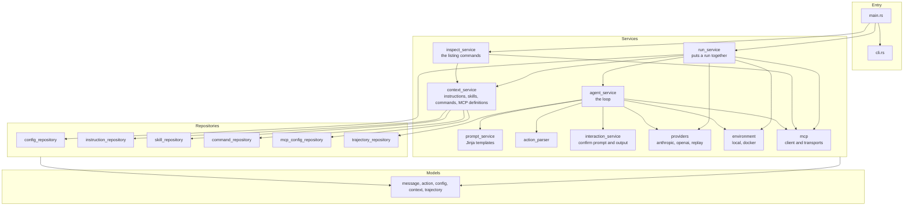
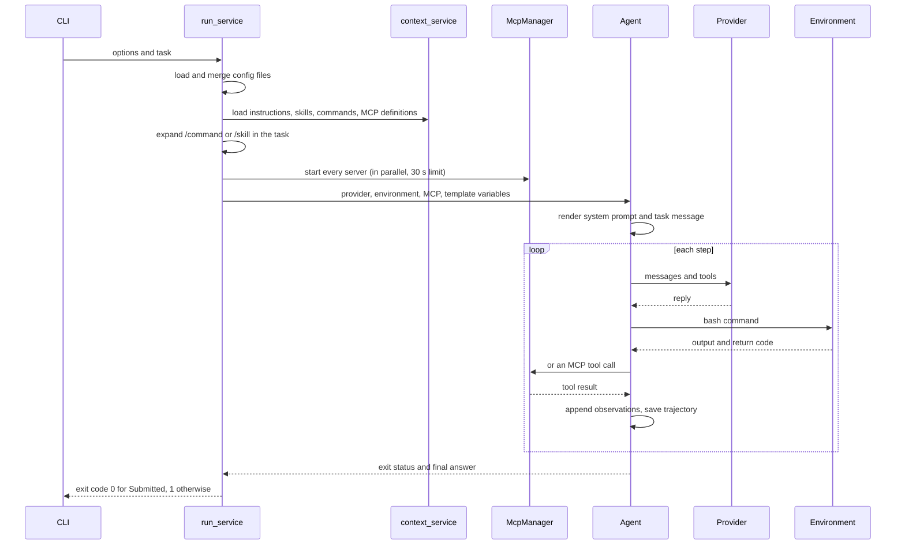
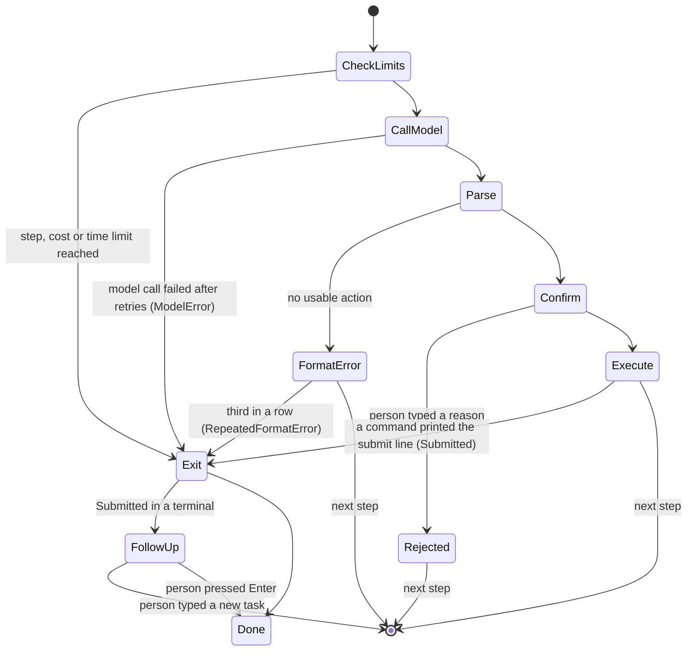

# Architecture

Umbra is one binary. The code is split into four layers, and each layer only calls the layers
below it.



| Layer | Folder | What lives there |
|---|---|---|
| Models | `src/models` | Plain data with no behavior: `Message`, `Action`, `Observation`, `UmbraConfig`, `Skill`, `InstructionFile`, `McpServerDefinition`, `Trajectory`. |
| Repositories | `src/repositories` | Everything that reads or writes files. Each loader takes a `DiscoveryContext` (home folder, working folder, project root, enabled sources) and returns models. |
| Services | `src/services` | The agent loop and everything it talks to: models, shells, MCP servers, templates, the person at the keyboard. |
| Utils | `src/utils` | Small helpers with no knowledge of the agent: paths, frontmatter, variable expansion, HTTP, terminal output. |

## One run, start to finish



## The message list

Umbra keeps one list of `Message` values. Each has a `role` (`system`, `user`, `assistant`,
`tool` or `exit`), its text, any tool calls, and an `extra` object that only the trajectory file
uses. `exit` is a local marker that ends the loop and is never sent to a model.

Each provider converts the list into its own format just before sending it:

- **Anthropic**: system messages become the `system` field. Tool results become `tool_result`
  blocks in a user message. Messages with the same role in a row are joined. An assistant
  message is sent with the exact content blocks the API returned (kept in
  `extra.anthropic_content`), because current Claude models reject thinking blocks that were
  changed.
- **OpenAI compatible**: each message maps to one chat message. Tool call arguments are sent as
  JSON text.

## How a step ends



## Commands and their output

The local environment runs each command as `bash -c "exec 2>&1\n<command>"`, so stdout and stderr
arrive in their original order as one stream, the way mini-swe-agent merges them. Stdin is closed,
so a command that waits for input ends instead of hanging. Two threads read the pipes, so a large
output never blocks the command. After `environment.timeout` seconds (30 by default) the whole
process tree is killed: `taskkill /F /T` on Windows, the process group on Linux and macOS. The
model sees return code -1 and a message saying the command timed out.

On Windows, Umbra uses Git for Windows' `bash.exe`. It never uses `C:\Windows\System32\bash.exe`,
which would run the command inside WSL instead of on Windows. When no bash is found it falls back to
`cmd /C`.

The Docker environment starts `docker run -d <image> sleep 2h` once, runs each command with
`docker exec -w <cwd> <container> bash -lc`, and removes the container at the end of the run.

## The trajectory file

The file is rewritten after every step, through a temporary file, so a crash leaves a complete
record up to the last step. Its shape follows mini-swe-agent's `mini-swe-agent-1.1` format:

```json
{
  "info": {
    "model_stats": { "instance_cost": 0.0037, "api_calls": 2, "input_tokens": 51293, "output_tokens": 427 },
    "config": { "agent": {}, "model": {}, "environment": {}, "mcp_servers": [], "skills": 42, "instruction_files": [] },
    "umbra_version": "0.1.0",
    "exit_status": "Submitted",
    "submission": "5050\n"
  },
  "messages": [
    { "role": "system", "content": "..." },
    { "role": "user", "content": "Please solve this issue: ..." },
    { "role": "assistant", "content": "...", "tool_calls": [], "extra": { "actions": [], "cost": 0.0033, "usage": {} } },
    { "role": "tool", "tool_call_id": "...", "content": "{ \"returncode\": 0, \"output\": \"5050\" }", "extra": { "raw_output": "5050\n", "returncode": 0 } },
    { "role": "exit", "content": "5050\n", "extra": { "exit_status": "Submitted", "submission": "5050\n" } }
  ],
  "trajectory_format": "mini-swe-agent-1.1"
}
```
