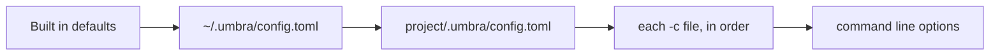

# Configuration

Umbra works with no config file. When you want to change something, the settings are read from
these places, and each one overrides the one before it, setting by setting:



`umbra config` prints the result. A `-c` file can also be a mini-swe-agent YAML config; its
`agent`, `model` and `environment` sections are mapped onto the settings below, so its prompts and
limits work unchanged.

## A complete example

```toml
# ~/.umbra/config.toml

model = "anthropic/claude-haiku-5-5"   # provider/model, or a name from [models.<name>]
models = ["local/qwen"]                # more models the pickers offer; or write [models.<name>] tables, shown below
mode = "confirm"                       # confirm, yolo or human
action_format = "tools"                # tools or text
finish = "reply"                       # reply (a reply with no command ends the turn) or submit
step_limit = 0                         # model calls; 0 means no limit
cost_limit = 3.0                       # dollars; 0 means no limit
wall_time_limit_seconds = 0
max_consecutive_format_errors = 3
confirm_exit = true                    # ask for a follow up task when the agent finishes
status_bar = true                      # context bar, agent time, cost, model and weekly usage under the output
banner = true                          # umbra banner with the logo, version, model and folder at start
fullscreen = true                      # open on the alternate screen with a scrollable transcript
mouse = true                           # mouse reporting in the fullscreen view: clicks, and a drag selects and copies
syntax_highlight = true                # color the code in fenced code blocks of replies
verbose = false                        # every detail: step costs, whole outputs, full errors
whitelist_actions = ["ls", "cat ", "git (status|diff|log)"]   # run without asking
output = ""                            # trajectory path; empty means ~/.umbra/trajectories/<time>.traj.json

[environment]
kind = "local"                         # local or docker
cwd = ""                               # empty means the folder Umbra was started in
timeout = 30                           # seconds before a command is killed
shell = []                             # empty means bash, found automatically
image = ""                             # docker only
run_args = ["--rm"]                    # docker only
forward_env = []                       # docker only: host variables copied into the container

[environment.env]
PAGER = "cat"
MANPAGER = "cat"
GIT_PAGER = "cat"

[models.opus]                          # a named model; use it with -m opus or model = "opus"
provider = "anthropic"
model = "claude-opus-5-5"
label = "Opus 5.5"                     # optional, shown in the pickers

[sessions]
auto_title = true                      # one small request after the first turn for a session title and summary

[usage]
enabled = true                         # the weekly usage bar, for a Claude login

[providers.local]
kind = "openai"
base_url = "http://localhost:8080/v1"
max_tokens = 8192

[providers.anthropic]
effort = "medium"                      # sent as output_config.effort

[sources]                              # whose files to read; all on by default
claude = true
codex = true
gemini = true
opencode = true
cursor = true
copilot = true
windsurf = true
cline = true
agents = true
vscode = true
claude_desktop = true
umbra = true

[instructions]
enabled = true
max_bytes = 262144
extra_files = ["~/notes/house-rules.md"]

[skills]
enabled = true
extra_paths = ["~/work/shared-skills"]
disabled = ["slack-emoji"]

[commands]
enabled = true

[mcp]
enabled = true
only = []                              # start only these servers; empty means all
disabled = ["ghidra"]
startup_timeout_seconds = 30
call_timeout_seconds = 120
defer_tools = "auto"                   # auto, always or never: send MCP tools by name behind tool_search
defer_ratio = 0.1                      # auto defers past this share of the context window

[mcp_servers.docs]                     # same shape as Claude Code's mcpServers entries
command = "npx"
args = ["-y", "@example/docs-mcp"]
env = { DOCS_TOKEN = "${DOCS_TOKEN}" }

[mcp_servers.remote]
type = "http"
url = "https://mcp.example.com/mcp"
headers = { Authorization = "Bearer ${REMOTE_TOKEN}" }

[templates]                            # empty means the built in template
system = ""
instance = ""
observation = ""
format_error = ""
action_regex = ""                      # text mode; one capture group for the command
compact_summary = ""                   # the request for a summary when the history is compacted
compact_resume = ""                    # the message that carries the summary

[compaction]                           # ratios are shares of the model's context window
enabled = true                         # --no-compact turns it off for one run
context_window = 0                     # tokens; 0 asks the server, then a table, then 128000
trigger_ratio = 0.8                    # compact when the request estimate passes this
target_ratio = 0.6                     # a mask pass that leaves more than this is followed by a summary
protect_recent_ratio = 0.2             # the newest seen outputs worth this are never masked
protect_recent_max = 40000             # ...and never more than this many tokens
min_reclaim_ratio = 0.1                # a mask pass must free at least this
min_reclaim_max = 20000                # ...capped at this many tokens
keep_recent_ratio = 0.1                # the newest turns kept word for word after a summary
mask_min_chars = 400                   # shorter outputs are never masked

[images]
max_long_edge = 1568                   # scale bigger images down to this; 0 never scales
max_bytes = 10485760                   # refuse an image whose base64 is bigger
detect_paths = true                    # attach image files named in a task or a comment
```

## Settings

| Setting | Default | Meaning |
|---|---|---|
| `model` | none | `provider/model`. Also `-m` or the `UMBRA_MODEL` environment variable. A bare `claude-...` name means the `anthropic` provider. |
| `models` | [] | Either a list of `provider/model` strings, or one `[models.<name>]` table for each named model with `provider`, `model` and an optional `label`. The `/model` picker in the fullscreen view and an editor's model picker over ACP offer these, after `model`. `-m`, `UMBRA_MODEL` and `model` accept a name from a `[models.<name>]` table. See [editors and ACP](acp.md). |
| `mode` | `confirm` | `confirm` asks before each command, `yolo` never asks, `human` lets you type the commands. |
| `action_format` | `tools` | `tools` uses native tool calls; `text` asks for one fenced block per reply. |
| `finish` | `reply` | How a turn ends. `reply`: a reply with no command ends the turn and your next message continues the conversation, as in Claude Code; the model is given your words as they are and decides from them how much work to do. `submit`: mini-swe-agent's behavior, where the task is framed as an issue, every reply must run a command, and the run ends when a command prints `COMPLETE_TASK_AND_SUBMIT_FINAL_OUTPUT`. A mini-swe-agent YAML config sets `submit`. `--finish` sets it for a run. |
| `step_limit` | 0 | Stop after this many model calls. |
| `cost_limit` | 3.0 | Stop once the run has cost this many dollars. In a terminal Umbra asks whether to raise the limit. |
| `wall_time_limit_seconds` | 0 | Stop after this many seconds. |
| `max_consecutive_format_errors` | 3 | End the run after this many unusable replies in a row. |
| `confirm_exit` | true | When a turn ends in a terminal, wait for the next message instead of exiting. |
| `fullscreen` | true | Open on the terminal's alternate screen, the way Claude Code's fullscreen mode does: the shell's earlier output is not in view or in the scrollback, the transcript scrolls with PageUp, PageDown and the mouse wheel, and the shell's screen comes back when Umbra exits. Only when stdin and stdout are terminals and the run is not `--quiet`. `--no-fullscreen` or `UMBRA_FULLSCREEN=0` prints inline instead. |
| `mouse` | true | Turn on mouse reporting in the fullscreen view, so a click works on the header, the command groups and the status bar, and a drag selects text and copies it to the clipboard. `mouse = false`, `--no-mouse` or `UMBRA_MOUSE=0` turns it off anywhere: the terminal then selects text itself and everything is done with the keyboard. In a classic Windows console window (conhost, a visible console window) `mouse` is off by default and quick edit stays on, so a drag selects text with the console's own selection; `UMBRA_MOUSE=1` turns the mouse on there. Windows Terminal and other pseudoconsole terminals get the mouse. |
| `syntax_highlight` | true | Color the code in fenced code blocks of replies by the fence's language, and the shell command of an expanded command run. Umbra reads Rust, Python, JavaScript and TypeScript, Go, C and C++, Java, Kotlin, C#, Swift, Ruby, PHP, shell, PowerShell, SQL, JSON, TOML, YAML, CSS, Lua, HTML and XML, and diff. A fence with no language or another language is drawn without colors. The colors are the 16 basic terminal colors, so they follow the terminal's theme. |
| `updates.check` | true | Look for a newer Umbra release when an interactive session starts in the fullscreen view, at most once every `updates.interval_hours`. The answer is kept in `~/.umbra/update.json`. When a newer release exists, a prompt above the input line offers **Install and restart**, **Remind me tomorrow** and **Skip this version**. Install downloads the release archive for this machine, checks it against the release's `SHA256SUMS`, replaces the binary (or runs `brew upgrade` for a Homebrew install), and starts the new binary with `--resume` on the same session. `UMBRA_UPDATE_CHECK=0` turns the check off. `umbra update` checks and installs from any terminal. |
| `updates.interval_hours` | 24 | Hours between two update checks. |
| `sessions.auto_title` | true | After the first turn, in a terminal, Umbra sends one small request to the session's model for a title of at most 6 words and a one sentence summary, and saves both in the session list. Until then the title is the first line of the first prompt. A compaction summary replaces the summary. `sessions.auto_title = false` turns the request off. |
| `usage.enabled` | true | Show the weekly usage bar in the status bar when the active provider uses a Claude login. Umbra polls `https://api.anthropic.com/api/oauth/usage` with the Claude Code login token at most every 180 seconds and waits longer after an HTTP 429. `usage.enabled = false` turns the polling and the bar off. |
| `mcp.defer_tools` | `auto` | `auto` sends MCP tools by name only, with a `tool_search` tool that loads their definitions, when the definitions would take more than `mcp.defer_ratio` of the context window. `always` and `never` force it. Loaded tools are sent with every later request and loaded again on `--resume`. |
| `mcp.defer_ratio` | 0.1 | The share of the context window the MCP tool definitions may take before `auto` defers them. |
| `status_bar` | true | Draw the status bar under the output in a terminal: how full the context window is, the agent time, the cost, the model, the weekly usage, and a box with the number of MCP servers that failed. `--no-status-bar` or `UMBRA_STATUS_BAR=0` turns it off for a run. |
| `banner` | true | Draw the umbra banner when a run starts in a terminal: the logo with "by Black Rainbow Labs" under it, the version, the model, the folder, the mode, how many skills were found, and the state of the MCP servers. In the fullscreen view the header is the first block of the transcript and its rows are drawn from live state. The logo's stripes appear one at a time over about 1.4 seconds; `UMBRA_BANNER_ANIMATION=0` shows the finished logo at once. The logo goes beside the text when both fit, above the text when only the logo fits, and is left out in a terminal narrower than about 64 columns. It uses 24 bit color when `COLORTERM` is `truecolor` or `24bit`, and the nearest of the 256 colors otherwise. Never drawn into a pipe or with `--quiet`. `UMBRA_BANNER=0` turns it off and `UMBRA_BANNER=1` draws it into a pipe. |
| `verbose` | false | Print every detail of a run: the step number and cost before each reply, command output up to 2000 characters instead of the first 10 lines, the whole text of a format error, and the context warning every time compaction cannot help instead of once. `--verbose` turns it on for a run. |
| `whitelist_actions` | empty | Regexes matched at the start of a command. A match runs without asking in confirm mode. |
| `environment.timeout` | 30 | Seconds before a command and everything it started is killed. |
| `environment.shell` | bash | The program and flags that run a command string, such as `["zsh", "-c"]`. |
| `providers.<name>.*` | see [models](providers.md) | Endpoints, keys, token limits and prices. |
| `sources.<name>` | true | Read that tool's files. `--no-source <name>` turns one off for a run. |
| `instructions.max_bytes` | 262144 | Stop adding instruction files after this many bytes. |
| `skills.disabled` | empty | Skill names to leave out. |
| `mcp.only`, `mcp.disabled` | empty | Which MCP servers to start. `--mcp a,b` and `--no-mcp` do the same for one run. The `/mcp` panel with "all sessions" selected, the checkboxes in the MCP section of `/config`, and `umbra mcp enable <name>` and `umbra mcp disable <name>` change both lists for you. |
| `compaction.enabled` | true | Compact the history when it nears the context window. `--no-compact` turns it off for one run. |
| `compaction.context_window` | 0 | The window in tokens. 0 asks the provider (llama.cpp's `/props`, a server's `/models`) or uses the built in table. `--context-window <tokens>` sets it for one run. |
| `compaction.*` | see above | When to compact and how much to keep. See [compaction](architecture.md#compaction). |
| `images.max_long_edge` | 1568 | Images whose long edge is bigger are scaled down to it. 0 never scales. |
| `images.max_bytes` | 10485760 | Images whose base64 text is bigger are refused. |
| `images.detect_paths` | true | Attach PNG, JPEG, GIF and WebP files whose paths are typed in a task, a follow up task or a comment. |
| `providers.<name>.stream` | true | OpenAI compatible servers: stream replies, so Ctrl+C stops the server generating. |

`UMBRA_FORCE_INTERACTIVE=1` treats a piped stdin as a terminal, so a script or a test can type into
Umbra's prompts.

## Editing settings from the command line

Every setting in this file can be read and changed with `umbra config`, which uses the same parser
and the same file writer as the modal, so comments in the file are kept.

| Command | What it does |
|---|---|
| `umbra config` | Prints the merged config |
| `umbra config list [prefix]` | Every setting with its value, the file it comes from (`default`, `user`, `project`) and what it does. `--json` prints JSON. |
| `umbra config get <key>` | One value, such as `umbra config get compaction.trigger_ratio` |
| `umbra config set <key> <value>` | Sets a value in `~/.umbra/config.toml`. Lists are comma separated, maps are `k=v, k=v`, and a percent setting takes `70` for 70%. A value of the wrong kind is refused and the file is left as it was. |
| `umbra config unset <key>` | Removes the key, so the default or another file applies |
| `umbra config path` | The file `set` changes |

`--project` makes `set`, `unset`, `path` and `list` use `<project>/.umbra/config.toml`, and `--cwd`
names the folder. A change applies to the next session; `umbra session` changes a running one.

## Editing settings in the terminal

`/config` in the fullscreen view opens a configuration modal with a list of sections on the left and
the fields of the selected section on the right. Every setting in this file is a field in it.

| Key | What it does |
|---|---|
| Up, Down | Move between sections or fields |
| Tab | Switch between the section list and the fields |
| Enter or Space | Edit the selected field |
| Ctrl+S | Save. Only the changed keys are written, and the comments and the key order in the file are kept. |
| Ctrl+T | Switch between the user file `~/.umbra/config.toml` and the project file `<project>/.umbra/config.toml` |
| Esc | Close. When there are unsaved changes, Umbra asks whether to save or discard them. |

The MCP section lists every server found, each with a checkbox and the file it came from, in place
of text fields for `mcp.only` and `mcp.disabled`. Space turns a server on or off for every session,
Ctrl+S writes the lists to the chosen file, and the running session turns the changed servers on
or off at once.

Each provider has a Test button. It checks the credentials, checks that the server answers, and
sends a "Say hello." completion. See [models](providers.md#testing-a-provider).

## Templates

The prompts are [minijinja](https://github.com/mitsuhiko/minijinja) templates, a Rust version of
Jinja. An undefined variable is an error, as in mini-swe-agent, so a typo shows up at once.

| Template | Variables |
|---|---|
| `system`, `instance` | `task`, `system`, `release`, `version`, `machine`, `cwd`, `shell`, `timeout`, `model_name`, `action_format`, `instructions` (path, source, scope, content), `skills` (name, description, path, source), `mcp_tools` (qualified_name, description, input_schema), `mcp_instructions`, `n_model_calls`, `model_cost`, `elapsed_seconds` |
| `observation` | all of the above plus `output.output`, `output.returncode`, `output.exception_info` |
| `format_error` | `error`, `actions`, `finish_reason`, `has_tool_calls` |
| `compact_summary` | the `system` variables plus `focus`, the text after `/compact` |
| `compact_resume` | the `system` variables plus `summary`, the text the model wrote |

The built in templates are in `src/templates/`. `umbra prompt "<task>"` shows exactly what a task
would receive.
