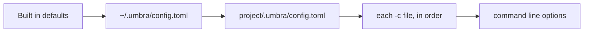

# Configuration

Umbra works with no config file. When you want to change something, the settings are read from
these places, and each one overrides the one before it, setting by setting:



`umbra config` prints the result. A `-c` file can also be a mini-swe-agent YAML config; its
`agent`, `model` and `environment` sections are mapped onto the settings below, so its prompts and
limits work unchanged.

## A complete example

```toml
# ~/.umbra/config.toml

model = "anthropic/claude-haiku-5-5"   # provider/model
mode = "confirm"                       # confirm, yolo or human
action_format = "tools"                # tools or text
step_limit = 0                         # model calls; 0 means no limit
cost_limit = 3.0                       # dollars; 0 means no limit
wall_time_limit_seconds = 0
max_consecutive_format_errors = 3
confirm_exit = true                    # ask for a follow up task when the agent finishes
whitelist_actions = ["ls", "cat ", "git (status|diff|log)"]   # run without asking
output = ""                            # trajectory path; empty means ~/.umbra/trajectories/<time>.traj.json

[environment]
kind = "local"                         # local or docker
cwd = ""                               # empty means the folder Umbra was started in
timeout = 30                           # seconds before a command is killed
shell = []                             # empty means bash, found automatically
image = ""                             # docker only
run_args = ["--rm"]                    # docker only
forward_env = []                       # docker only: host variables copied into the container

[environment.env]
PAGER = "cat"
MANPAGER = "cat"
GIT_PAGER = "cat"

[providers.local]
kind = "openai"
base_url = "http://localhost:8080/v1"
max_tokens = 8192

[providers.anthropic]
effort = "medium"                      # sent as output_config.effort

[sources]                              # whose files to read; all on by default
claude = true
codex = true
gemini = true
opencode = true
cursor = true
copilot = true
windsurf = true
cline = true
agents = true
vscode = true
claude_desktop = true
umbra = true

[instructions]
enabled = true
max_bytes = 262144
extra_files = ["~/notes/house-rules.md"]

[skills]
enabled = true
extra_paths = ["~/work/shared-skills"]
disabled = ["slack-emoji"]

[commands]
enabled = true

[mcp]
enabled = true
only = []                              # start only these servers; empty means all
disabled = ["ghidra"]
startup_timeout_seconds = 30
call_timeout_seconds = 120

[mcp_servers.docs]                     # same shape as Claude Code's mcpServers entries
command = "npx"
args = ["-y", "@example/docs-mcp"]
env = { DOCS_TOKEN = "${DOCS_TOKEN}" }

[mcp_servers.remote]
type = "http"
url = "https://mcp.example.com/mcp"
headers = { Authorization = "Bearer ${REMOTE_TOKEN}" }

[templates]                            # empty means the built in template
system = ""
instance = ""
observation = ""
format_error = ""
action_regex = ""                      # text mode; one capture group for the command
```

## Settings

| Setting | Default | Meaning |
|---|---|---|
| `model` | none | `provider/model`. Also `-m` or the `UMBRA_MODEL` environment variable. A bare `claude-...` name means the `anthropic` provider. |
| `mode` | `confirm` | `confirm` asks before each command, `yolo` never asks, `human` lets you type the commands. |
| `action_format` | `tools` | `tools` uses native tool calls; `text` asks for one fenced block per reply. |
| `step_limit` | 0 | Stop after this many model calls. |
| `cost_limit` | 3.0 | Stop once the run has cost this many dollars. In a terminal Umbra asks whether to raise the limit. |
| `wall_time_limit_seconds` | 0 | Stop after this many seconds. |
| `max_consecutive_format_errors` | 3 | End the run after this many unusable replies in a row. |
| `confirm_exit` | true | When the agent finishes in a terminal, ask for a follow up task. |
| `whitelist_actions` | empty | Regexes matched at the start of a command. A match runs without asking in confirm mode. |
| `environment.timeout` | 30 | Seconds before a command and everything it started is killed. |
| `environment.shell` | bash | The program and flags that run a command string, such as `["zsh", "-c"]`. |
| `providers.<name>.*` | see [models](providers.md) | Endpoints, keys, token limits and prices. |
| `sources.<name>` | true | Read that tool's files. `--no-source <name>` turns one off for a run. |
| `instructions.max_bytes` | 262144 | Stop adding instruction files after this many bytes. |
| `skills.disabled` | empty | Skill names to leave out. |
| `mcp.only`, `mcp.disabled` | empty | Which MCP servers to start. `--mcp a,b` and `--no-mcp` do the same for one run. |

## Templates

The prompts are [minijinja](https://github.com/mitsuhiko/minijinja) templates, a Rust version of
Jinja. An undefined variable is an error, as in mini-swe-agent, so a typo shows up at once.

| Template | Variables |
|---|---|
| `system`, `instance` | `task`, `system`, `release`, `version`, `machine`, `cwd`, `shell`, `timeout`, `model_name`, `action_format`, `instructions` (path, source, scope, content), `skills` (name, description, path, source), `mcp_tools` (qualified_name, description, input_schema), `mcp_instructions`, `n_model_calls`, `model_cost`, `elapsed_seconds` |
| `observation` | all of the above plus `output.output`, `output.returncode`, `output.exception_info` |
| `format_error` | `error`, `actions`, `finish_reason`, `has_tool_calls` |

The built in templates are in `src/templates/`. `umbra prompt "<task>"` shows exactly what a task
would receive.
