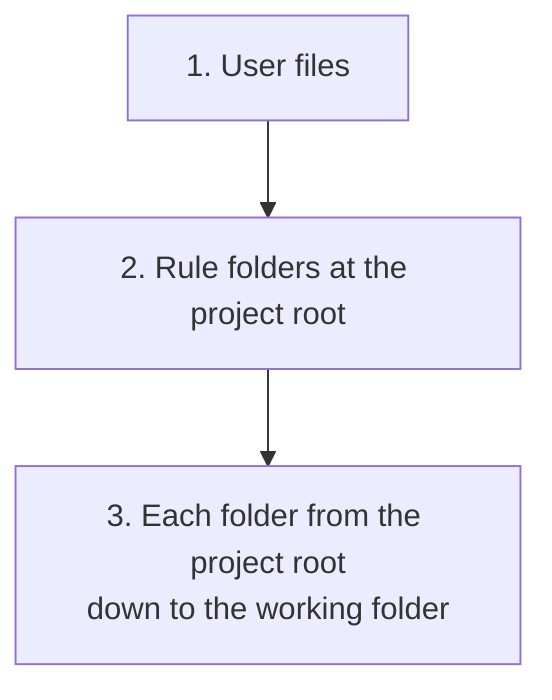

# Where files are found

Umbra reads the files other coding agents use. This page lists every place it looks, in order,
and the rules it follows when two places hold the same thing.

Two folders matter for every search:

- **Home**: your home folder (`~`).
- **Project root**: the nearest folder at or above the working folder that holds `.git`. With no
  `.git`, the working folder itself.

Each tool's files can be turned off with `--no-source <name>` or `[sources] <name> = false`. The
names are `claude`, `codex`, `gemini`, `opencode`, `cursor`, `copilot`, `windsurf`, `cline`,
`agents` (the shared `AGENTS.md` and `.agents/skills` conventions), `vscode`, `claude_desktop` and
`umbra`.

## Instruction files

Instruction files are added to the system prompt from the most general to the most specific, so
a project's file comes after your personal one and wins when they disagree.



**1. User files**

| Tool | File |
|---|---|
| Umbra | `~/.umbra/UMBRA.md` |
| Claude Code | `~/.claude/CLAUDE.md`, `~/.claude/rules/**/*.md` |
| Codex | `~/.codex/AGENTS.override.md` when it has content, otherwise `~/.codex/AGENTS.md` (`CODEX_HOME` moves the folder) |
| Gemini CLI | `~/.gemini/GEMINI.md` |
| opencode | `~/.config/opencode/AGENTS.md` |
| Shared | `~/.agents/AGENTS.md` |
| Windsurf | `~/.devin/global_rules.md`, `~/.codeium/windsurf/memories/global_rules.md` |
| Cline | `~/Documents/Cline/Rules/`, `~/.cline/rules/` |

**2. At the project root**

| Tool | Files |
|---|---|
| Claude Code | `.claude/rules/**/*.md` |
| Cursor | `.cursorrules`, `.cursor/rules/**/*.mdc` |
| GitHub Copilot | `.github/copilot-instructions.md`, `.github/instructions/**/*.instructions.md` |
| Windsurf | `.windsurfrules`, `.windsurf/rules/`, `.devin/rules/` |
| Cline | `.clinerules` (a file or a folder), `.cline/rules/` |

**3. In each folder from the project root down to the working folder**

| File | Read by |
|---|---|
| `AGENTS.override.md` when it has content, otherwise `AGENTS.md` | Codex, opencode, Cursor, Copilot, Windsurf, Cline |
| `CLAUDE.md`, `.claude/CLAUDE.md`, `CLAUDE.local.md` | Claude Code |
| `GEMINI.md` | Gemini CLI |
| `UMBRA.md` | Umbra |

### Rules for instruction files

- **Each file is loaded once**, even when two paths lead to it.
- **Two files with the same content are loaded once.** A machine that keeps `~/.codex/AGENTS.md`
  as a hard link or copy of `~/.claude/CLAUDE.md` gets one copy in the prompt.
- **`@path` imports** in Claude Code and Gemini files are followed up to four levels deep. A path
  is relative to the file that holds it; `~/` means the home folder. Imports inside code blocks
  and inline code are ignored, and so are email addresses. The imported text is added after the
  file that imports it.
- **Rule files with frontmatter** are only included when they apply to every file:
  `alwaysApply: true` (Cursor), `trigger: always_on` (Windsurf), `applyTo: "**"` (Copilot), or no
  `paths` or `globs` key (Claude Code, Cline). Rules tied to particular files are left out,
  because Umbra does not track which files the agent is editing. A rule file with no frontmatter
  is always included.
- **Empty files are skipped.**
- **The total is capped** at `instructions.max_bytes` (256 KB). A file that would go over the cap
  is skipped with a warning.

## Skills

A skill is a folder with a `SKILL.md` file whose frontmatter gives a `name` and a `description`:

```markdown
---
name: release-notes
description: Write release notes from the git log. Use when asked for release notes or a changelog.
---
# Release notes

1. Run `git log --oneline <last tag>..HEAD`.
2. ...
```

Umbra searches these folders, in this order. When two skills have the same name, the first one
found is used. Project skills therefore override your personal ones.

| Order | Folders |
|---|---|
| 1 | `skills.extra_paths` from the config |
| 2 | In each folder from the working folder up to the project root: `.umbra/skills`, `.agents/skills`, `.claude/skills`, `.codex/skills`, `.gemini/skills`, `.opencode/skills`, `.opencode/skill`, `.github/skills`, `.windsurf/skills`, `.devin/skills` |
| 3 | `~/.umbra/skills`, `~/.agents/skills`, `~/.claude/skills` |
| 4 | Each installed Claude Code plugin's `skills` folder, read from `~/.claude/plugins/installed_plugins.json` |
| 5 | `~/.codex/skills`, `~/.gemini/skills`, `~/.config/opencode/skills`, `~/.config/opencode/skill`, `~/.copilot/skills`, `~/.config/devin/skills` |

Umbra looks up to three folders deep under each of these, which finds the claude.ai skills
Claude Code keeps under `~/.claude/skills/synced/<id>/`. Hidden folders and `node_modules` are
skipped. A skill without a description, or with `disable-model-invocation: true`, is left out.
Claude Code's `when_to_use` field is added to the description.

**How the model uses a skill.** The system prompt lists each skill's name, description (shortened
to 1,024 characters) and the path to its SKILL.md. When a task matches, the model reads the file
with `cat` and follows it. This is how Codex and pi use skills. To force a skill, start the task
with its name: `umbra /release-notes v0.2.0` puts the skill's instructions into the task.

## Slash commands

A task that starts with `/name` is replaced by that command's prompt.

| Order | Folders |
|---|---|
| Project | `.umbra/commands`, `.claude/commands`, `.gemini/commands`, `.opencode/command`, `.opencode/commands`, `.github/prompts` |
| User | `~/.umbra/commands`, `~/.claude/commands`, `~/.codex/prompts`, `~/.gemini/commands`, `~/.config/opencode/command`, `~/.config/opencode/commands` |

Markdown files are a prompt with optional frontmatter. Gemini's TOML files hold `prompt` and
`description`. A file in a subfolder gets a namespaced name: `git/commit.md` is `/git:commit`.

In the prompt, `$ARGUMENTS` and `{{args}}` become everything after the command name, and `$1` to
`$9` and `$ARGUMENTS[0]` to `$ARGUMENTS[8]` become single words. A prompt with no placeholder gets
the arguments added at the end. When no command has the name, Umbra looks for a skill with that
name.

## MCP servers

See [MCP](mcp.md) for the file formats. The search order is:

| Order | File |
|---|---|
| 1 | `[mcp_servers]` in Umbra's own config |
| 2 | `<root>/.umbra/mcp.json` |
| 3 | `<root>/.mcp.json` (Claude Code project scope) |
| 4 | This project's entry in `~/.claude.json` under `projects` (Claude Code local scope) |
| 5 | `<root>/.cursor/mcp.json` |
| 6 | `<root>/.vscode/mcp.json` |
| 7 | `<root>/.gemini/settings.json` |
| 8 | `<root>/opencode.json`, `<root>/opencode.jsonc` |
| 9 | `<root>/.codex/config.toml` |
| 10 | `~/.umbra/mcp.json` |
| 11 | `~/.claude.json` (Claude Code user scope) |
| 12 | Claude Desktop's `claude_desktop_config.json` |
| 13 | `~/.codex/config.toml` |
| 14 | `~/.gemini/settings.json` |
| 15 | `~/.cursor/mcp.json` |
| 16 | `~/.config/opencode/opencode.json` |

When the same server name appears in more than one file, the first one found is used whole, and
the others are ignored. This is how Claude Code resolves the same conflict.
