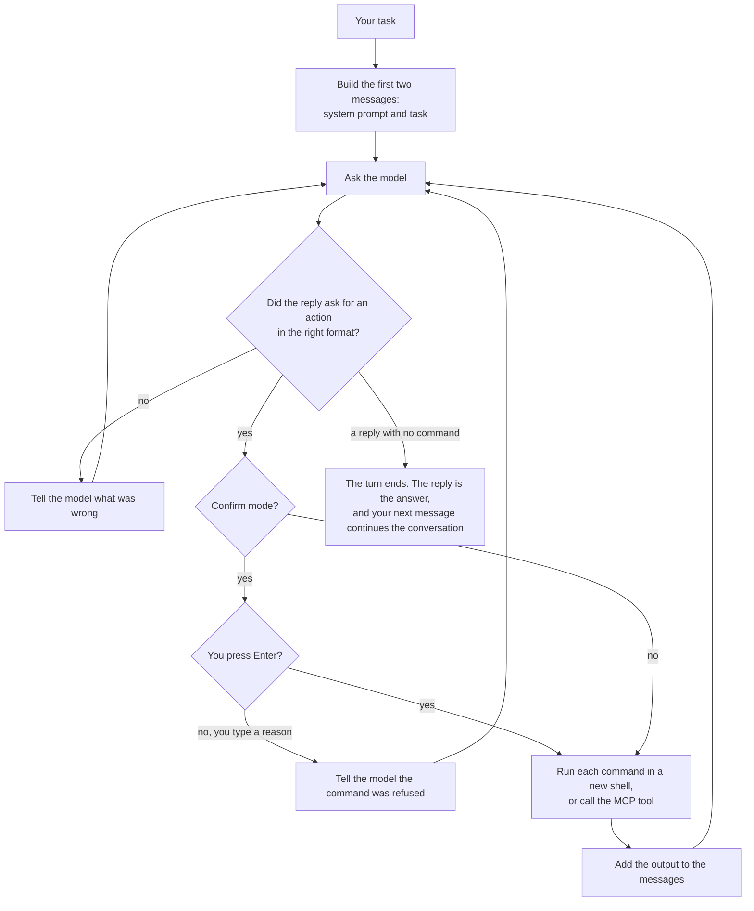

# How it works

This page explains Umbra's loop: what it sends the model, how the model asks for a command, what
happens to the command, and how a turn ends. It is for anyone who wants to know why Umbra does what
it does. The code that does it is described in [Architecture](architecture.md).

## Terms used on this page

| Term | Meaning |
|---|---|
| Step | One model call and the actions it asked for |
| Action | One command the model asks Umbra to run, or one MCP tool call |
| Observation | What the model is shown after an action: the output and the return code |
| Turn | Everything from one message you send to the reply that ends it |
| Context window | The most tokens the model can read in one request |

## The loop

1. **Umbra builds two messages.** The system prompt holds Umbra's instructions to the model, your
   [instruction files](discovery.md#instruction-files), the list of your
   [skills](discovery.md#skills), the text your MCP servers sent, and facts about the machine. The
   second message is your task. `umbra prompt "<task>"` prints both.
2. **It asks the model.** The request carries the whole list of messages, the `bash` tool, and the
   MCP tools of the servers that are ready.
3. **It reads the reply.** A reply that asks for one or more actions in the right format goes on.
   A reply it cannot use is a format error: Umbra sends it back with what was wrong, and three in a
   row end the run.
4. **It runs each action.** In confirm mode, the default, it shows each command and waits for
   Enter. Each command runs in a new shell. An MCP tool call goes to its server.
5. **It shows the model what happened.** Each output and return code is added to the list of
   messages as an observation, and the loop goes back to step 2.
6. **A reply with no action ends the turn.** The reply is the answer. Your next message is added to
   the same list, so the model still has everything it read and ran.

## A few rules shape everything else

- **The model has one tool: `bash`.** It reads files with `cat`, edits them with `sed` or a
  heredoc, and runs tests the way you would. MCP tools are added next to it.
- **Every command runs in a new shell.** `cd` and `export` do not carry over to the next command,
  so the model writes `cd src && make` in one command. This keeps each step simple to read and to
  run again.
- **The history is one list.** The trajectory file holds exactly what the model saw.
- **Stdin is closed.** A command that waits for input ends instead of waiting forever. After
  `environment.timeout` seconds, 30 by default, the command and everything it started are stopped.
- **Long runs are compacted.** Near 80% of the context window, old command outputs are replaced by
  a short placeholder, and if that is not enough the model summarizes the middle of the session.
  See [Compaction](architecture.md#compaction).

## Two ways to ask for a command

| | Tool mode, the default | Text mode, `--text` |
|---|---|---|
| How the model asks | A native tool call: `bash` with a `command` | A fenced block marked `umbra_bash` |
| Best for | Current models with tool calling | Any model, including ones with no tool calling |
| Commands in one reply | One or more | Exactly one |
| MCP tools | Native tool calls named `mcp__<server>__<tool>` | A fenced block marked `umbra_mcp` with JSON |

`action_format = "text"` in the config is the same as `--text`. A model on a local server that does
tool calling badly often does better in text mode.

## How a turn ends

A turn ends when the model replies without asking for a command, as in Claude Code. What the model
does depends on your message:

| You send | What the model does |
|---|---|
| A greeting such as "Hello" | A one line reply and no commands |
| A question about the code | Reads the code it needs, then answers |
| A request to change something | Makes the change, runs the build or tests that check it, then reports |
| An unclear request | Asks one short question |

A turn can also end early:

| Exit status | Why the turn ended |
|---|---|
| `Replied` | The model replied with no command |
| `Submitted` | A command printed `COMPLETE_TASK_AND_SUBMIT_FINAL_OUTPUT` as its first line and exited with code 0 |
| `LimitsExceeded` | The step limit or the cost limit was reached |
| `TimeExceeded` | `wall_time_limit_seconds` passed |
| `RepeatedFormatError` | Three replies in a row could not be used |
| `ModelError` | A model call still failed after its retries |
| `Interrupted` | You pressed Ctrl+C and then ended the run |

In a terminal, a turn that ends with `Replied` or `Submitted` waits for your next message. With
`--exit-immediately` Umbra exits instead. `umbra -q -t "<question>"` with `--exit-immediately`
prints only the answer, the way `claude -p` does.

### The mini-swe-agent style

`finish = "submit"`, or `--finish submit`, keeps mini-swe-agent's behavior for benchmark runs. The
task is framed as an issue to solve, every reply must run a command, and the run ends when a
command prints `COMPLETE_TASK_AND_SUBMIT_FINAL_OUTPUT` as its first line and exits with code 0. A
mini-swe-agent YAML config passed with `-c` sets it. In the default reply style that command still
ends a turn.

## Many MCP tools

When the MCP tool definitions would take more than a tenth of the context window, Umbra sends the
model only their names and a `tool_search` tool that loads the definitions it needs, the way
Claude Code does. On the machine Umbra was built on, every MCP server together is 229 tools and
124,715 tokens of definitions. With deferral a "Hello" is 31,905 input tokens instead of 214,611.
`[mcp] defer_tools = "always"` or `"never"` overrides the choice. See [MCP](mcp.md).

## The prompt cache

A provider such as Anthropic or llama.cpp keeps the start of a request it has already read, so the
next request with the same start costs less and is answered sooner. Umbra changes earlier messages
as little as it can, so the cache keeps matching:

- The system prompt is written once at the start of a session and kept on resume.
- An assistant message is sent back exactly as the model returned it, reasoning included.
- A compaction pass that would free little space does nothing, because changing an earlier message
  makes the cache miss from that message on.

## Where to go next

- [Modes](modes.md): confirm, yolo and human mode, refusing a command, and Docker.
- [The terminal view](terminal.md): what each part of the screen shows.
- [Architecture](architecture.md): the code behind each step.
