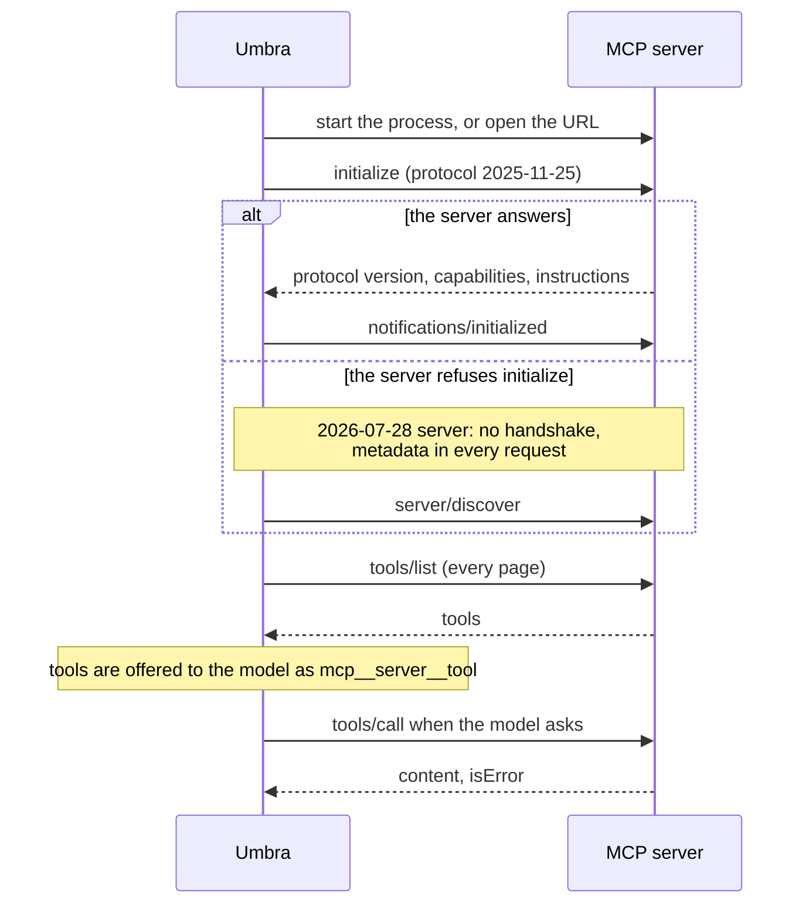

# MCP

The [Model Context Protocol](https://modelcontextprotocol.io) lets a program offer tools to a
model. Umbra is an MCP client: it starts the servers it finds, asks each for its tools, offers
those tools to the model next to `bash`, and runs a tool when the model calls it.

Umbra starts the servers in the background when it starts. In the fullscreen view and in an inline
run at a terminal, a prompt typed while the servers are still starting gets a reply at once, and a
server's tools are offered from the first model call after the server is ready. A run with no
terminal waits for the servers before the first model call. See
[Starting the servers](#starting-the-servers).



## Starting the servers

| Run | What happens at the start |
|---|---|
| The fullscreen view | The servers start on their own threads and Umbra does not wait. The `mcp` row of the header shows a spinner and `starting 2 of 5` until every server has answered. A server that becomes ready during a turn is offered from the next model call, and a dim line `mcp <server> ready, <N> tools` is added to the transcript. |
| An inline run at a terminal (`--no-fullscreen`) | The same: Umbra does not wait. A server that fails later prints one warning line. |
| A run with no terminal: a pipe, `-q`, ACP, and `UMBRA_FORCE_INTERACTIVE` over pipes | Umbra waits until every server is ready or has failed, or until `mcp.startup_timeout_seconds` plus 2 seconds have passed, before the first model call. A server that fails is listed on stderr. |

The `mcp` row of the header reads `starting 2 of 5` while any server starts, then `5 running`,
`4 running · 1 failed`, `3 running · 2 off`, `none` when no server is defined, or `off` when
`mcp.enabled = false`.

### The MCP panel

`/mcp`, or a click on the `mcp` row of the header, opens a panel with a switch between **this
session** and **all sessions**, then one row for each server: a checkbox, the name, the state, the
number of tools, and for a failed server the first line of the error.

```
 MCP servers                       Space toggles · s switches scope · r restarts · Esc closes
   applies to  (•) this session   ( ) all sessions
 › [x] chordical        running    42 tools
   [ ] blender          off
```

| Key | What it does |
|---|---|
| Up, Down | Move between servers |
| `s`, Left, Right, or a click on the `applies to` row | Switch between this session and all sessions |
| Space, or a click | Tick or clear the selected server's checkbox |
| `r` | Start a failed server again |
| Enter | On a failed server, show the full error and the path of its log file |
| Esc | Close the panel |

**This session**: the checkbox shows whether the server runs in this session. Clearing it closes
the server, and its tools are not sent with the next model call. The servers turned off are saved
with the session, so `umbra resume` turns them off again. The config file is not changed.

**All sessions**: the checkbox shows whether the config files let the server start. Changing it
writes `~/.umbra/config.toml` and turns the server on or off in this session too. Off adds the name
to `mcp.disabled` and takes it out of `mcp.only`. On takes the name out of `mcp.disabled` and, when
`mcp.only` is not empty, adds it to `mcp.only`. When the project's `.umbra/config.toml` still turns
the server off, the row says `off in the project file`.

The same change from the command line: `umbra mcp disable <name>` and `umbra mcp enable <name>`
(`--project` for the project file), and `umbra session mcp off <name>` for a running session only.
`umbra mcp` lists the servers with `on` or `off` for each. When the model calls a tool of a server that is not ready, the result says why: `(it is
still starting)`, `(it failed to start: <first line of the error>)` or `(it is turned off for this
session)`.

### The MCP error box

When at least one server failed, the right end of the status bar shows a red `▲ N MCP error` box
(`▲ 2 MCP errors` for two). A click on the box, or Enter or Space when it has focus, opens a list
above the status bar with each failed server, its full error and its log file. The same action
closes the list. The fullscreen view shows a failed server there and in the panel. It does not add
a warning line to the transcript.

## Setting up a server

You do not need to set up anything for servers you already use in Claude Code, Codex, Gemini CLI,
opencode, Cursor, VS Code or Claude Desktop: Umbra reads their files. To add a server only for
Umbra, put it in `~/.umbra/config.toml` or `<project>/.umbra/config.toml`:

```toml
[mcp_servers.files]
command = "npx"
args = ["-y", "@modelcontextprotocol/server-filesystem", "/home/me/projects"]

[mcp_servers.tickets]
type = "http"
url = "https://mcp.example.com/mcp"
headers = { Authorization = "Bearer ${TICKETS_TOKEN}" }
```

or in `<project>/.umbra/mcp.json` or `~/.umbra/mcp.json`, in Claude Code's format:

```json
{
  "mcpServers": {
    "files": { "command": "npx", "args": ["-y", "@modelcontextprotocol/server-filesystem", "."] }
  }
}
```

Check what was found and whether it starts:

```bash
umbra mcp             # the servers and which file each came from
umbra mcp --connect   # start them and list their tools
```

## Formats Umbra reads

| Tool | Where the servers are | Shape |
|---|---|---|
| Claude Code, Claude Desktop, Cursor, Gemini CLI, Umbra's `mcp.json` | `mcpServers` | `{"name": {"command", "args", "env"}}` or `{"type": "http", "url", "headers"}` |
| Claude Code local scope | `~/.claude.json` → `projects["/abs/path"].mcpServers` | same |
| VS Code | `servers` | same, with `type` |
| Codex | `[mcp_servers.<name>]` in TOML | `command`, `args`, `env`, `env_vars`, `cwd`, `url`, `http_headers`, `env_http_headers`, `bearer_token_env_var`, `enabled` |
| opencode | `mcp` (older layout) or `mcp.servers` (newer layout) | `{"type": "local", "command": ["program", "arg"], "environment"}` or `{"type": "remote", "url", "headers"}` |
| Umbra's config | `[mcp_servers.<name>]` | the Claude Code shape, in TOML |

How the transport is chosen:

| The entry has | Transport |
|---|---|
| `command` | stdio |
| `httpUrl` (Gemini) | Streamable HTTP |
| `url` with `type = "sse"`, or a Gemini `url` | the older HTTP+SSE transport |
| `url` with any other type | Streamable HTTP |

An entry with `"enabled": false` or `"disabled": true` is skipped.

### Variables in config values

Every string in a server entry has its variables expanded, in every syntax the other tools use:

| Syntax | Used by | Becomes |
|---|---|---|
| `${VAR}` | Claude Code, Cursor, Gemini | the variable, or empty |
| `${VAR:-default}` | Claude Code | the variable, or `default` |
| `${env:VAR}` | Cursor, VS Code | the variable |
| `{env:VAR}` | opencode | the variable |
| `${workspaceFolder}`, `${CLAUDE_PROJECT_DIR}` | VS Code, Cursor, Claude Code | the project root |
| `${userHome}` | Cursor | the home folder |

Gemini's bare `$VAR` and `%VAR%` forms and VS Code's `${input:...}` prompts are not supported.

## Transports

| Transport | How Umbra uses it |
|---|---|
| stdio | Starts the program and sends one JSON message per line. On Windows, a program that is a `.cmd` or `.bat` file (such as `npx`) runs through `cmd /c`. The server's stderr goes to `~/.umbra/logs/mcp/<name>.log`. When the run ends, Umbra waits half a second for the server to exit, then stops it. |
| Streamable HTTP | Each message is a POST with `Accept: application/json, text/event-stream`. Replies can be JSON or an event stream. Umbra keeps the `Mcp-Session-Id` the server hands out, sends `MCP-Protocol-Version` after the handshake, and sends a DELETE at the end. |
| HTTP+SSE (older) | Opens the event stream with GET, waits for the `endpoint` event, then POSTs messages to that endpoint and reads replies from the stream. |

## Protocol versions

There are two kinds of MCP server today.

- **2025-11-25 and earlier** (almost every server in use): the client sends `initialize`, then
  `notifications/initialized`, then normal requests.
- **2026-07-28**: there is no handshake. Every request carries
  `_meta.io.modelcontextprotocol/protocolVersion`, `clientInfo` and `clientCapabilities`, and HTTP
  requests also carry `Mcp-Method` and `Mcp-Name` headers.

Umbra sends `initialize` first. If the server answers with a JSON-RPC error, Umbra treats it as a
2026-07-28 server from then on and adds the metadata to every request.

## Tool names and results

The model sees each tool as `mcp__<server>__<tool>`, the convention Claude Code uses, with any
character other than letters, digits, `_` and `-` replaced by `_` and the name cut to 64
characters. In text mode the model writes:

````text
```umbra_mcp
{"tool": "mcp__files__read_file", "arguments": {"path": "README.md"}}
```
````

A result's text items are joined into the output the model sees. Images are attached to the
result and reach the model as images, scaled down like any other image; the text also says
`[N image(s) attached to this result]`. An image that cannot be read gets a note in the text
instead. Audio is described by type and size. A result with `isError: true` is shown with return
code 1, so the model knows the call failed and can try again.

The text a server sends in `instructions` during the handshake is added to the system prompt.

## Limits and failures

| Situation | What happens |
|---|---|
| A server does not start or does not answer within 30 seconds | It is marked as failed, and the run goes on without it. In a terminal the header and the error box show it. With no terminal it is listed on stderr. A stdio server that missed the limit is stopped, so no process is left behind. `mcp.startup_timeout_seconds` changes the limit. |
| A tool call takes more than 120 seconds | The model sees an error. On stdio Umbra also sends `notifications/cancelled`. `mcp.call_timeout_seconds` changes the limit. |
| The server sends a request to Umbra | `ping` gets an empty result. Anything else gets "method not found", because Umbra offers no client features such as sampling. |
| The server prints text before a message on the same line | The message is still read. |
| You press Ctrl+C during a call to a stdio server | Umbra stops waiting, sends `notifications/cancelled` with the reason `interrupted by the user`, and shows the comment prompt. The server keeps running for the rest of the run, because it was started in its own process group and never receives the key press. A call to an HTTP server is not stopped; Umbra shows the prompt once it answers or reaches its timeout. |

## Not supported

OAuth sign in for remote servers, resources, prompts, sampling, elicitation, roots, and
`notifications/tools/list_changed` (the tool list is read once at the start of a run).
