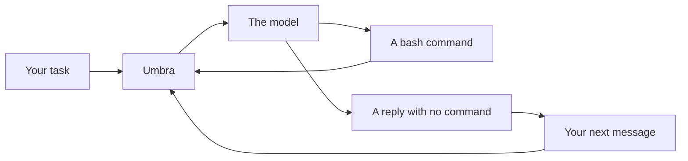

# Product overview

This page says what Umbra is, who it is for, and how it compares with other coding agents. To
install Umbra and run a first task, go to [Getting started](getting-started.md).

## Terms used on this page

| Term | Meaning |
|---|---|
| Coding agent | A program that gives a language model a task, runs the commands the model asks for, and shows the model what happened, until the task is done |
| Harness | The program around the model that does that work. Claude Code, Codex and Umbra are harnesses |
| Instruction file | A Markdown file such as `CLAUDE.md` or `AGENTS.md` that tells an agent how to work in a project |
| Skill | A folder with a `SKILL.md` file that teaches an agent one job |
| MCP | Model Context Protocol, the way an agent calls tools that another program offers |
| ACP | Agent Client Protocol, the way an editor runs an agent in its own panel |

The [glossary](glossary.md) has every other term.

## What Umbra is

Umbra is a coding agent for the terminal, written in Rust. You give it a task. It asks a model what
to do, runs the commands the model asks for, shows the model what happened, and repeats until the
model replies without asking for a command. That reply ends the turn, and your next message
continues the same conversation.

Umbra is one program with no runtime to install. The Windows download for 0.7.2 is 3.8 MB.

| What | How Umbra does it |
|---|---|
| Models | Claude through the Anthropic API or your Claude Code login, and any server with the OpenAI chat API: OpenAI, OpenRouter, llama.cpp, Ollama, vLLM, LM Studio. One flag switches between them |
| Your setup | Umbra reads the instruction files, skills, slash commands and MCP servers you already set up for Claude Code, Codex, Gemini CLI, opencode, Cursor, Copilot, Windsurf and Cline |
| Safety | Confirm mode shows each command and runs it when you press Enter. Every command runs in a new shell. `--docker <image>` runs every command in a new container |
| The screen | A fullscreen view with a transcript, an input line that is always there, and a status bar with the context use, the agent time, the cost and the model |
| Sessions | Saved after every step. Any session can be resumed, continued or copied, from the terminal or from an editor |
| Editors | `umbra acp` runs Umbra in the agent panel of Zed, the JetBrains IDEs, Unluminous and any other editor that speaks ACP |

## Who it is for

- **People who use more than one agent.** Umbra reads the files every other agent reads, so a
  project set up for Claude Code or Codex works in Umbra on the first run.
- **People who run local models.** Umbra talks to llama.cpp, Ollama and vLLM with no key. Text mode
  (`--text`) works with a model that has no tool calling.
- **People who want to see each step.** The model has one tool, `bash`. Every command is shown
  before it runs, and the record of every run is one JSON file that holds exactly what the model saw.
- **People who build on agents.** The trajectory file uses mini-swe-agent's format, a
  mini-swe-agent YAML config runs unchanged, and `umbra session` lets a script or the agent itself
  change a running session.

## Where it comes from

Umbra's loop is a port of [mini-swe-agent](https://github.com/swe-agent/mini-swe-agent), the agent
from the team behind SWE-bench and SWE-agent: one shell tool, a new shell for every command, and one
plain list of messages. Umbra adds what a coding agent needs on a real machine: other tools' setup,
MCP, confirm mode, the fullscreen view, sessions, compaction, images and ACP.

## How it compares

| | Umbra | mini-swe-agent | Claude Code | Codex CLI | opencode |
|---|---|---|---|---|---|
| Any model, hosted or local | yes | yes | Claude only | yes | yes |
| Reads every other tool's instruction files | yes | no | no | no | no |
| MCP servers from other tools' config | yes | no | no | no | no |
| Confirm before each command | yes | yes | yes | yes | yes |
| A new shell for every command | yes | yes | no | no | no |
| Fullscreen terminal view | yes | no | yes | yes | yes |
| Resume a session | yes | no | yes | yes | yes |
| Agent Client Protocol | yes | no | through an adapter | through an adapter | yes |
| Subagents, hooks and plan mode | no | no | yes | yes | yes |

The full table, with 38 rows and the source of each column, is in
[Feature comparison](feature-comparison.md). How Umbra measures against pi on 61 graded tasks is in
[the eval status](../evals/STATUS.md).

## Where to go next

- [Getting started](getting-started.md): install, choose a model and run a first task.
- [How it works](how-it-works.md): the loop, the two ways a model asks for a command, and how a turn ends.
- [The terminal view](terminal.md): everything on the screen and every key.
