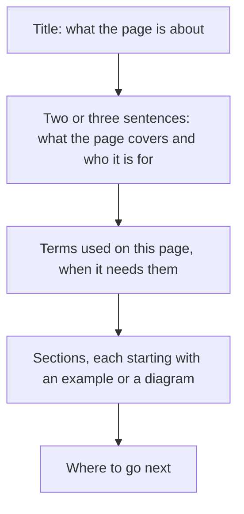

# How to write Umbra documentation

This page is the style guide for every page in this repository and for the Umbra documentation at
[unluminous.com/umbra/docs](https://unluminous.com/umbra/docs). Read it before you write or change
a page.

Most readers are programmers who have used a coding agent such as Claude Code or Codex. They know
what a terminal, a model and a prompt are. They may not know what a trajectory, a context window or
an MCP transport is. Write for that reader.

## The rules

1. **Short declarative sentences.** One idea per sentence. If a sentence has two clauses joined by a
   dash, a semicolon or "which", split it into two sentences.
<!-- doc-style: off -->
2. **Plain words.** Use the common word: "write" instead of "materialize", "show" instead of
   "surface", "use" instead of "reach for".
<!-- doc-style: on -->
3. **Name the thing every time.** Write "`compaction.trigger_ratio` sets when Umbra compacts", and
   in the next sentence write `compaction.trigger_ratio` again. Do not write "the setting", "it" or
   "this" when the reader could lose track of what you mean.
4. **Say what is true and stop.** Do not add a contrast clause to make a sentence sound stronger.
5. **Explain a term the first time a page uses it**, or link it to [the glossary](glossary.md). A
   page that uses more than three specialist terms starts with a table of them.
6. **Show, then explain.** Put a command, a config example or a diagram near the top of a section,
   then describe what it did.
7. **Output is what the program printed.** An example's output is copied from a real run of the
   current release, never typed from memory. Say which release and which machine when it matters.
8. **Every number has a source.** A number is printed by a program in this repository, measured in
   the eval suite, or read from the code. Say which run and which date when the number is a
   measurement.
9. **Present tense, about the current release.** Describe what Umbra does now. The history of how it
   got there belongs in the design documents under `tasks/` and in the commit log.
10. **No ticket numbers.** A ticket number names a card on a private board, and a reader cannot look
    it up. Say what the change did.

## What not to write

`docs/style-rules.txt` lists the phrases below, and `tests/documentation.rs` fails when one appears
in a page.

<!-- doc-style: off -->

| Do not write | Why | Write instead |
|---|---|---|
| An em dash or an en dash | It joins two sentences that should be separate | Two sentences |
| Words joined by a hyphen, like "read-only" or "built-in" | They read as invented terms | "read only", "built in" |
| "X, not Y" or "X rather than Y" when Y is only there for contrast | It adds a second idea the reader did not need | "X" |
| "load bearing", "first class", "battle tested" | Invented technical words | Say what the thing does |
| "worth noting", "to be clear", "honestly", "put simply" | It announces a sentence instead of writing it | Delete the announcement |
| "the whole point", "which is the point" | Emphasis with no information in it | State the reason once |
| "the shape of", "surface", "vocabulary" | A vague noun where a concrete one exists | "the list of values", "the status bar" |
| "blows up", "takes down", "kills" for a failure | Dramatic words for an error | "the run ends with `ModelError`" |
| An idiom, a metaphor or a saying | The reader has to translate it | The fact it stands for |

<!-- doc-style: on -->

A hyphen is fine inside a name somebody else chose, such as mini-swe-agent, JSON-RPC or Claude
Code's `oauth-2025-04-20` header, and in anything in backticks, such as `--no-fullscreen`.

## How a page is laid out

- **Diagrams.** Use a mermaid diagram when a reader needs to see how parts connect or in what order
  things happen. Keep a diagram under about twelve boxes. Every box label is plain words.
- **Tables.** Use a table for anything the reader will look up: settings, keys, commands, exit codes.
- **Code blocks.** Every command and config example can be copied and run as written.

## Keeping pages correct

**A change that alters what a user sees updates the pages that describe it in the same commit.**
That means three places:

| Place | What it holds |
|---|---|
| `docs/` in this repository | The reference pages, indexed in [docs/README.md](README.md) |
| `README.md` in this repository | The front page on GitHub: what Umbra is, install, a first task, and links to the docs |
| `sites/unluminous/src/data/umbraDocumentation.ts` in the Black-Rainbow-Labs/black-rainbow-labs-sites repository | The chapters at [unluminous.com/umbra/docs](https://unluminous.com/umbra/docs). The site is deployed with `npm run deploy -- unluminous` from that repository |

`cargo test --test documentation` fails on a page missing from the index, a relative link that does
not resolve, and a phrase this guide bans. It cannot tell whether a sentence is still true. That is
the job of whoever changes the code.
