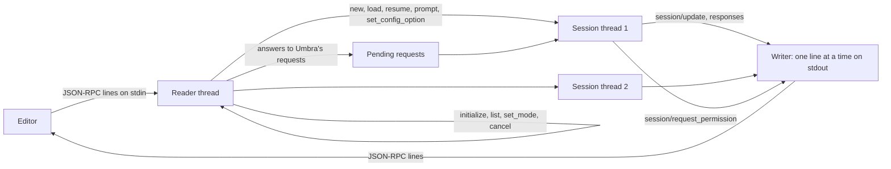

# Umbra: the Agent Client Protocol, a public repository and installers (task-2583)

## Introduction

Umbra 0.3.0 is a terminal program. An editor that wants to use it has to start it in a terminal pane
and read the colored text it prints. Zed, the JetBrains IDEs, Unluminous and the other editors that
host coding agents do not do that. They speak the Agent Client Protocol (ACP): the editor starts the
agent as a child process and the two exchange JSON-RPC messages on its standard input and output.
The editor shows the agent's messages and tool calls in its own interface, and asks the person
before a tool runs.

The editors find agents in the ACP registry (`agentclientprotocol.com/get-started/registry`). An
entry names a download for each platform, and the editor downloads and starts the program itself.

The repository is private today, and the only way to install Umbra is `cargo install --path .` from
a checkout. This design does four things:

1. Adds `umbra acp`, an ACP agent server built on the existing agent loop.
2. Makes the repository public and builds release archives for macOS, Linux and Windows on GitHub.
3. Adds install scripts, a Homebrew tap and a registry entry.
4. Rewrites the README's install section so it can be pasted to an agent, the way Inillucent's is.

## Terms

| Term | Meaning |
|---|---|
| ACP | Agent Client Protocol. JSON-RPC 2.0, one message per line, over the agent's stdin and stdout. Version `1`. |
| client | The editor. It starts `umbra acp` and sends requests to it. |
| turn | One `session/prompt` request, from the person's message to the agent's answer. |
| session update | A `session/update` notification the agent sends during a turn: message text, a tool call, a tool call's result, usage. |
| tap | A GitHub repository Homebrew reads formulas from. This one is `Black-Rainbow-Labs/homebrew-umbra`. |
| target | A Rust target triple such as `aarch64-apple-darwin`. |
| registry platform | The registry's name for a platform, such as `darwin-aarch64` or `windows-x86_64`. |

## What the protocol asks for

Read from the protocol pages on `agentclientprotocol.com` and the registry repository
`agentclientprotocol/registry` on 2026-11-09.

| Part | What the agent must do |
|---|---|
| Transport | Read JSON-RPC from stdin and write it to stdout, one message per line, UTF-8. Write nothing else to stdout. Logging goes to stderr. |
| `initialize` | Answer with `protocolVersion: 1`, `agentCapabilities`, `agentInfo` and `authMethods`. |
| `authenticate` | Answer `{}` for a method id it listed. |
| `session/new` | Take `cwd` (absolute) and `mcpServers`. Answer `sessionId`, and optionally `modes` and `configOptions`. Answer error `-32000` when the person has to sign in first. |
| `session/prompt` | Take a list of content blocks. Send session updates while it works. Answer `stopReason`: `end_turn`, `max_tokens`, `max_turn_requests`, `refusal` or `cancelled`. |
| `session/cancel` | A notification. Stop the turn and answer the open `session/prompt` with `cancelled`. |
| `session/request_permission` | A request the agent sends to the client before a tool runs. The client answers `{outcome: {outcome: "selected", optionId}}` or `{outcome: {outcome: "cancelled"}}`. |
| `session/load` | With `loadSession: true`. Send the whole history as session updates, then answer `{}`. |
| `session/resume` | With `sessionCapabilities.resume`. Continue a session without sending its history. |
| `session/list`, `session/close` | With `sessionCapabilities.list` and `.close`. |
| `session/set_mode`, `session/set_config_option` | Change the mode, the model or another option the agent offered. |

The registry adds rules for an entry:

- An `agent.json` with `id`, `name`, `version` (`x.y.z`), `description`, `license_url` and a
  `distribution`. A `binary` distribution names an archive (`.tar.gz` or `.zip`), the `cmd` inside it,
  `args` and an optional `sha256` for each registry platform.
- Archive URLs must contain the version and must not contain `/latest/`.
- An `icon.svg` that is 16 by 16 and uses only `currentColor`.
- CI starts the agent and sends `initialize`. `authMethods` must hold at least one method of type
  `agent` (the default) or `terminal`. An agent with an empty list is refused.
- Once listed, the registry raises the version by itself from the repository's GitHub releases.

## What other agents do

| Agent | How it speaks ACP | Distribution in the registry |
|---|---|---|
| Claude Code | An adapter package, `@agentclientprotocol/claude-agent-acp`, around the Claude Agent SDK | `npx` |
| Codex | An adapter, `codex-acp` | `binary` for every platform |
| Gemini CLI | `gemini --experimental-acp`, built in | `npx` |
| goose | `goose acp`, built in | `binary`, with `sha256` and the `-musl` Linux keys |

Umbra follows goose: a subcommand of the same program, distributed as an archive for each platform.

The Unluminous client (`unluminous/crates/unluminous-chat/src/acp.rs`) is the one client on this
machine. It starts a new agent process for every turn, opens the session with `session/resume` when
the agent offers it (`session/load` otherwise), reads the model from the `configOptions` entry whose
`category` is `model`, answers permission requests from its own setting, and offers no file system
and no terminal to the agent. Umbra has to work with that shape: a session opened in one process and
continued in the next.

## Goals and non goals

| Goal | How it is checked |
|---|---|
| `umbra acp` answers every request in the table above | Integration tests drive the real binary over stdin and stdout |
| Nothing but ACP messages reaches stdout | Every test parses every stdout line as JSON |
| Tool calls, their output and the final answer reach the client as session updates | Integration test reads the updates of a scripted turn |
| Confirm mode asks the client before each command, and a refusal reaches the model | Integration test answers a permission request with reject, then allow |
| `session/cancel` stops a running command or a model call and the turn answers `cancelled` | Integration test cancels a long `sleep` |
| A session started in one process continues in another with `session/resume` and `session/load` | Integration test, two processes |
| The person can pick the model and the mode in the editor | `configOptions` with `category` `model` and `mode` |
| `umbra acp` works in Unluminous's chat pane with a real model | Run in Unluminous with `anthropic/claude-haiku-5-5` and `local/qwen` |
| Release archives for macOS (both chips), Linux (x86_64 and arm64) and Windows (x86_64 and arm64) | GitHub Actions release workflow, then each archive is downloaded and run |
| `curl ... install.sh \| sh`, `irm ... install.ps1 \| iex` and `brew install` install a working `umbra` | Run on this PC (Windows), on the MacBook Pro through the Tasks board, and on Linux in WSL |
| The repository is public with no secret in its history | A scan of every commit before the visibility change |
| A registry entry that passes the registry's own validation | `build_registry.py` and `verify_agents.py --auth-check` from the registry repository |

Not in this version:

- **The client's file system and terminal.** ACP lets an agent read and write files and run commands
  through the editor. Umbra keeps running commands itself in a fresh shell, which is its design, and
  the editor sees each command and its output as a tool call. Unluminous offers neither. They can be
  added later as an environment that sends `terminal/create`.
- **Streaming partial replies.** Each model reply is sent as one message update when it arrives.
- **Plans.** Umbra has no todo list, so it sends no `plan` updates.
- **crates.io.** The name `umbra` is taken there. `cargo install --git` works instead.
- **Signed macOS binaries.** The macOS archives are unsigned. Homebrew, `curl` and the editors that
  download from the registry do not set the quarantine flag, so macOS runs them.

## Design

### Overview



- **The reader thread** reads stdin. It answers the requests that need no agent (`initialize`,
  `authenticate`, `session/list`, `session/set_mode`) at once, sets a session's cancel flag on
  `session/cancel`, and hands an answer from the client to the session thread that asked for it. It
  never waits on a session, so a cancel is read while a turn runs.
- **Each session has its own thread**, which builds and owns the session's `Agent`. The provider, the
  environment and the MCP clients are not `Send`, and building them on the thread that uses them
  avoids changing that. The thread takes `session/new`, `session/load`, `session/resume`,
  `session/prompt` and `session/set_config_option` in order and writes their answers itself.
- **The writer** holds stdout behind a mutex and writes each message as one line.
- When stdin closes, every session is cancelled and closed (its MCP servers and containers are
  stopped) and the process exits 0.

### Changes to the agent loop

The agent loop today prints to the terminal and asks the person at the terminal. Three changes let a
different front end drive it without changing what the terminal sees.

**An events hook.** `AgentParts` gets `events: Box<dyn AgentEvents>`. The terminal passes a hook that
does nothing, so the terminal run is unchanged. The ACP session passes one that sends session
updates.

```rust
pub trait AgentEvents {
    fn reply(&mut self, content: &str, actions: &[Action]) {}
    fn action_started(&mut self, index: usize, action: &Action) {}
    fn action_finished(&mut self, index: usize, action: &Action, observation: &Observation) {}
    fn action_not_run(&mut self, index: usize, action: &Action, reason: &str) {}
    fn notice(&mut self, label: &str, text: &str) {}
    fn usage(&mut self, used: u64, window: u64, cost: f64) {}
    fn confirm(&mut self, actions: &[Action]) -> Option<Decision> { None }
}
```

`confirm` returning `None` means "ask the terminal the way Umbra does today".

**A turn API.** `Agent::run` becomes four public steps, and `run` is written with them:

| Method | What it does |
|---|---|
| `open_new(task, images)` | Renders the system prompt and the first message. |
| `open_resumed(session)` | Loads a saved history and totals. |
| `add_task(task, images)` | Removes a trailing exit marker and adds `The user added a new task: ...`. |
| `run_turn()` | Runs steps until one ends the run, and returns the exit status and submission without asking for a follow up task. |
| `end_turn(status, submission)` | Adds the exit marker and saves. |
| `close()` | Stops the environment and the MCP servers. |

The terminal's `run` is `open`, then `run_turn` and the follow up prompt in a loop, then `end_turn`
and `close`, which is what it does today. ACP calls `open_new` on the first prompt (the system
prompt needs the task text), `add_task` on every later one, and `end_turn` after each.

The first message and each new task message keep the person's own words in `extra.user_text`, so
`session/load` can show the person what they typed rather than the rendered instance template.

**Cancel for one thread.** Ctrl+C sets a global flag that the environment, the providers and the MCP
clients check. ACP needs a flag for each session. `utils::interrupt` gets a cancel flag for the
current thread: `set_thread_flag(Arc<AtomicBool>)`. `is_pending()` and `take()` read the global flag
or the thread's flag, so every place that already checks for Ctrl+C stops for a cancelled session
too, with no change at those places. Every such check runs on the thread that made the call, which
is the session thread.

**Nothing on stdout.** In ACP mode the console is quiet, the status bar is off, and
`console::use_stderr()` sends anything the console still writes to stderr. The commands Umbra runs
and the MCP servers it starts already have their own pipes. The Ctrl+C handler is not installed: the
editor stops the agent with `session/cancel`, or by closing its stdin.

### Requests and what Umbra answers

**`initialize`**

```json
{
  "protocolVersion": 1,
  "agentInfo": { "name": "umbra", "title": "Umbra", "version": "0.4.0" },
  "agentCapabilities": {
    "loadSession": true,
    "promptCapabilities": { "image": true, "audio": false, "embeddedContext": true },
    "mcpCapabilities": { "http": true, "sse": true },
    "sessionCapabilities": { "list": {}, "resume": {}, "close": {} }
  },
  "authMethods": [
    { "id": "umbra-config", "name": "Use Umbra's configured model", "description": "...", "type": "agent" },
    { "id": "umbra-setup", "name": "Set up Umbra in a terminal", "description": "...", "type": "terminal", "args": ["--setup"] }
  ]
}
```

The `terminal` method is listed only when the client said `clientCapabilities.auth.terminal`. The
client runs it as `umbra acp --setup`, which is the setup wizard below.

**`authenticate`** with `umbra-config` checks that a model is configured and its provider has a
credential. It answers `{}`, or error `-32000` with the message that says what to set.

**`session/new`** builds the session on its own thread:

1. Load the config the way the terminal does, with the client's `cwd` as the working folder, and the
   `umbra acp` command line options on top.
2. Find instructions, skills, commands and MCP servers in that folder. The client's `mcpServers` are
   added, and replace a discovered server of the same name.
3. Build the provider. No model, or no credential for it, answers `-32000` (`auth_required`) with
   the reason, so the editor offers the sign in methods.
4. Start the environment and the MCP servers.
5. Answer `sessionId` (Umbra's own session id, the same one `umbra --resume` takes), `modes` and
   `configOptions`. Then send `available_commands_update` with every slash command and skill.

**Modes and config options**

| Option | `category` | Values |
|---|---|---|
| `mode` | `mode` | `confirm` (ask before running commands) and `yolo` (run without asking) |
| `model` | `model` | The session's model, then each entry of the new `models` list in the config |

The same two modes are also sent as `modes`, for clients that use the older `session/set_mode`. A
mode change takes effect at once, also during a turn, because the mode is shared between the reader
thread and the session thread. A model change builds a new provider and takes effect on the next
model call. Human mode is not offered: the editor has no command line for the person to type into.

**`session/prompt`**

1. Clear the session's cancel flag.
2. Turn the content blocks into the task: `text` blocks joined, `resource` blocks added as a fenced
   file with its URI, `resource_link` blocks added as the file path, `image` blocks decoded and scaled
   the way `-i` images are. Image paths in the text are attached too, as at the terminal. A task
   starting with `/name` runs that slash command or skill.
3. The first prompt opens the session, a later one adds a new task. The step, cost and time limits
   count from the start of each turn.
4. Run the turn. The events hook sends:

| Agent event | Session update |
|---|---|
| Model reply with text | `agent_message_chunk` with the text |
| Each action in the reply | `tool_call`, status `pending`. `kind: execute` and the command as `title` for `bash`; `kind: other` and `server.tool` for an MCP tool. `rawInput` holds the command or the arguments. |
| Action starts | `tool_call_update`, status `in_progress` |
| Action ends | `tool_call_update`, status `completed` (exit code 0) or `failed`, with the output (at most 20,000 characters) as text content and `rawOutput` `{output, returncode, exception_info}` |
| Action not run (refused, cancelled, or after the submitting command) | `tool_call_update`, status `failed`, with the reason |
| After each model call | `usage_update` with the estimated size of the next request, the context window and the cost so far |
| Compaction, format errors, images attached | `notice` when the client said `session.notices`, otherwise an `agent_thought_chunk` |

5. When the turn ends, the submission is sent as an `agent_message_chunk`, and the prompt is
   answered:

| How the run ended | `stopReason` |
|---|---|
| `Submitted` | `end_turn` |
| `LimitsExceeded`, `TimeExceeded` | `max_turn_requests` |
| `Interrupted` (cancel) | `cancelled` |
| `RepeatedFormatError` | `end_turn`, after a message saying the model's replies could not be used |
| `ModelError` | error `-32603` with the provider's message |

**Permissions.** In confirm mode, before actions run, the hook asks the client about each action that
is not on `whitelist_actions` and not already allowed for the session:

| Option id | `kind` | What Umbra does |
|---|---|---|
| `allow` | `allow_once` | Runs it. |
| `allow-always` | `allow_always` | Runs it, and runs the same program (the command's first word), or the same MCP tool, without asking for the rest of the session. |
| `reject` | `reject_once` | Does not run it. The model is told `Commands not executed. The user rejected your commands.` |

A `cancelled` answer, or a cancel while Umbra waits, stops the turn the way Ctrl+C at the terminal's
confirm prompt does.

**`session/load`** loads the trajectory of that session id, starts the session the way `session/new`
does, and sends the history: the person's words as `user_message_chunk`, model text as
`agent_message_chunk`, each action as a `completed` or `failed` `tool_call` with its output, and each
submission as `agent_message_chunk`. **`session/resume`** does the same without sending the history.
Both continue the same trajectory file, and the resume is recorded in the session block the way
`umbra --resume` records it.

**`session/list`** reads `~/.umbra/sessions`, for the client's `cwd` when it gives one. Each entry
has `sessionId`, `cwd`, `title` (the first task) and `updatedAt`. **`session/close`** cancels the
session's turn, stops its environment and MCP servers, and ends its thread.

An unknown method is answered `-32601`. A request before `initialize` is answered `-32600`. An unknown
session is answered `-32002` with `data.sessionId`.

### The setup wizard

`umbra setup`, also run as `umbra acp --setup` by an editor's terminal sign in:

1. Lists the providers with what each needs: Anthropic (an API key, or the Claude Code login),
   llama.cpp on port 8080, Ollama, OpenAI and OpenRouter (an API key).
2. Asks for the model name, with a default for each provider.
3. For a provider that needs a key and has none in its environment variable, says which variable to
   set, and offers to write the key into `~/.umbra/config.toml` under `[providers.<name>]`.
4. Writes `model` into `~/.umbra/config.toml`, keeping everything else in the file.
5. Sends one short request to the model and prints whether it answered.

### Building and publishing releases

**Targets**

| Registry platform | Target | Runner | Archive |
|---|---|---|---|
| `darwin-aarch64` | `aarch64-apple-darwin` | `macos-14` | `umbra-aarch64-apple-darwin.tar.gz` |
| `darwin-x86_64` | `x86_64-apple-darwin` | `macos-14` (cross) | `umbra-x86_64-apple-darwin.tar.gz` |
| `linux-x86_64` | `x86_64-unknown-linux-musl` | `ubuntu-24.04` | `umbra-x86_64-unknown-linux-musl.tar.gz` |
| `linux-aarch64` | `aarch64-unknown-linux-musl` | `ubuntu-24.04-arm` | `umbra-aarch64-unknown-linux-musl.tar.gz` |
| `windows-x86_64` | `x86_64-pc-windows-msvc` | `windows-2022` | `umbra-x86_64-pc-windows-msvc.zip` |
| `windows-aarch64` | `aarch64-pc-windows-msvc` | `windows-2022` (cross) | `umbra-aarch64-pc-windows-msvc.zip` |

The Linux builds are static musl binaries, so one archive runs on every distribution. That needs a
TLS library with no system dependency, so on Linux `ureq` uses rustls with the platform certificate
verifier. macOS and Windows keep the operating system's TLS library.

**The workflow.** `.github/workflows/release.yml` runs on a tag `v*`. It checks that the tag matches
the version in `Cargo.toml`, runs `cargo test` on Linux, macOS and Windows, builds each target,
packs the binary with `README.md` and `LICENSE`, writes `SHA256SUMS`, and publishes a GitHub release
with every archive. `.github/workflows/ci.yml` runs the tests on every push and pull request.

**The release script.** `packaging/release.ps1`, run on the PC:

1. Refuses a dirty checkout. Raises the version (`-Part patch|minor|major`) in `Cargo.toml` and
   `Cargo.lock`, commits it and tags `v<version>`.
2. Pushes the commit and the tag, and waits for the release workflow.
3. Downloads `SHA256SUMS` from the release and writes the Homebrew formula and the registry entry
   from it, so no checksum is typed by hand.
4. Pushes the formula to the tap.
5. Installs the new release on this PC with `install.ps1`.

The registry raises its version from the GitHub release by itself once the entry is listed.

**Install scripts.** `install.sh` (macOS and Linux) and `install.ps1` (Windows) at the repository
root, served from `raw.githubusercontent.com`. Each finds the platform, downloads the archive and
`SHA256SUMS` from the latest release, checks the archive against `SHA256SUMS`, and installs `umbra`
into `~/.local/bin` (`%LOCALAPPDATA%\Programs\umbra` on Windows, added to the user's `PATH`). Neither
needs administrator rights. `UMBRA_VERSION` installs a given version and `UMBRA_INSTALL_DIR` another
folder.

**Homebrew.** The tap `Black-Rainbow-Labs/homebrew-umbra` holds `Formula/umbra.rb`, which installs
the release archive for macOS (both chips) and Linux. Its test runs `umbra --version` and sends
`initialize` to `umbra acp`.

### Making the repository public

1. Scan every commit for credentials: API key patterns (`sk-`, `sk-ant-`, `ghp_`, `gho_`, `AKIA`,
   `xox`), private keys, `.env` files, and the names of this machine's secrets. Review the paths in
   the history for anything personal.
2. Add `LICENSE` (MIT, as Inillucent), and `license = "MIT"` in `Cargo.toml`.
3. Change the visibility with `gh repo edit --visibility public`.

## Testing

`tests/acp.rs` starts `umbra acp` with a fake home folder and the replay provider and talks to it
through its pipes, the way an editor does:

| Test | What it checks |
|---|---|
| initialize | version 1, capabilities, both sign in methods with `auth.terminal`, one without |
| no model | `session/new` answers `-32000` |
| a turn in yolo mode | message, tool call, `in_progress`, `completed` with the output, final answer, `end_turn`, the file the command wrote exists |
| confirm mode | a permission request for each command; reject sends the refusal to the model, allow runs it, allow always stops asking |
| cancel | a `sleep 30` is stopped within a few seconds and the prompt answers `cancelled` |
| resume and load | a second process continues the session; the model is sent the old history; `session/load` sends the old turn as updates |
| list and close | the session is listed with its title; closing it ends its thread |
| images | an `image` block reaches the model |
| client MCP server | a server given in `mcpServers` is started and its tool is offered |
| stdout | every line of stdout in every test is a JSON-RPC message |

Then, by hand:

- A turn in Unluminous's chat pane with `umbra acp -m anthropic/claude-haiku-5-5`, and one with
  `-m local/qwen`, with permission requests answered in the pane.
- Each release archive downloaded and run (`--version`, then `initialize`) on Windows, on the
  MacBook Pro, and on Linux in WSL.
- The registry repository's `build_registry.py` and `verify_agents.py --auth-check` on the entry.

## Risks

| Risk | What is done about it |
|---|---|
| A stray write to stdout breaks the protocol for the editor | The console writes to stderr in ACP mode, and every test checks every stdout line |
| A cancel is not read while a turn runs | The reader thread never waits on a session |
| Two sessions in one process share the Ctrl+C flag | Each session thread has its own cancel flag |
| The registry's automatic version bump expects a URL layout | Archive names have no version in them and the version is in the `/download/v<version>/` path, which the bump rewrites |
| GitHub Actions minutes | The repository is public, so they are free |
| A musl build of a crate that needs a C library | Only `ring` needs a C compiler, and `musl-tools` gives it one |
