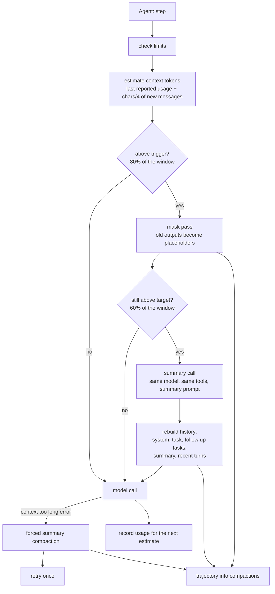
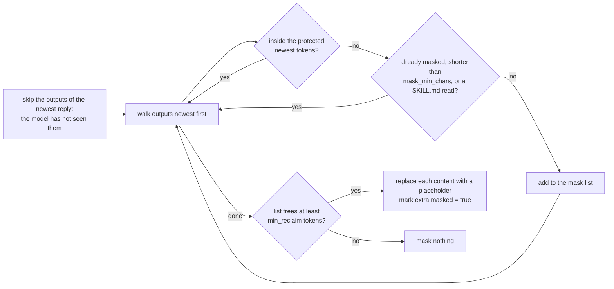

# Umbra: context compaction (task-2562)

## Introduction

Umbra keeps one list of messages and sends all of it on every model call. A long task fills the
model's context window, and then the provider refuses the request (Anthropic answers HTTP 400
"prompt is too long", llama.cpp answers "the request exceeds the available context size"). The run
ends with `ModelError` and the work in progress is lost. Before that point, every step also costs
more, because every old command output is sent again.

This design adds compaction: when the history gets close to the context window, Umbra first replaces
old command outputs with a short placeholder, and if that is not enough, asks the model to write a
summary of the session and continues from the summary. Both steps are recorded in the trajectory, so
the file still shows exactly what the model saw, and nothing that was removed is lost.

## Research: what other agents do

| Agent | When it compacts | What it does | Source |
|---|---|---|---|
| Claude Code | About 95% of the window, or `/compact [focus]` | The model writes a structured summary; the history is replaced by the summary. The compaction request reuses the same system prompt and tools so the cached prefix is reused. | Claude Code docs, community write ups |
| Codex CLI | `model_auto_compact_token_limit`, at most 90% of the window, or `/compact` | Appends a handoff prompt as a user message, keeps the model's reply as a summary message, and rebuilds the history as the most recent user messages (up to 20,000 tokens) plus the summary. Earlier summaries are not kept. The prompt can be replaced with `compact_prompt`. | `codex-rs/core/src/compact.rs`, write ups by D. Vaughan and others |
| opencode | Two steps. A prune pass, then a summary when the context overflows | Prune walks back through tool outputs, protects the newest 40,000 tokens of them, and only prunes when at least 20,000 tokens come back. Pruned outputs are marked, not deleted. The skill tool and the last two user turns are never pruned. | `packages/opencode/src/session/compaction.ts` (`PRUNE_PROTECT`, `PRUNE_MINIMUM`) |
| SWE-agent | Every step | "Last N observations": older tool outputs are replaced by a one line note. | SWE-agent history processors |
| OpenHands | When the history passes `max_size` | Condensers: an observation masking condenser, and an LLM summarizing condenser that keeps the first events and the newest ones. | OpenHands condenser docs |
| Anthropic API | Server side, beta | `clear_tool_uses_20250919` (context editing, header `context-management-2025-06-27`) clears old tool results; `compact_20260112` (header `compact-2026-01-12`) summarizes on the server. | platform.claude.com docs |

The most useful measurement is Lindenbauer et al., "The Complexity Trap" (arXiv 2508.21433,
NeurIPS 2025 workshop). On SWE-bench Verified with SWE-agent and five model configurations:

- Command outputs are about 84% of the tokens in an average turn.
- Masking old outputs halves the cost of a run compared with keeping everything, and solves as many
  tasks as LLM summarization, sometimes more.
- A hybrid (mask first, summarize only when masking is not enough) costs 7% less than masking alone
  and 11% less than summarization alone.

Two more facts shape the design:

- **Every change to an earlier message breaks the prompt cache** from that message onwards. Masking
  one output per step would make every step a cache miss. opencode's 20,000 token minimum exists to
  make each prune pass big enough to be worth one cache miss.
- **Thresholds written for one window size are wrong for another.** opencode's 40,000 and 20,000 were
  set for 200,000 token models, and a pull request to scale them was closed. Umbra runs on a local
  model whose window may be 32,000 tokens, so the numbers scale with the window.

## Goals and non goals

| Goal | How it is checked |
|---|---|
| A run that would overflow the window finishes instead | Integration test with a small `context_window` and large outputs; live runs with Claude Haiku and the local model |
| Masking runs first, and only in batches large enough to be worth a cache miss | Integration test reads what the replay provider was sent at each step |
| A summary replaces the old history when masking is not enough | Integration test checks the summary message and the kept task message |
| A provider "context too long" error triggers a compaction and one retry | Integration test with a replay reply that returns that error |
| The trajectory records every compaction and keeps every removed message | Integration test reads `info.compactions` |
| Tool calls and tool results stay paired after every compaction | Unit tests on the cut point; the Anthropic API rejects unpaired results, so the live run also checks it |
| Can be turned off and tuned | `--no-compact`, `[compaction]` in config, documented |

Non goals: Anthropic's server side compaction and context editing (they work only with Anthropic,
and Umbra's local model path needs a client side version anyway; they can be added later as an
option for the anthropic provider), a separate cheaper model for summaries, compaction in human
mode (no model calls happen there), and token counting with each model's real tokenizer.

## Problem statement

- `Agent::step` sends `self.messages` unchanged on every call. Nothing ever leaves the list.
- The observation template already cuts a single output above 10,000 characters to its first and
  last 5,000. That limits one output, not the sum of them. Forty commands that print 8,000
  characters each are 320,000 characters, about 80,000 tokens.
- When the provider refuses an oversized request, the error is a `ModelError` and the run ends.
  The retry logic treats HTTP 400 as not retryable, which is correct for every other 400.
- Umbra's README lists "Context compaction: no" in its feature table, against yes for Claude Code,
  Codex and opencode.

## Architectural overview



## Detailed design

### Components

| File | Layer | What it holds |
|---|---|---|
| `src/models/config.rs` | model | `CompactionConfig` and its defaults |
| `src/models/compaction.rs` | model | `CompactionRecord`, `CompactionKind`, `CompactionReason` |
| `src/utils/tokens.rs` | util | `estimate_text_tokens`, `estimate_message_tokens`, `context_window_for` |
| `src/services/compaction_service.rs` | service | the pure planning functions and the summary call |
| `src/services/agent_service.rs` | service | calls compaction before each model call and after an overflow error |
| `src/services/providers/*` | service | `ProviderError.context_overflow`; `Provider::context_window()`; llama.cpp `/props` lookup; the replay provider can record what it was sent |
| `src/templates/compact_summary.jinja`, `compact_resume.jinja` | templates | the summary request and the message that carries the summary |

### Config

```toml
[compaction]
enabled = true            # --no-compact turns it off
context_window = 0        # tokens; 0 means ask the provider, then a table, then 128000
trigger_ratio = 0.8       # compact when the estimate passes this share of the window
target_ratio = 0.6        # a mask pass that leaves the estimate above this is followed by a summary
protect_recent_ratio = 0.2    # the newest outputs worth this share of the window are never masked
protect_recent_max = 40000    # ...and never more than this many tokens (opencode's PRUNE_PROTECT)
min_reclaim_ratio = 0.1       # a mask pass must free at least this share of the window
min_reclaim_max = 20000       # ...capped at this many tokens (opencode's PRUNE_MINIMUM)
keep_recent_ratio = 0.1       # recent turns kept word for word after a summary
mask_min_chars = 400          # outputs shorter than this are never masked
```

Templates gain `compact_summary` and `compact_resume`, empty for the built in text.

### Estimating the context size

Providers report token counts after every call. The size of the next request is the size of the
last request (`input + cache_read + cache_write` tokens) plus the reply (`output` tokens) plus the
messages added since, estimated at four characters per token. When a provider reports no usage
(the replay provider, some servers), the whole history is estimated at four characters per token.
After a compaction the reported figure is out of date, so the whole history is estimated until the
next call reports again.

The window comes from, in order: `compaction.context_window`; the provider (`Provider::context_window`),
which for llama.cpp reads `n_ctx` from `GET /props` once, and for Anthropic uses a table (1,000,000
for a model id ending in `[1m]`, 200,000 otherwise); a table for known OpenAI models; then 128,000.

### Step 1: the mask pass



An output is a `tool` message, or in text mode a `user` message that has `extra.raw_output`.
Outputs after the last assistant message are never masked: the compaction runs before the model
call that would show them, and one reply can ask for several commands whose outputs together are
larger than the protected window. The placeholder keeps the return code and the size, and says the
model already read it, so the model knows it can run the command again:

```text
[Output removed to save context after you read it: 18432 characters, return code 0. Run the command again if you need it.]
```

`extra.raw_output` still holds the full output, so the trajectory loses nothing. The assistant
message with the command is not touched, so on Anthropic the raw content blocks, including thinking
blocks, are sent back exactly as before.

### Step 2: the summary

The history is split into three parts:

| Part | What it is | Kept? |
|---|---|---|
| Head | the system message and the first user message (the task) | yes, word for word |
| Middle | everything between, including earlier summaries | replaced by the summary |
| Tail | the newest turns worth `keep_recent` tokens | yes, word for word |

The tail always starts at an assistant message, so every tool result in it follows the tool call it
answers. Follow up tasks the person typed (`extra.interrupt_type = "UserNewTask"`) are moved out of
the middle and kept, because they are the person's instructions; Codex keeps recent user messages
for the same reason.

The summary call sends the head and middle (already masked) plus `compact_summary` as the last user
message, with the same tools, so Anthropic does not reject the `tool_use` blocks in the history and
the cached prefix is reused. The prompt asks for text only, under these headings: the task and every
request the person made, word for word; what has been done; files created or changed, with paths;
important commands and what they showed; errors and how they were fixed; the current state; the next
step. If the reply has no text, the compaction fails, a notice is printed, and the run continues
uncompacted.

The new history is: head, kept follow up tasks, one user message rendered from `compact_resume`
holding the summary (`extra.compaction_summary = true`), then the tail.

The summary call's cost is added to the run's cost. It does not count as a step for `--step-limit`.

### Step 3: a provider says the request is too long

`ProviderError` gains `context_overflow`, set when the status is 400 or 413 and the body says
"prompt is too long", "context length", "context_length_exceeded", "maximum context", "exceeds the
available context size" or "too many tokens". The agent then runs a summary compaction (reason
`overflow`) and makes the call once more. A second overflow ends the run as before.

### Manual compaction

At the follow up prompt after a submission, `/compact` or `/compact <what to focus on>` runs a
summary compaction and asks again. The focus text is added to the summary prompt.

### Trajectory

`messages` stays what the model saw on the last call. `info.compactions` lists every compaction:

```json
{
  "kind": "mask",
  "reason": "threshold",
  "step": 14,
  "tokens_before": 52100,
  "tokens_after": 23800,
  "window": 64000,
  "masked_message_indexes": [3, 5, 7],
  "removed_messages": [],
  "summary": "",
  "cost": 0.0
}
```

A summary record has `kind: "summary"`, the summary text, the cost of the summary call, and the
removed messages in full. `info.model_stats` gains `compactions`.

### Risks

| Risk | What reduces it |
|---|---|
| The model forgets a detail that was masked or summarized | Masking first keeps every command and every reasoning step; the placeholder says to run the command again; the summary prompt asks for paths, commands and errors |
| Cache misses make compaction cost more than it saves | Masking only in batches of at least `min_reclaim`, and the target ratio stops a pass that would leave the history just under the trigger and fire again next step |
| The estimate is wrong, especially for code and non English text | The estimate uses reported usage whenever there is one; the trigger leaves 20% of the window free; the overflow retry covers the rest |
| A cut that splits a tool call from its result | The tail always starts at an assistant message; unit tests check the cut against histories with several tool calls per reply |
| The summary call itself is too long | The middle is masked before the summary call; if the summary call overflows, the oldest half of the middle is dropped and the call is tried once more |

## Results

All runs read the same seven Umbra source files (the largest is 23,000 characters), one `cat` per
command, and report the first function in each. The windows were set far below the real ones to
force compaction. Trajectories are in `_agent_output/task-2562-compaction/`.

| Run | Window | Compactions | Model calls | Cost | Result |
|---|---|---|---|---|---|
| Claude Haiku 5.5, first build | 16,000 (flag) | 3 masks | 9 | $0.0083 | Submitted, correct, but the model said outputs were removed before it saw them |
| Claude Haiku 5.5, after the fix | 16,000 (flag) | 1 mask, 1 summary | 4 | $0.0079 | Submitted, all seven correct |
| Claude Haiku 5.5, summary forced (`target_ratio = 0.05`) | 16,000 (config) | 3 masks, 3 summaries | 10 | $0.0138 | Submitted, all seven correct; each summary cost about $0.0025 |
| Local Qwen 3.8 27B on :8080 | 262,144 (read from `/props`) with low ratios | 2 masks | 10 | $0 | Submitted, all seven correct |
| Local Qwen 3.8 27B, summary forced | 262,144 (read from `/props`) | 1 mask, 1 summary | 13 | $0 | Submitted, all seven correct |

The first Haiku run found a defect: Haiku asked for several `cat` commands in one reply, and the
mask pass, which ran before the call that would show their outputs, masked some of them. The model
then said it had not seen those files and read them again with `grep`. The fix is the rule above:
the outputs of the newest reply are never masked. A unit test
(`mask_never_removes_outputs_the_model_has_not_seen`) checks it.

The summary runs exercised the parts the replay tests cannot: Anthropic accepted the summary
request with `tool_use` and `tool_result` blocks in the history and the tools attached, and the
OpenAI compatible path did the same on the local server. Both models wrote summaries under the
seven headings and continued from them.

At a 16,000 token window a 6,000 token file read is masked one step after it is read, so a model
that does not write down what it learned has to read it again. At the real windows (200,000 for
Haiku, 262,144 for the local model) the protected window is 40,000 tokens, and this only happens on
long runs.

## Alternatives considered

| Option | For | Against |
|---|---|---|
| Summary only (Claude Code) | One mechanism | Costs a model call every time and loses detail; the Complexity Trap results show masking matches it for less |
| Masking only (SWE-agent) | No extra model call, keeps reasoning | Cannot help when the reasoning and commands alone fill the window |
| Mask every step, keeping the last N outputs (SWE-agent) | Simple, small context all the time | A cache miss on every step; Anthropic charges cache writes at 125% of input |
| Anthropic server side compaction and context editing | No client code, exact token counts | Anthropic only; Umbra's local model path would still need this design |
| Truncate the oldest messages | Trivial | Drops the task itself, and breaks tool call pairing |

## Testing strategy

Integration tests in `tests/compaction.rs` run the real binary with the replay provider. The replay
provider gains `UMBRA_REPLAY_RECORD=<file>`, which writes each request it receives as one JSON line,
so a test can read exactly what the model was sent.

| Test | Setup | Checks |
|---|---|---|
| `masking_replaces_old_outputs_first` | window 6,000, eight commands that each print 2,000 characters | a later request has placeholders in old tool results, the newest outputs are whole, `info.compactions[0].kind == "mask"`, the run submits |
| `summary_runs_when_masking_is_not_enough` | window 3,000, long assistant replies | the request after the summary holds the task, the summary text and the tail; a `summary` record holds the removed messages |
| `overflow_error_compacts_and_retries` | a replay entry that returns a 400 "prompt is too long" | one summary record with reason `overflow`, then the run submits |
| `no_compact_flag_turns_it_off` | as the first test with `--no-compact` | no records, every request has full outputs |
| `masking_works_in_text_mode` | as the first test with `--text` | old text mode observations are placeholders |

Unit tests in `compaction_service.rs` cover the estimate, the mask plan (protected window, minimum,
already masked, short outputs, SKILL.md reads, outputs the model has not seen), the cut point with
one and several tool calls per reply and in text mode, and the budgets at 32,000 and 1,000,000
tokens. `agent_service.rs` tests the `/compact` parsing, and `openai.rs` tests reading the window
from `/props` and `/models` replies.

Live checks: Claude Haiku 5.5 through the Claude Code login and the local model on :8080, each with
`context_window` set small enough that a real task compacts at least once, and each must submit.
