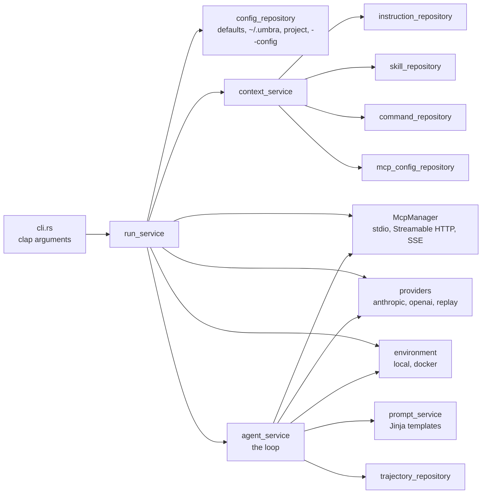
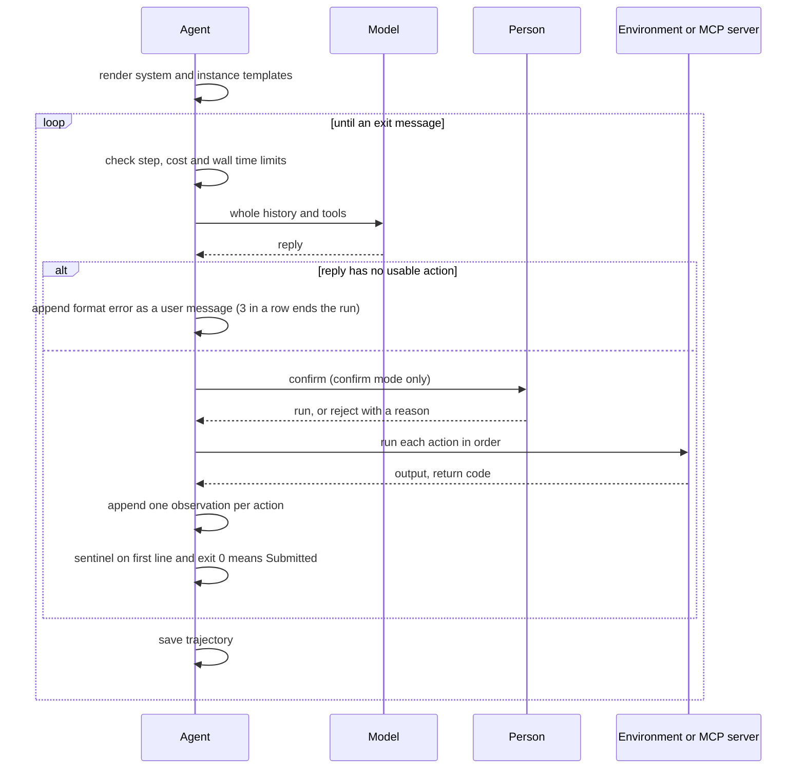
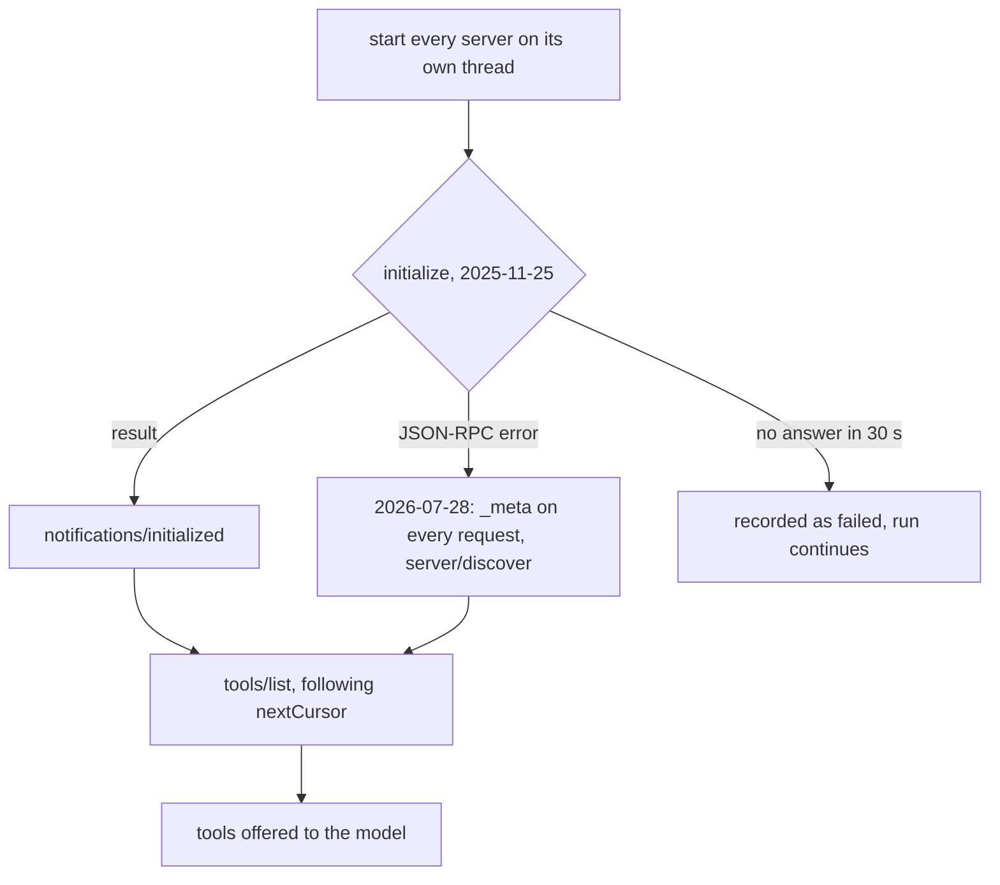

# Umbra: a coding agent harness in Rust (task-2559)

## Introduction

Umbra is a command line coding agent written in Rust. Its core is a port of mini-swe-agent
(github.com/swe-agent/mini-swe-agent, version 2.4.6 read in full for this design): the model gets
one `bash` tool, every command runs in a new shell, the history is one list of messages, and the
run ends when a command prints `COMPLETE_TASK_AND_SUBMIT_FINAL_OUTPUT`.

On top of that core, Umbra reads the files other coding agents already use, so a machine set up for
Claude Code, Codex, Gemini CLI, opencode, Cursor, Copilot, Windsurf or Cline works with Umbra with
no extra setup: instruction files (CLAUDE.md, AGENTS.md, GEMINI.md and the rule folders), Agent
Skills (SKILL.md folders), custom slash commands, and MCP server definitions. It talks to Claude
through the Anthropic Messages API and to any OpenAI compatible server, which includes llama.cpp.

## Goals and non goals

Goals, each checked by a test or a recorded run:

| Goal | How it is checked |
|---|---|
| The mini-swe-agent loop, limits, exit statuses and trajectory format | `tests/agent_loop.rs` (7 tests on the real binary) |
| Tool mode and text mode both work | Live runs with Claude Haiku 5.5 and the local model on :8080 |
| Every Claude Code skill on this machine is found | `umbra skills` lists 42, including plugin and synced claude.ai skills |
| Instruction files from every harness, in a clear order, each loaded once | `tests/discovery.rs` and `umbra instructions` |
| MCP servers from every harness's config file, started and usable | `tests/mcp.rs` (fake server in both protocol eras) and live runs against blender, chordical, code-search and inillucent |
| Works with Claude Haiku and the local model | Recorded runs, below |

Non goals for this version: a full screen terminal UI, context compaction, subagents, hooks,
dedicated file edit tools, web search, image input, session resume, MCP OAuth, and running rules
that apply only to some file paths. The README's feature table lists these.

## Problem statement

mini-swe-agent shows that a coding agent can be about a hundred lines of loop plus a shell, and
still score well on SWE-bench. It is Python, it reads no instruction files, no skills and no MCP
servers, and it reaches models only through LiteLLM. Jason's machine already holds a large amount
of agent configuration: 40 KB of `~/.claude/CLAUDE.md`, 28 skills in `~/.claude/skills` (the same
skills again in `~/.codex/skills` and `~/.agents/skills`), nine MCP servers in `~/.claude.json`,
nine in `~/.codex/config.toml`, three in opencode's config. A new harness that ignores all of that
would need its own copy of everything.

## Architectural overview



The code follows the layered layout: `models` (plain data), `repositories` (everything that reads
or writes disk), `services` (the loop, models, environments, MCP, prompts) and `utils`.

## Detailed design

### The agent loop



Exit statuses match mini-swe-agent: `Submitted`, `LimitsExceeded`, `TimeExceeded`,
`RepeatedFormatError`, plus `ModelError` for a model call that failed after its retries and
`UserQuit` for human mode. The process exits 0 only for `Submitted`.

Two choices differ from mini-swe-agent on purpose:

- When the agent submits in the middle of a list of tool calls, the calls after it are still given
  a "not executed" result. Anthropic rejects a request where a `tool_use` block has no
  `tool_result`, and a follow up task continues the same conversation.
- The Anthropic reply's raw content blocks, including thinking blocks, are kept in the message's
  `extra` and sent back byte for byte. Current Claude models reject edited thinking blocks.

### Action formats

| | Tool mode (default) | Text mode (`--text`) |
|---|---|---|
| How the model acts | `bash` tool with `{"command"}`, and one tool per MCP tool named `mcp__<server>__<tool>` | Exactly one ```` ```umbra_bash ```` block, or one ```` ```umbra_mcp ```` block holding `{"tool", "arguments"}` |
| Actions per reply | One or more, run in order | Exactly one |
| Observation format | JSON (`mini.yaml` template) | XML tags (`mini_textbased.yaml` template) |
| Long output | First and last 5,000 characters, with the count left out | Same |

Templates are minijinja with strict undefined variables, so mini-swe-agent YAML configs load
unchanged through `--config file.yaml`.

### Providers

| Kind | Endpoint | Credential | Notes |
|---|---|---|---|
| `anthropic` | `POST /v1/messages` | `ANTHROPIC_API_KEY`, then `ANTHROPIC_AUTH_TOKEN`, then Claude Code's login in `~/.claude/.credentials.json` | With the Claude Code login the first system block must be Claude Code's identity line; without it the API answers 429. Umbra adds it. Umbra never refreshes that token. Top level `cache_control` caches the prefix automatically. |
| `openai` | `POST /chat/completions` | `api_key_env` | llama.cpp, Ollama, vLLM, OpenAI, OpenRouter |
| `replay` | none | none | Returns scripted replies from a JSON file. Used by the tests. |

Retries follow mini-swe-agent: up to 10 attempts, waits of 4, 8, 16, 32 then 60 seconds, for 408,
409, 429, 5xx and network errors only. Cost uses a price table for current Claude models and is
zero for unknown models.

### Discovery

All discovery takes a `DiscoveryContext` (home, working folder, project root, enabled sources).
The project root is the nearest folder above the working folder holding `.git`. Each source can be
turned off with `--no-source <name>` or `[sources]` in the config.

**Instruction files** go into the system prompt from most general to most specific: user files,
then project root rule folders, then each folder from the project root down to the working folder.

| Scope | Files |
|---|---|
| User | `~/.umbra/UMBRA.md`, `~/.claude/CLAUDE.md`, `~/.claude/rules/`, `~/.codex/AGENTS.override.md` or `AGENTS.md`, `~/.gemini/GEMINI.md`, `~/.config/opencode/AGENTS.md`, `~/.agents/AGENTS.md`, Windsurf global rules, Cline rule folders |
| Project root | `.claude/rules/`, `.cursorrules`, `.cursor/rules/*.mdc`, `.github/copilot-instructions.md`, `.github/instructions/`, `.windsurfrules`, `.windsurf/rules/`, `.devin/rules/`, `.clinerules`, `.cline/rules/` |
| Each folder, root to working folder | `AGENTS.override.md` or `AGENTS.md`, `CLAUDE.md`, `.claude/CLAUDE.md`, `CLAUDE.local.md`, `GEMINI.md`, `UMBRA.md` |

A file is loaded once even when it is reached by two paths, and two files with the same content
are loaded once (this machine's `~/.codex/AGENTS.md` is a hard link to `~/.claude/CLAUDE.md`).
`@path` imports in Claude Code and Gemini files are followed four levels deep, skipping code
blocks and email addresses. Rule files with frontmatter load only when they apply to every file
(`alwaysApply: true`, `trigger: always_on`, `applyTo: "**"`, or no `paths`/`globs`). The total is
capped at 256 KB.

**Skills**: project folders first, from the working folder up to the root (`.umbra/skills`,
`.agents/skills`, `.claude/skills`, `.codex/skills`, `.gemini/skills`, `.opencode/skill(s)`,
`.github/skills`, `.windsurf/skills`, `.devin/skills`), then user folders (`~/.umbra/skills`,
`~/.agents/skills`, `~/.claude/skills`, each installed Claude Code plugin's `skills` folder read
from `installed_plugins.json`, `~/.codex/skills`, `~/.gemini/skills`,
`~/.config/opencode/skill(s)`, `~/.copilot/skills`, `~/.config/devin/skills`). The first skill
with a name wins. The system prompt lists name, description and SKILL.md path; the model reads
the file with `cat` when the task matches, which is how Codex and pi do it. A task that starts with
`/<skill-name>` puts the skill's body into the task.

**Slash commands**: `.claude/commands`, `.gemini/commands` (TOML), `.opencode/command`,
`.github/prompts`, `~/.codex/prompts` and the user level copies. `$ARGUMENTS`, `$1` to `$9`,
`$ARGUMENTS[N]` and `{{args}}` are filled in.

**MCP servers**, first found wins for each name: Umbra's own `[mcp_servers]`, then project files
(`.umbra/mcp.json`, `.mcp.json`, this project's entry in `~/.claude.json`, `.cursor/mcp.json`,
`.vscode/mcp.json`, `.gemini/settings.json`, `opencode.json(c)`, `.codex/config.toml`), then user
files (`~/.umbra/mcp.json`, `~/.claude.json`, Claude Desktop, `~/.codex/config.toml`,
`~/.gemini/settings.json`, `~/.cursor/mcp.json`, `~/.config/opencode/opencode.json`). Each
harness's shape is read: `command` as a string or an array, `env`/`environment`/`env_vars`,
`url`/`httpUrl`, `headers`/`http_headers`/`bearer_token_env_var`, `enabled: false` and
`disabled: true`, and the variable forms `${VAR}`, `${VAR:-default}`, `${env:VAR}`, `{env:VAR}`
and `${workspaceFolder}`.

### MCP client



Transports: stdio (newline separated JSON-RPC; `.cmd` launchers such as `npx` run through
`cmd /c` on Windows; stderr goes to `~/.umbra/logs/mcp/<name>.log`), Streamable HTTP (POST with
`Accept: application/json, text/event-stream`, session id kept, protocol version header, and the
`Mcp-Method`/`Mcp-Name` headers of the 2026-07-28 revision), and the older SSE transport. Requests
from the server get `{}` for `ping` and "method not found" for anything else, because Umbra
declares no client capabilities. A tool result with `isError: true` becomes return code 1.

### Security and risks

| Risk | Handling |
|---|---|
| The model runs any command | Confirm mode is the default. With no terminal, Umbra refuses to start unless `--yolo` is given, so it never runs unattended by accident. `--docker <image>` runs every command in a container. |
| Secrets in logs | `umbra mcp` prints the number of environment variables and headers, never their values. `umbra config` masks `api_key`. Credentials are never written to the trajectory. |
| Claude Code's login | Read only. A refresh would replace the refresh token Claude Code depends on. |
| A slow or broken MCP server | Each starts on its own thread with a 30 second limit; a failure is reported and the run continues. Each call has a 120 second limit and sends `notifications/cancelled` on timeout. |
| A command that never ends | Killed after `environment.timeout` (30 s) with its whole process tree (`taskkill /T` on Windows, the process group elsewhere). Output readers run on their own threads, so a leftover child holding the pipe cannot block Umbra. |

## Alternatives considered

| Option | Pros | Cons | Decision |
|---|---|---|---|
| Text mode only, as in mini-swe-agent v1 | Works with any model | Native tool calls are more reliable on current models, and MCP tools fit tool calling naturally | Both modes; tool mode is the default, as in mini-swe-agent v2 |
| A `skill` tool that returns the body (opencode, Gemini) | The model cannot misread a path | One more tool, and Umbra's only tool is bash by design | The model `cat`s SKILL.md, as Codex and pi do |
| tokio and an async HTTP stack | Concurrent MCP calls | A larger dependency tree for a loop that is sequential | Blocking `ureq` plus threads |
| rustls for TLS | No system dependency | Its `ring` dependency needs C headers that this build machine does not expose to cargo | `native-tls` with the platform's root certificates |
| Merge every MCP field across files with the same server name | More flexible | Hard to predict; Claude Code does not do it | First definition found wins, whole entry |

## Testing strategy

- `cargo test` runs 22 unit tests and 16 integration tests. The integration tests run the built
  binary with a fake home folder (`UMBRA_HOME_OVERRIDE`) so the machine's real configuration is
  never read.
- `tests/agent_loop.rs`: tool mode submit, the trajectory shape, text mode format error recovery,
  `RepeatedFormatError`, the step limit, the command timeout, unknown tools, and the refusal to run
  without a terminal in confirm mode.
- `tests/discovery.rs`: a fake home and project in the Claude Code, Codex, opencode and Cursor
  layouts; checks order, duplicates, `@` imports, glob scoped rules, skill precedence, plugin and
  synced skills, commands, MCP precedence and `--no-source`.
- `tests/mcp.rs`: the test binary acts as an MCP server in both protocol eras; checks the
  handshake, tool listing, server instructions reaching the system prompt, a server initiated
  `ping`, and an agent run that calls an MCP tool.
- Live runs, recorded in the task comments: Claude Haiku 5.5 and the local model, each in tool and
  text mode, plus Haiku calling a real MCP server.
