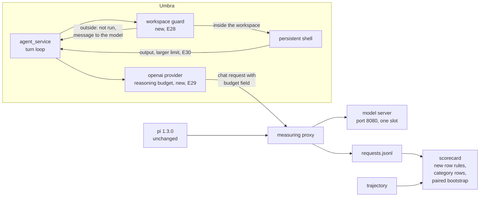
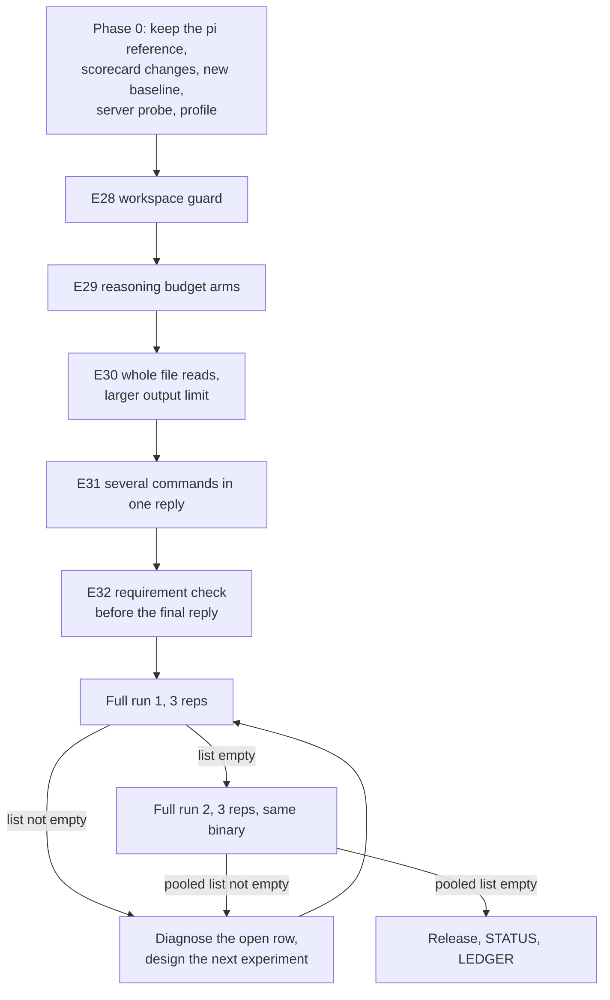
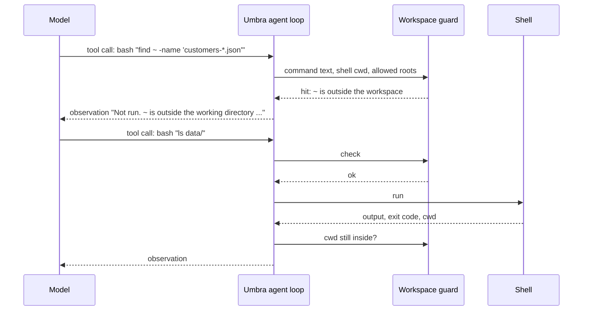

# Umbra hill climb 3: at or above pi on every scorecard row and every category (task-2711)

## Introduction

task-2617 and task-2643 ran 27 experiments and released Umbra 0.8.0. In the final run
(`final-8df86c3`, 61 tasks, 3 reps, model `ninfer-qwen3.8-27b-coletti-v9`) Umbra is better than
pi 1.3.0 beyond pi's noise band on pass rate, the hard tier, compaction, and every token, request
and time row except one. The goal was not met. Four things are still at or below pi: total
reasoning tokens, one run that left its workspace and ran the eval's reference solution, the
edit-precision pass rate, and five tasks where pi passes more reps than Umbra.

This document is the plan for the third hill climb. It restates the goal as "better than or equal
to pi on every row and every category", says how the scorecard decides that, lists the
experiments in the order to run them with the evidence for each, and sets the acceptance run. It
is a plan only. The build and the runs are a separate ticket for Opus.

## Where we stand

Numbers are from `evals/STATUS.md`, `evals/LEDGER.md` and `report-final-8df86c3.md`.

| Row | Umbra | pi | pi noise band | State |
|---|---|---|---|---|
| Reasoning tokens, total per rep | 338,858 | 315,434 | 25,289 | Inside the band, pi ahead by 7% |
| Runs that reached the eval's task files | 1 of 183 | 0 of 183 | 0 | pi better |
| edit-precision pass rate | 14 of 15 | 15 of 15 | not a scorecard row today | pi ahead |
| Tasks where pi passes more reps | 5 of 61 | | | See the table below |
| Runs that hit a limit, nonzero exits, resume after a crash | 0, 0, 3 of 3 | 1, 1, 2 of 3 | as wide as the gap | Umbra at the best possible value |

The five tasks where pi passes more reps, with the failure text from the run log:

| Task | Umbra | pi | What failed in the Umbra cells |
|---|---|---|---|
| esm-migration-25 (hard) | 0 of 3 | 2 of 3 | 27 of 28 checks pass in two reps. The same check fails each time: "semver is a default export with parse and satisfies as named exports" |
| symptom-elsewhere-dates (hard) | 1 of 3 | 3 of 3 | 25 of 26 checks pass. The same check fails twice: "weekNumber gives the ISO 8601 week of the UTC day" |
| json-cleanup-30 (hard) | 1 of 3 | 2 of 3 | One rep scored 0.57. One rep passed all 42 checks and was failed for running the reference solution |
| shared-mutable-config (hard) | 2 of 3 | 3 of 3 | 25 of 27 checks pass |
| near-duplicate-formatter (edit-precision) | 2 of 3 | 3 of 3 | Score 0: "Identifier 'weight' has already been declared". The edited module does not load |

What the saved data says about reasoning tokens (pi's cells are on disk; the Umbra cells of
`final-8df86c3` are not, so the Umbra side is from the report's totals):

- 70% of pi's reasoning tokens are on the hard tier (220,563 of 315,434 per rep).
- pi's reasoning is concentrated in a few replies. The median request has 20 reasoning tokens and
  the 99th percentile has 3,627. 55 of pi's 4,887 requests have more than 3,000 reasoning tokens
  and hold 52% of pi's total. The largest is 16,000, which is the whole reply limit.
- On the hard tier Umbra makes 38% more requests than pi (1,146 against 828 over 3 reps; 24.4
  against 20.7 per passed cell). On compaction Umbra makes 40% fewer (1,397 against 2,337).
- Per passed task Umbra already uses fewer reasoning tokens than pi (about 6,085 against 6,440),
  because Umbra passes 20 more cells. The scorecard row is the total, and the total is what must
  come down.
- Umbra's system prompt tells the model to read long files 120 lines at a time, and Umbra shows
  the model at most 5,000 characters from each end of a command's output. pi's `read` tool returns
  up to 2,000 lines in one call. This is a likely cause of the extra hard tier requests.

## Goals and Non-Goals

### Goals

- **G1.** A full run of all 61 tasks, 3 reps, where the scorecard's list "Rows where Umbra is
  behind pi" is empty, under the row rules in "Scorecard changes" below.
- **G2.** A second full 3 rep run of the same binary. The list is also empty when the two runs are
  pooled (6 Umbra reps against pi's 3). One run can meet G1 by chance: the reasoning total moved
  from 307,198 to 338,858 between two full runs of nearly the same build.
- **G3.** Reasoning tokens, total per rep, at or below 290,000 in both runs. That is pi's mean
  minus pi's band, so the row reads "Umbra" and does not depend on which side of a tie a run
  lands.
- **G4.** No Umbra cell in either run names a path outside its workspace, other than the
  allowed paths listed under E28.
- **G5.** Every category pass rate at or above pi's in the pooled result, including
  edit-precision at 100%.
- **G6.** No row that is "Umbra" today becomes a tie or worse. The tightest margins are first
  request size (1,835 against 2,154 tokens, band 0) and prompt tokens per passed task (353,094
  against 447,300, band 22,849).
- **G7.** Every decision is a row in `evals/LEDGER.md`, `evals/STATUS.md` is updated, and the
  kept changes are released with `packaging/release.ps1`.

### Non-Goals

- Changing pi, patching pi, or giving pi different settings. pi 1.3.0 stays unpatched.
- Changing the model server's flags. A server flag applies to pi too and would make the pi
  reference invalid.
- New task categories or tasks from public suites. Changing the suite during a climb moves the
  target. Suggestions are at the end as later work.
- Zero tasks where pi passes more reps. With 3 reps per task some tasks will always differ by
  chance. The five tasks above are used to find causes, and the per task sign test is reported.
- A real operating system sandbox for Umbra on Windows. The workspace guard in E28 stops the
  model from wandering. It is not a security boundary.

## Problem statement

1. **The stated goal could never be met.** The scorecard asks for "strictly better" on every row.
   Three rows have Umbra at 0 errors or 100% and pi within its band, so no change to Umbra can
   move them. task-2643 asked how to count them and the question was left open. This ticket's
   wording, "beating or being equal to pi", answers it: a tie counts.
2. **The scorecard does not show every category.** Only the hard tier and compaction pass rates
   are rows. edit-precision is 93.3% against pi's 100% and is not on the list of open rows.
3. **Reasoning tokens.** Two system prompt changes (E25, E27) did not move the total beyond the
   band. Turning thinking off halves the hard tier pass rate (E12). No experiment has yet limited
   how long one reply may think, or reduced the number of requests on the hard tier.
4. **Leaving the workspace.** On json-cleanup-30 about one rep in three leaves its workspace. A
   prompt sentence did not stop it (E24). Asking for a backup before bulk edits removed one cause
   (E26) and the model then left for another reason: to find something to check its output
   against. Published audits of SWE-bench and Terminal-Bench runs report the same thing: wording
   does not stop a model from looking for the answer, and only a check in the harness or removing
   the answer does.
5. **Requirement misses.** Three of the five losing tasks fail one or two checks out of 26 to 28,
   and two of them fail the same check in more than one rep. The model finishes without noticing
   one stated requirement.
6. **Weak evidence per decision.** A change was kept or reverted on 60 hard tier cells against a
   band of 10 points. Several kept changes were inside the band. The band is the range of 3 pi
   reps, which is itself a noisy estimate.
7. **The Umbra cells of the final run are not on disk.** Only `pi-1.3.0-ref`, `pi-1.3.0-store`
   and one smoke run are under
   `C:\jason\dev\umbra\_agent_output\retired-worktrees\task-2643\_agent_output\task-2643\eval-runs`.
   The split of Umbra's reasoning tokens by task and by request cannot be computed until a new
   baseline is run.

## Architectural Overview

## Detailed Technical Sections

### Phase 0: before any experiment

1. **Keep the pi reference.** Copy
   `C:\jason\dev\umbra\_agent_output\retired-worktrees\task-2643\_agent_output\task-2643\eval-runs\pi-1.3.0-ref`
   (292 MB) into the new ticket's `_agent_output/<task>/eval-runs/` before doing anything else,
   and set `EVAL_RUNS_DIR` there. It is the only copy. Do not rerun pi. Check that
   `pi --version` still prints 1.3.0 and that the model name on port 8080 is unchanged; if either
   changed, stop and say so on the ticket.
2. **Scorecard changes** (below), one commit, with the old report on `final` data no longer
   available, check the new report on the baseline run from step 3.
3. **New baseline.** Build main and run all 61 tasks, 3 reps, run id `base-<commit>`. Keep every
   run folder of this ticket until the ticket is closed. This run is the "before" for every
   experiment.
4. **Reasoning profile.** Add `node evals/run.mjs profile <run id> [--ref <pi run>]`. It prints,
   per agent: reasoning tokens by category and by task, per request percentiles, the share of
   the total held by requests above 1,000, 2,000, 3,000 and 4,000 reasoning tokens, the totals by
   request position in the cell (1, 2 to 5, 6 to 20, 21 and later), requests per passed cell by
   category, and tool calls per reply. A first version for pi's side is
   `_agent_output/task-2711/analyze.mjs` in the task-2711 worktree, if that folder still exists.
   Post the Umbra and pi tables on the ticket. The E29 budget arms are chosen from this table.
5. **Server probe.** Find out which of these the server on port 8080 accepts, with direct
   requests that ask a question needing long thought:
   - `reasoning_budget_tokens: 200` in the request body (llama.cpp honors it per request from
     build b9982; the server here is behind the NInfer gateway, so test it).
   - `reasoning_control: true` and then `POST /v1/chat/completions/control` with action
     `reasoning_end` while the reply is streaming.
   - `thinking_budget` and `thinking_token_budget`, the names other servers use.
   Record for each: accepted or rejected, whether `reasoning_tokens` in the usage stayed at or
   under the budget, and whether the reply still had content or a tool call after the cut.
   Confirm the proxy forwards the field unchanged.
6. **Request comparison.** Save one Umbra and one pi request body for the same task from the
   proxy and list every field that differs (`chat_template_kwargs`, `preserve_thinking`,
   `reasoning_effort`, `max_tokens`, how earlier reasoning is sent). Umbra sends
   `preserve_thinking: true` to a localhost server and pi does not. If a difference other than
   the known ones is found, add an experiment for it.
7. **Read the failing transcripts** of the baseline for the five tasks above and for every
   failed edit-precision cell. For each, write two or three sentences on the ticket: what the
   model did and which stated requirement it missed. Use the trajectory and the failure text in
   `result.json`. Do not open `verify.mjs`, `hidden/` or `solution/`.

### Scorecard changes (eval only)

| Change | Why |
|---|---|
| Each row gets one of five verdicts: `Umbra` (better beyond pi's band), `equal` (same value, or Umbra at the best possible value), `tie, Umbra ahead`, `tie, pi ahead` (inside the band, pi's mean is better), `pi` (worse beyond the band) | "Beating or equal" needs a rule for ties. `tie, pi ahead` is where the reasoning row is today |
| The closing list is renamed "Rows where Umbra is behind pi" and holds the rows with verdict `pi` or `tie, pi ahead` | G1 is this list being empty. The three rows where Umbra is at 0 or 100% leave the list |
| A pass rate row for each of the 9 categories | edit-precision was behind pi and not listed |
| A row "Reasoning tokens per passed task" beside the total | Every other token row has both forms. The total stays and still has to pass |
| A paired bootstrap over tasks (10,000 resamples of the 61 per task differences) printed as a 95% interval beside pass rate, mean score and reasoning tokens | Reported for the lab. It does not decide a verdict |
| `report --pool <run id>,<run id>` scores two Umbra runs as 6 reps against the pi reference | G2 |
| A row "Runs that named a path outside the workspace", for both agents, from the transcripts, using the same path rules as E28. Reported, with the existing "reached the eval's task files" row kept as the scored one | Shows how often either agent leaves, where today only the worst case is counted |

The verdict rule for the band does not change, so every earlier ledger row still reads the same.

### Experiment protocol

The rules from task-2617 still apply: one slot on port 8080, never two cells at once; one change
per commit; each arm built with `cargo build --release` and passed as `UMBRA_BIN`; never read
verifiers or solutions to shape a change; a setting for every change so an arm is a config line.
Two additions:

- **Target and guard rows are named before the run**, in the ledger row. A change is kept when
  its target improves beyond pi's band for that row and no guard row gets worse beyond its band.
- **A change aimed at one task is measured on that task with 12 reps**, then on its whole
  category with 3 reps for the guard rows. 3 reps of one task cannot show a rate of one in three
  changing.

The system prompt can grow by at most 300 tokens in total across all kept changes. First request
size is 1,835 against pi's 2,154 and that row has a band of 0.

### E28: workspace guard

**Hypothesis.** A check in the harness that does not run a command naming a path outside the
workspace, and tells the model why, ends the runs that leave the workspace.

**Design.**

- New setting `environment.workspace_guard`: `block` (default), `ask`, `off`. In an interactive
  session `ask` shows the usual confirm prompt with the outside path named. With `--yolo` or no
  terminal, `block` and `ask` both refuse.
- The workspace root is the session's starting working directory. Extra allowed roots: the
  system temp folder, Umbra's own home folder, `/dev`, program folders (`/usr`, `/bin`, `/etc`,
  `/mingw64`, `C:/Program Files`, `C:/Windows`), any path that appears in a message the person
  typed in this session, and paths in a new list setting `environment.allowed_paths`.
- Before a command runs, the guard collects the path like words in the command text: words that
  start with `/`, `~`, `$HOME`, `%USERPROFILE%`, a drive letter and colon, or that contain `..`.
  Git Bash forms are mapped to Windows forms (`/c/x` to `C:/x`). Relative words are resolved
  against the shell's current directory. A word that resolves outside every allowed root is a
  hit. A bare `/`, `/c`, `~` or `$HOME` given to a command is a hit.
- After each command the guard reads the shell's current directory. If it is outside the allowed
  roots, the shell is moved back to the workspace root and the model is told.
- On a hit the command is not run. The observation is: "Not run. `<path>` is outside the working
  directory `<root>`. Work only inside the working directory. If something you need is not
  there, say so in your reply and stop looking for it elsewhere."
- The check is on the command's text. A command that builds a path at run time gets past it.
  That is accepted: the model is wandering, not attacking.

**Files.** `src/services/environment/local.rs` or a new `src/services/workspace_guard_service.rs`,
`src/models/config.rs`, `src/models/settings_schema.rs`, `docs/configuration.md`.

**Target.** json-cleanup-30, 12 reps before and after: cells that name an outside path. Before is
expected near 4 of 12. After must be 0 of 12.
**Guards.** Hard tier, 3 reps: pass rate, reasoning tokens, requests per passed task. Session
category, 3 reps: all scenarios pass (resume and fork read Umbra's home folder, which is allowed).

**Risk.** A task that legitimately needs a path outside the workspace. No eval task does. For
users, the path named in their message is allowed and the setting can be turned off. This is a
default change and goes in the release notes.

### E29: reasoning budget for one reply

**Hypothesis.** A limit on reasoning tokens in one reply removes the long tail, which holds about
half of all reasoning tokens for pi and probably for Umbra, without lowering the pass rate,
because a reply that thinks for 8,000 or 16,000 tokens is usually going in circles. pi's largest
replies spend the whole 16,000 token reply limit on thinking and return nothing.

**Design.**

- New provider setting `reasoning_budget` (tokens; unset means no limit). Sent to a local server
  using whichever mechanism the Phase 0 probe found working, in this order of preference:
  1. The request field `reasoning_budget_tokens`.
  2. `reasoning_control: true`, with Umbra counting streamed reasoning and calling the control
     endpoint with `reasoning_end` when the count passes the budget.
  3. If the server supports neither: Umbra stops reading the stream at the budget and sends the
     request again with one added line saying the thinking was cut off and to act now. This arm
     is only valid if the proxy counts the tokens of the abandoned reply (it gets no usage chunk
     for an aborted stream, so the proxy must count the streamed text with the server's
     `/tokenize`). Without that proxy change the row would undercount Umbra, so do not use
     mechanism 3 without it.
- The proxy does not set or remove the budget field. It is listed in `evals/README.md` under
  "Known differences left as shipped", next to `max_tokens`, with the value.

**Arms.** Hard tier, 3 reps each: budgets 8,000, 4,000 and 2,000, against the baseline. Adjust
the three values after reading the Phase 0 profile: put the middle arm where requests above it
hold about 40% of Umbra's reasoning tokens.

**Target.** Reasoning tokens on the hard tier, down by more than pi's band of 12,984.
**Guards.** Hard tier pass rate and mean score, requests per passed task, nonzero exits.

**Decision.** Keep the smallest budget whose pass rate and mean score are inside the band of the
baseline. Then run compaction and session with it (3 reps), since compaction summaries may need
long replies; if the summary call is hurt, exempt it from the budget.

**Risk.** A budget may lower quality on the spec tasks that need a long plan. The Qwen3 paper
reports that more thinking budget helps, and no published study measures a cap on agent tasks.
The arms measure it. If every arm loses pass rate beyond the band, the budget is not adopted and
E30 and E31 carry the reasoning goal.

### E30: read whole files, larger output limit

**Hypothesis.** Umbra spends extra hard tier requests reading files in parts. Letting the model
read a file of ordinary size in one command lowers requests per passed task on the hard tier
toward pi's, and reasoning tokens with it (each hard tier request costs several hundred).

**Design.**

- The observation limit becomes a setting, `environment.output_limit_chars`, and the default goes
  from 5,000 characters from each end to an arm value. Arms: 10,000 total (today), 24,000 total
  and 48,000 total. The 1 MB cap from E23 is unchanged.
- The system prompt line "Read long files a part at a time, for example `sed -n '1,120p' file`"
  becomes: "Read a file whole with `cat` when it is under about 500 lines. Read a longer file in
  parts of a few hundred lines with `sed -n`."

**Target.** Requests per passed task on the hard tier, down by more than pi's band of 2.
**Guards.** Prompt tokens per passed task (must stay below pi's 447,300 minus the band in the
full run), uncached prompt tokens, large-output pass rate and its prompt tokens per passed task,
compaction pass rate and peak prompt tokens on window tasks. Run hard, large-output and
compaction.

### E31: several commands in one reply

**Hypothesis.** The model sends one command per reply even when it needs three files. Umbra
already accepts several tool calls in one reply. One prompt sentence saying so lowers requests.

**Design.** One line under "Commands": "When you need several things that do not depend on each
other, such as reading three files, send the commands in one reply." Check in Phase 0 how often
the model already does this; if more than 20% of replies have two or more tool calls, skip E31.

**Target.** Requests per passed task on the hard tier and reasoning tokens.
**Guards.** Hard tier pass rate; session category (long-300-resume failed once when the model
batched its commands, before steps were counted as tool calls).

### E32: requirement check before the final reply

**Hypothesis.** The cells that fail one check out of 26 to 28 fail because the model stops
without comparing its work with each stated requirement, and the cell that failed edit-precision
stopped without loading the module it edited.

**Design.** Decide the form after Phase 0 step 7. Two candidates, run as arms:

- Arm A, prompt only: one sentence in "Ending your turn": "Before your final reply, read the
  request again and check each requirement against what you changed, and run each file you
  changed at least once."
- Arm B, harness: the existing `finish_check` setting (E3), changed to fire only when the request
  has a numbered or bulleted list of 5 or more requirements, at most once per turn, with a
  message of under 40 tokens. E3 was reverted because prompt tokens rose 30% on the hard tier for
  a gain inside the band; it was measured when 13% of hard cells were dying at the reply limit
  (fixed later by E13), so its pass rate result is not reliable.

**Target.** esm-migration-25, symptom-elsewhere-dates, shared-mutable-config and
near-duplicate-formatter, 12 reps each: passes out of 48, against the baseline's count on the
same 48.
**Guards.** Hard tier and edit-precision, 3 reps: prompt tokens per passed task, requests per
passed task, reasoning tokens.

### If the list is still not empty

After E28 to E32, run the full 3 rep run. For each row still on the list, run `profile`, read
the transcripts, and design one experiment aimed at it. Candidates not yet tried, in the order I
would try them:

- A reply limit for thinking plus tool call smaller than 16,000 for requests after the fifth,
  if the profile shows runaway replies late in a run.
- One message after a command fails twice in a row with the same error, asking for a different
  approach (a published small model harness reports this helps; no number given).
- A step count reminder when 75% of the step limit is used.
- The `edit` tool (E5) measured again on reasoning tokens. E5 was judged on pass rate only, and
  writing a `sed` or Python edit takes more thought than naming old and new text.

### Acceptance and release

1. Full run 1: all 61 tasks, 3 reps, the binary with every kept change. `report` shows an empty
   list.
2. Full run 2: the same binary, a new run id. `report --pool` over both shows an empty list, and
   G3, G4 and G5 hold.
3. If run 2 or the pool fails, the open row goes back to diagnosis. Do not rerun until a run
   passes.
4. Post both scorecards and the pooled one on the ticket. Update `evals/STATUS.md` and
   `evals/LEDGER.md`. Release with `packaging/release.ps1` (minor, because `workspace_guard`
   changes a default), then check `umbra --version`.

Expected machine time: baseline 3.5 hours, E28 about 3 hours, E29 6 to 9 hours, E30 about 8
hours, E31 3 hours, E32 about 6 hours, two full runs 7 hours. About 40 hours of model time.

### Data Flows and Security

- The guard reduces what an unattended Umbra reads on a person's disk. It does not make Umbra
  safe to run on untrusted input, and the docs must say so.
- The reasoning budget changes only requests to a local server. Hosted providers are untouched.
- A blocked command is recorded in the trajectory with the path that caused it, so the eval's
  outside path row and a person reading a session can both see it.
- Fairness of the comparison: the budget is a field Umbra sends by default, like `max_tokens`.
  pi's request is not changed, and the server's flags are not changed. The lab should state the
  budget value next to the reasoning row.

## Alternatives Considered

| Option | For | Against | Decision |
|---|---|---|---|
| Hide `evals/tasks` from the agent (another Windows user, or ACLs) | Removes the answer, which is what public benchmarks do | The row then measures nothing, and Umbra would still search a user's disk | Not in this climb. The guard fixes the behavior; the row stays to show it |
| A real sandbox (restricted token as in Codex, or AppContainer) | An actual boundary | Codex's Windows sandbox restricts writes and not reads; AppContainer breaks many tools; weeks of work | Later, as its own project |
| Another prompt sentence about staying in the workspace | Free | E24 tried it: no effect, and reasoning rose 8% | Rejected |
| Thinking off, or on for the first request only | Zero reasoning tokens | E12: hard tier 40.0% and 37.1% against 81.7% | Rejected |
| A third prompt paragraph asking for short thinking | Free | E25 and E27 did not move the total beyond the band | Rejected |
| A server flag `--reasoning-budget` | Simple | Applies to pi too, so the pi reference would have to be run again and both agents would be capped | Rejected |
| Report reasoning per passed task in place of the total | Umbra already wins that form | Changing a row to win it is what a reader of the lab would object to | Add the row, keep the total |
| More pi reps to narrow the band | Better noise estimate | The band definition would change under every earlier ledger row; 2 hours per rep | Not now. The bootstrap interval is reported beside the band |
| Add Terminal-Bench 2.1 or SWE-bench tasks now | An outside check | A new suite during a climb moves the target; needs Docker, which the suite's rules exclude | Later work |

## Testing strategy

Functional tests, run against the built binary where possible:

- **Guard blocks.** `umbra --yolo -t` with a stub model that sends `ls ~`, `cat /c/Users/x/y`,
  `cd .. && ls`, `find / -name a`: none runs, each observation names the path, and the
  trajectory records the block. With `workspace_guard = "off"` each runs.
- **Guard allows.** Commands on paths inside the workspace, the temp folder, `/dev/null`,
  `python -c` with no path, a path the user message named, and a path in `allowed_paths` all run.
  A path with spaces and a Git Bash path map correctly.
- **Guard and the shell directory.** After `cd` to an outside folder through a path built at run
  time, the next observation says the shell was moved back, and `pwd` prints the workspace.
- **Session scenarios.** The 7 session tasks pass with the guard on (resume, fork, branch, cut
  resume).
- **Reasoning budget.** With `reasoning_budget = 300` against the local server and a prompt that
  needs long thought, the reply's `reasoning_tokens` is at or under the budget plus the server's
  closing message, and the reply still has content or a tool call. With the setting unset the
  request body has no budget field. A hosted provider's request never has it.
- **Proxy.** `proxycheck` shows the budget field reaches the server unchanged and is recorded in
  `agentSampling`.
- **Scorecard.** A fixture run folder with known cells checks each of the five verdicts, the
  category rows, the renamed list, `--pool`, and that the bootstrap interval is the same for the
  same seed. The report on `pi-1.3.0-ref` against itself lists nothing.
- **Profile.** `profile pi-1.3.0-ref` reproduces the numbers in this document: 315,434 reasoning
  tokens per rep, 55 requests above 3,000 holding 52%.
- **Output limit.** A command printing 100,000 characters shows the model the configured number
  of characters and one line saying how much was left out.
- **Eval selftest.** `node evals/run.mjs selftest` passes after the eval changes.

## Later work (recommendations, not part of this climb)

- Tasks the suite does not have and public suites do: a request with an ambiguous requirement, a
  task where the first obvious fix fails, recovery from the agent's own broken edit, and a task
  of more than 100 steps outside the compaction category.
- A paired Umbra and pi run on Terminal-Bench 2.1 through Harbor in WSL, as an outside check for
  the lab.
- The research found that 61 tasks at 3 reps can resolve a pass rate difference of about 10
  points and not 5. Growing the suite does more for that than adding reps.

## Sources

- llama.cpp server README (reasoning budget, `reasoning_control`, `chat_template_kwargs`):
  https://raw.githubusercontent.com/ggml-org/llama.cpp/master/tools/server/README.md
- Qwen3 technical report (thinking budget and quality): https://arxiv.org/html/2505.09388v1
- pi's design notes: https://mariozechner.at/posts/2025-11-30-pi-coding-agent/
- Adding Error Bars to Evals: https://arxiv.org/pdf/2411.00640
- On Randomness in Agentic Evals: https://arxiv.org/html/2602.07150v1
- Claude Code sandboxing: https://code.claude.com/docs/en/sandboxing
- Reward hacking in coding benchmarks: https://cursor.com/blog/reward-hacking-coding-benchmarks
- A small model harness on Terminal-Bench 2.0:
  https://dev.to/dmitry_barakhov/how-far-can-a-small-coding-model-go-with-a-better-harness-18lb
