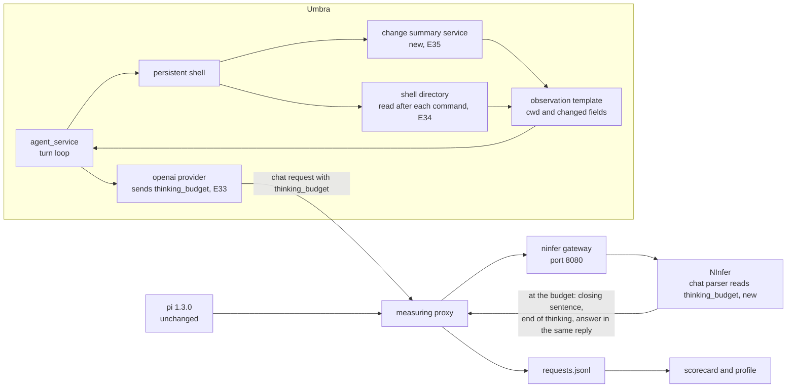
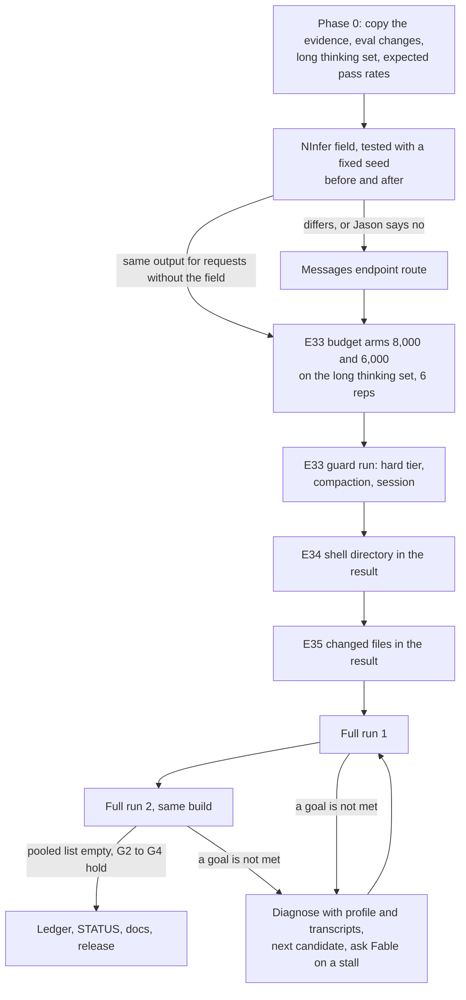
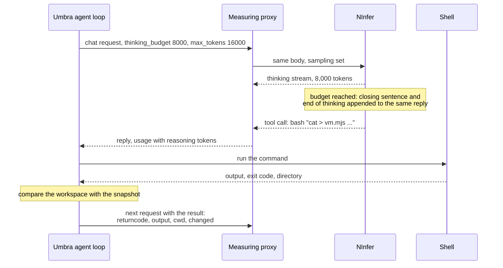

# Umbra hill climb 4: the reasoning row and the edit-precision row (task-2765)

## Introduction

Hill climb 3 (task-2712) released Umbra 0.9.2. In its acceptance runs (`full3-96b35ad` and
`full4-96b35ad`, 61 tasks, 6 Umbra reps pooled against pi 1.3.0) every scorecard row reads Umbra
or equal except two. Total reasoning tokens are 344,698 per rep against pi's 315,434. The
edit-precision category is 29 of 30 against pi's 30 of 30. The one experiment that lowered
reasoning (E29, a reply limit of 4,000 tokens with a second request) also lowered the hard tier
pass rate, so it was turned off and the reasoning goal was dropped.

This document is the plan for hill climb 4. It is based on a new reading of the task-2712 run
folders, the pi 1.3.0 source, the model server's source and chat template, and published work.
It finds three causes that hill climb 3 did not act on, and designs one change for each: a
thinking budget that the model server applies inside one reply, the shell's directory shown in
each command result, and a short list of the files each command changed. It is a plan only. The
build and the runs are a separate ticket for Opus.

## Where we stand

Pooled result of `full3-96b35ad` and `full4-96b35ad` (`pooled34-report.md` in
`C:\jason\agent-evidence\umbra\task-2712\`).

| Row | Umbra | pi | pi noise band | Verdict |
|---|---|---|---|---|
| Reasoning tokens, total per rep | 344,698 | 315,434 | 25,289 | pi |
| Reasoning tokens per passed task | 6,111 | 6,440 | 452 | tie, Umbra ahead |
| edit-precision pass rate | 29 of 30 | 30 of 30 (6 pi reps) | 0 | pi |
| create pass rate | 23 of 24 | 23 of 24 (6 pi reps) | 0 | equal |
| Pass rate | 92.6% | 80.3% | 6.6 points | Umbra |
| Hard tier pass rate | 81.7% | 66.7% | 10.0 points | Umbra |
| Compaction pass rate | 94.4% | 44.4% | 22.2 points | Umbra |

Five full runs of builds with no reply limit measured 307,198, 313,312, 338,858, 341,819 and
347,577 reasoning tokens per rep. One run of the same build differs from the next by about
18,000.

## What the research found

The full notes are in `C:\jason\agent-evidence\umbra\task-2765\` (`forensics/REPORT.md` with
the scripts that produced it, and `messages-probe/` with the log of every probe request).

### Where the reasoning tokens go

| Fact | Umbra | pi |
|---|---|---|
| Reasoning on the hard tier, per rep | 270,766 | 220,563 |
| Reasoning on compaction, per rep | 27,259 | 58,780 |
| Replies that reach the 16,000 token output limit while still thinking, per rep | 1.83 (29,002 tokens) | 3.0 (47,194 tokens) |
| What happens after such a reply | Umbra discards it, adds "Write a shorter reply", and asks again. The next reply thinks for about 9,600 more tokens. 8 of 10 cells pass | The cell ends and fails |
| Replies with 8,000 to 15,999 reasoning tokens, per rep | 7.5 (79,169 tokens) | 6.7 (70,792 tokens) |
| Replies with 4,000 to 7,999, per rep | 8.5 (50,037 tokens) | 5.3 (34,802 tokens) |
| Replies with 500 to 3,999, per rep | 93 (119,006 tokens) | 62 (76,098 tokens) |

- 64% of the gap to pi is in tasks that both agents pass every time. The gap is not caused by
  pi giving up early: replacing pi's 9 cells that end at the limit with a normal passing cell
  changes pi's total by 2,745.
- The 65 largest replies of both agents were read. Every one has the same order: restate the
  requirements, work examples by hand, draft the code in the reasoning, then write the same code
  in the tool call. None is a repetition loop. None is mainly about shell quoting. The large
  reply is the second to fifth request of a cell, right after the model has read the files.
- pi's `write` tool does not make that reply smaller. The drafted code is in the reasoning
  either way.
- A reply cut at the limit is not stored by Umbra in any file, so the 11 largest Umbra replies
  cannot be read.

### What the model server can do

The server is NInfer (source in WSL at `/home/jason/ninfer`, commit `e31bc99`), behind
`C:\jason\dev\ai-service\tools\ninfer\ninfer-gateway.cjs` on port 8080.

- The server has a thinking budget. The hill climb 3 probe did not find it because it tested
  field names on `/v1/chat/completions`, and the budget is read only on `/v1/messages`
  (`thinking: {"type": "enabled", "budget_tokens": N}`, N at least 1,024 and below `max_tokens`).
- At N thinking tokens the server appends "Considering the limited time by the user, I have to
  give the solution based on the thinking directly now." and the end of thinking tag to the same
  reply, and the model goes on to write its answer. This is the mechanism the Qwen3 technical
  report describes. There is no second request and the prompt does not change, which were the
  two costs of E29 (two requests with 0 cached tokens for each cut).
- Live checks: with a budget of 1,024 the thinking stopped at 1,048 tokens. In 3 of 3 runs where
  the answer fit in `max_tokens`, the reply after the forced end was a complete `bash` tool call.
- The budget is already a field of the server's internal request (`GenerationRequest.thinking_budget`,
  `request.h` line 182). It is set only in `parse_thinking`
  (`anthropic_messages_request.cpp` line 871) and used in `to_request_options`
  (`translate.cpp` lines 318 to 320). Reading it from a chat request is about 10 lines in
  `parse_chat_completion_request` (`openai_chat_request.cpp`, near line 906).
- `reasoning_effort` is no use. The template accepts `low`, `medium` and `xhigh`, the default is
  already `low`, and the text it adds is at the start of the prompt, so changing it between
  requests empties the prompt cache.
- The server rejects `logit_bias` and grammars, and a `stop` string ends the whole reply.

### Why cells fail

| Cell | Cause | Was there a signal in what the agent saw |
|---|---|---|
| facts-report rep 2, inventory-64k-reconcile rep 4, long-150-steps rep 1 (all in the compaction category) | An earlier `cd notes` (or `cd weeks`, `cd items`) stayed in effect, because the shell keeps its directory between commands. The final JSON file was written in the subfolder. No compaction had run and no fact was lost | No. The agent printed the file it had just written, which worked |
| esm-migration-25 rep 4 | Same cause. A second `cd src && cat > dates.mjs` failed at the `cd`, so the file was never written | Yes, one line "cd: src: No such file or directory" |
| makefile-tab-recipe rep 6 (the edit-precision cell) | A Python rewrite in text mode wrote all 1,743 lines with CRLF | No. The agent's check, `sed -n | cat -A`, cannot show a carriage return in Git Bash |
| near-duplicate-formatter (base run) | `sed -i` with no line range changed the same line in 50 functions | No. The check printed 10 lines, and `git diff` failed because the folder is not a repository |
| json-cleanup-30 rep 6 | A test file imported the cleaning script, which ran it a second time on the cleaned files | Partly. The agent saw one file change and decided the others were unharmed |
| json-cleanup-30 reps 1, 3, 4, semver-compare, csv-report-eight-reqs, esm-migration-25 reps 2 and 6 | One stated rule not implemented or not tested | No |

pi's `edit` tool prevents the Makefile and `sed` failures: it refuses text that matches more
than once and changes only the matched span. Umbra's own `edit` tool (E5) tied on pass rate and
cost 207 tokens in every first request, so it was not adopted.

## Goals and Non-Goals

### Goals

The goals are measured. The ticket is finished when they are measured as met, and not when the
experiments in this document have all been run.

- **G1.** A full run of all 61 tasks at 3 reps where the scorecard's list "Rows where Umbra is
  behind pi" is empty, a second full run of the same build where it is empty, and an empty list
  when the two are pooled. Rows where pi was at 100% with a band of 0 are judged against 6 pi
  reps, as decided on task-2712.
- **G2.** Reasoning tokens, total per rep, at or below 290,000 in the pooled result, and below
  pi's 315,434 in each of the two runs. 290,000 is pi's mean minus pi's band, so the row reads
  Umbra.
- **G3.** edit-precision 30 of 30, bugfix 36 of 36 and create at least 23 of 24 in the pooled
  result.
- **G4.** No row that reads Umbra in `pooled34-report.md` becomes a tie or worse. The hard tier
  pass rate must stay above 76.7%.
- **G5.** Every decision is a row in `evals/LEDGER.md`, `evals/STATUS.md` and the docs are
  updated, and the kept changes are released.

### Non-Goals

- Changing pi or its settings. pi 1.3.0 stays as shipped, and `pi-1.3.0-ref` and
  `pi-extra-zero-band` are not run again.
- Changing the model server's flags or its default behavior. The one server change in this
  plan adds a request field that does nothing unless a request sends it.
- New prompt paragraphs about short thinking (E25 and E27), a requirement check before the final
  reply (E3 and E32), turning thinking off (E12), or a reply limit with a second request (E29).
  Each was measured and did not work.
- Zero tasks where pi passes more reps. The per task sign test is reported.
- New tasks or categories.

## Problem statement

1. **Umbra pays for thinking that produces nothing.** A reply that reaches the 16,000 token
   limit while still thinking is discarded, and the model then thinks again. That is 29,002
   tokens per rep for the discarded replies alone, as large as the whole gap to pi.
2. **Nothing bounds one reply's thinking without harm.** E29 cut a reply at 4,000 tokens and
   asked again with thinking off. The second request ran in a different mode with no cache, and
   cells that were cut while thinking passed 121 times against 137.7 expected. The server's own
   budget was not known.
3. **The shell keeps its directory and the model cannot see it.** E10 made the shell persistent,
   which lowered requests. Nothing in a command result says where the shell is now. Four failed
   cells in the pooled runs come from a `cd` the model had forgotten.
4. **The model cannot see what a command changed.** A bash only agent gets no report of an
   edit's effect. pi's tool limits an edit to the matched text. Umbra's checks in the failed
   cells looked at a few lines and missed changes elsewhere in the file, and a line ending change
   is invisible through `sed` in Git Bash.
5. **Decisions were made on too few cells.** 60 hard tier cells have a standard error of about 5
   points. E29 was kept and then reverted on that evidence.
6. **A cut reply is not stored**, so the largest replies cannot be studied.

## Architectural Overview





## Detailed Technical Sections

### Rules that carry over

- The model on port 8080 has one slot. Never two cells at once. The runner's lock enforces it.
- Never read `verify.mjs`, `hidden/` or `solution/` to shape an Umbra change.
- One change per commit, a setting for each change, a ledger row for each decision with the run
  ids, and the target and guard rows named before the run.
- The system prompt does not grow in this climb. None of the three changes adds prompt text.
- Low memory: pause and wait inside the run. After a PC crash: restart the queue and go on.
- Keep every run folder until the ticket is closed, and say where they are.

### Phase 0

1. **Evidence.** Point `EVAL_RUNS_DIR` at a copy of
   `C:\jason\agent-evidence\umbra\task-2712\eval-runs` in the new worktree's `_agent_output`. It
   holds `pi-1.3.0-ref`, `pi-extra-zero-band` and every Umbra run named below. Leave the
   original folder as it is. Check that `pi --version` prints 1.3.0 and the
   model name is `ninfer-qwen3.8-27b-coletti-v9`.
2. **Baseline.** `full3-96b35ad` and `full4-96b35ad` are the "before" for every experiment.
   Main differs from 96b35ad only in guard fixes for Linux and macOS and in the release script,
   so no new baseline run is needed.
3. **The pool with no limit.** These runs used no reply limit: `base-a83592d`, `e28-guard2`,
   `e30-24k`, `e30-48k`, `e31-batch`, `full3-96b35ad`, `full4-96b35ad`. Add
   `node evals/run.mjs expected <run ids>`, which prints for each task its pass rate over those
   runs and its mean reasoning tokens per cell. Each hard task has 21 cells there.
4. **The long thinking set.** The hard tasks where at least one third of the pool's cells have
   a reply with 6,000 or more reasoning tokens. Print the list on the ticket. The forensics
   point to stack-vm-spec, markdown-table-formatter, json-cleanup-30, newline-safe-generator,
   pagination-five-handlers, paths-with-spaces, csv-report-eight-reqs and shared-mutable-config,
   but the list comes from the command, not from this sentence.
5. **Eval changes**, one commit:
   - The proxy saves the full text of any reply with `finish_reason` length into the cell
     folder, for both agents.
   - `profile` prints the reply size table used above (bands 1 to 499, 500 to 1,999, 2,000 to
     3,999, 4,000 to 7,999, 8,000 to 15,999, at the limit), and three new counts for each agent:
     replies whose reasoning tokens are at or above the budget the request sent, how many of
     those have a tool call, and the cache hit rate of the request that follows each one.
   - A reported row "Replies that reached the output limit" for both agents.
   - A reported row "Cells whose last written file is outside the workspace root", from the
     saved workspace and the trajectory: a cell counts when a file the task asks for is missing
     at the root and a file of that name exists in a subfolder.
6. Post the long thinking set, the expected pass rates and the new profile tables of the
   baseline on the ticket.

### The server field

**Change, in the NInfer repository (`/home/jason/ninfer` in WSL).** In
`parse_chat_completion_request` (`src/serve/openai_chat_request.cpp`, beside
`parse_template_options`), read an optional integer `thinking_budget`. Apply the same checks
`parse_thinking` applies on `/v1/messages` (at least 1,024, below the request's output limit,
the same error type). Set `output.generation.thinking_budget`. Add the field to
`docs/serving.md` and a test beside the existing chat request parser tests. Nothing else
changes. A request that does not send the field takes the path it takes today.

**Protocol. The server is shared, and pi's reference must stay valid.**

1. Read the commit of the running binary and `git status` of the NInfer tree. If the tree has
   work that is not committed, or the running binary is not built from a commit in that tree,
   stop and post what you found. Make the change in a git worktree of that commit, on a branch
   `task-N-chat-thinking-budget`, and build into a separate folder.
2. Before the switch, record 6 chat requests against the running server with a fixed `seed`:
   3 request bodies taken from `pi-1.3.0-ref` (`EVAL_DUMP_BODIES` output or rebuilt from the
   trajectory) and 3 from `full3-96b35ad`, each with `max_tokens` 600, each sent twice. If the
   two sends of one request do not give the same text, use `temperature` 0 for the check and say
   so.
3. Follow the shared service rules in the `task` skill: read who else is working, post a comment
   before the restart, and do not restart while a `local_ai` or `umbra` lane ticket is running.
   Switch the Service Manager's command to the new binary with the same flags.
4. Send the 6 requests again. Every reply text and every token count must match step 2. If one
   does not, switch back to the old binary, post the difference, and take the Messages route
   below.
5. Send one request with `thinking_budget: 1024` and a prompt that needs long thought. The
   usage must show about 1,048 reasoning tokens and the reply must have content or a tool call.
6. Commit the NInfer change in its repository and name the commit in the ledger row.

Jason can refuse this change on the ticket. Until the switch in step 3, nothing on the machine
has changed. If he refuses, or step 4 fails, use the Messages route.

**The Messages route (only if the server field cannot be used).** Umbra's Anthropic provider
already reaches `/v1/messages` with `kind = "anthropic"` and a `base_url`. Token counts and
cache reads matched the chat endpoint in both directions in the probe when `preserve_thinking:
true` is sent. The gaps to close: the provider does not stream, does not read
`output_tokens_details.thinking_tokens`, treats `input_tokens` as the whole prompt (the server
reports the part that was not cached), and has no `thinking` setting; `temperature` must be at
most 1 and `top_k` at most 20; the server sends no `timings` on that endpoint; the proxy
(`proxy.mjs`, `chatShape.mjs`, and every scorecard function that filters on `kind === "chat"`)
must measure `/v1/messages` requests. This route is several days of work and loses the server
timing rows, which is why it is second.

### E33: a thinking budget for one reply

**Hypothesis.** A budget that the server applies inside the reply removes the replies that end
at the limit and shortens the replies above the budget, and it does not lower the pass rate the
way E29 did, because the model answers in the same reply, in the same mode, with all of its
thinking in front of it.

**Estimate.** These assume the "Write a shorter reply" request disappears and later replies do
not grow.

| Budget | From replies that reached the limit | From replies of 8,000 to 15,999 | Total per rep | Reasoning per rep after |
|---|---|---|---|---|
| 8,000 | 1.83 x (16,000 + 9,600 - 8,000) = 32,200 | 79,169 - 7.5 x 8,000 = 19,200 | about 51,000 | about 294,000 |
| 6,000 | 1.83 x (16,000 + 9,600 - 6,000) = 35,900 | 79,169 - 7.5 x 6,000 = 34,200 | about 70,000 or more | about 275,000 or less |

**Design in Umbra.**

- Two provider settings: `reasoning_budget` (tokens, unset by default) and
  `reasoning_budget_field` (the request field name, default `thinking_budget`; vLLM's name is
  `thinking_token_budget`). When `reasoning_budget` is set, the OpenAI provider adds that field
  to the chat request body.
- The field is sent for agent replies only. The compaction summary call and the session title
  call do not send it (`ReplyKind::Summary`, as E29 did).
- It is not sent when `thinking = "off"`. A budget at or above `max_tokens` is a configuration
  error named at startup.
- Files: `src/services/providers/openai.rs`, `src/models/config.rs`,
  `src/models/settings_schema.rs`, `docs/providers.md`, `docs/configuration.md`.
- The shipped default stays unset, because a server that does not know the field may reject the
  request. The eval's Umbra configuration for this server (`evals/agents/`) sets the kept
  budget, the same way pi's `models.json` for this server sets `maxTokens` and `thinkingFormat`.
  `evals/README.md` lists it under "Known differences left as shipped" with the value.
  `docs/providers.md` recommends the setting for NInfer, vLLM and llama.cpp.
- The arms can run before the setting exists, with `extra_body = { thinking_budget = N }` in the
  provider entry. Use that only for a smoke run. The arms below run on the build with the
  setting, so the summary call is exempt.

**Arms.** The long thinking set, 6 reps for each arm: budget 8,000, then budget 6,000. A budget
of 4,000 runs only if 6,000 passes the rule below.

**Decision rule, written into the ledger row before the first arm.** For an arm, the expected
passes are the sum over its cells of the task's pass rate in the pool with no limit, and the
spread is the square root of the sum of p x (1 - p).

- The arm holds the pass rate when its passes are at or above the expected passes minus one
  spread.
- Cells with at least one reply that reached the budget must pass at or above their own expected
  passes minus one spread. This tests the mechanism directly, as on task-2741.
- No reply reaches the output limit while still thinking.
- At least 90% of the replies that reached the budget have a tool call or end the turn with
  text.
- Keep the smallest budget that meets all four lines.

**Guard run for the kept budget.** Hard tier, compaction and session, 3 reps. Hard tier pass
rate at or above 76.7% and inside pi's band of the pool's 81.6%. Requests and prompt tokens per
passed task not worse than `pooled34` beyond pi's bands. Cache hit rate not lower beyond pi's
band of 1.1 points: the request after a forced end must still hit the cache, which depends on
the closing sentence being sent back exactly as it was streamed. If it does not hit, fix how
Umbra stores that reply's reasoning before going on. Every session scenario passes.

**Risks.**

- The model may think again in its answer after a forced end. Published rates for Qwen3 are
  under 3%. The fourth line of the rule measures it.
- A budget may lower quality on the tasks that need a long plan. The first two lines measure it
  on the cells where it applies, with 21 cells per task as the comparison.
- The saving may be smaller than the estimate if later replies think more. The arm's reasoning
  per cell against the pool shows it.

### E34: the shell's directory in each command result

**Hypothesis.** When a command result names the shell's directory whenever it is not the
workspace root, the model stops writing its final files into a subfolder.

**Design.**

- After each command Umbra already reads the shell's directory for the workspace guard
  (`agent_service.rs` near line 1310, `workspace_guard_service.rs`). When that directory is
  inside the workspace and is not the root, the observation gets one more field:
  `"cwd": "notes"`, the path from the root with forward slashes. At the root the field is
  absent, so most results do not change.
- Setting `environment.show_cwd`, default `true` if the experiment keeps it.
- Files: `src/templates/observation_tools.jinja`, `src/services/agent_service.rs`,
  `src/services/prompt_service.rs`, `src/models/config.rs`, `src/models/settings_schema.rs`,
  `docs/configuration.md`, `docs/how-it-works.md`.
- The session journal leaves out a tool result's content when it can be rebuilt exactly (E22).
  The new field must be stored in the journal record, so a resumed session renders the same
  text and keeps its cache. `a_sample_journal_rewrites_without_loss` must pass with journals
  written before and after the change.

**Target.** facts-report, inventory-64k-reconcile and long-150-steps, 12 reps each (36 cells):
the new row "Cells whose last written file is outside the workspace root" at 0 of 36. The
"before" count is the same row computed over the existing runs that hold these tasks
(`base-a83592d`, `e28-guard2`, `e30-24k`, `e30-48k`, `full1` to `full4`, 72 cells), with 3 of
18 known in the pooled pair.
**Guards.** Compaction and session, 3 reps: pass rates, prompt tokens per passed task, cache hit
rate after a compaction.

### E35: the files a command changed

**Hypothesis.** When a command result lists the files the command changed, with the number of
lines changed and any change of line endings, the model notices an edit that touched more than
it meant to, and edit-precision failures fall.

**Design.**

- New service `src/services/change_summary_service.rs`, called from the local environment
  after each command. Free functions that take the snapshot as an argument.
- **Snapshot.** At the first command of a session, walk the workspace and record for each file
  its size, modified time and a content hash, skipping `.git`, `node_modules`, `target`, `.venv`
  and `__pycache__`. Keep the text of each file up to 256 KB, up to 32 MB in total. If the
  workspace has more than 5,000 files, the feature is off for the session.
- **After each command.** Walk again, compare with the snapshot, and replace the snapshot. For
  each changed text file with kept text, compute: lines added and removed (compare lines with
  their terminators removed), the count of CRLF and LF endings before and after, whether a byte
  order mark was added or removed, and whether the final newline was added or removed.
- **Rendering.** One more observation field, absent when nothing changed, at most 8 entries and
  then "and N more":

  ```json
  "changed": [
    "M src/rows.mjs: 50 lines changed",
    "M Makefile: 1 line added; line endings LF -> CRLF on 1743 lines",
    "A out/report.json",
    "D src/dates.js"
  ]
  ```

- Setting `environment.change_summary`, default `true` if the experiment keeps it. Local
  environment only. Stored in the journal record like `cwd`.
- Files: the new service, `src/services/environment/local.rs`,
  `src/templates/observation_tools.jinja`, `src/models/config.rs`,
  `src/models/settings_schema.rs`, `docs/configuration.md`, `docs/how-it-works.md`.

**Target.** The 5 edit-precision tasks at 60 reps before and 60 after (300 cells each, about 70
minutes for each run): failed cells. The baseline rate is about 3%, so about 10 failures are
expected before. Kept when the failures after are at most one third of the failures before.
**Guards.** bugfix and create at 12 reps, and the hard tier at 3 reps: pass rates, prompt
tokens per passed task and reasoning tokens not worse beyond pi's bands. The json-cleanup-30
and near-duplicate-formatter transcripts are read after the run to see whether the model acted
on the list.

**Risk.** The model may ignore the list, as it ignored a visible typo in utf8-bom-config. The
target run measures that. The walk costs time on a large workspace, which the 5,000 file limit
bounds.

### If a goal is still not met

Work the open row. Do not stop at the end of this list.

- After each experiment that misses its target, write in the ledger row what the miss says about
  the cause before starting the next one.
- When three attempts in a row have not moved a row, or every experiment here is done and a goal
  is not met, ask Fable with the `fable-advice` skill. Ask the open question: everything tried
  with its numbers, what is still wrong, and what the next directions are in order.
- If the evidence says a goal cannot be reached under these rules, post `DECISION NEEDED` with
  the evidence, keep working the best remaining direction, and leave the ticket in progress.

Candidates not in the first plan, in the order I would try them:

1. A lower budget for replies after the first file write of a turn (for example 8,000 before
   and 3,000 after), if the profile shows large replies late in a cell.
2. Tool results as plain text in place of JSON. Today `<`, `>`, `&` and non ASCII letters reach
   the model as `\uXXXX`, and a result costs about 10% more tokens than its text. Measure on
   reasoning and on uncached prompt tokens.
3. The `edit` tool (E5) with a `write` tool, measured on reasoning and on edit-precision at 60
   reps. First request size has 320 tokens of room before it reaches pi's.
4. The cut reply's reasoning kept in the history after a reply reaches the limit, for servers
   with no budget.

### Acceptance and release

1. Full run 1: 61 tasks, 3 reps, the build with every kept change and the eval's Umbra
   configuration. Full run 2: the same build. `report --pool` over both.
2. G1 to G4 are read from those three reports. If one does not hold, go to "If a goal is still
   not met".
3. Post the three scorecards on the ticket. Update `evals/STATUS.md`, `evals/LEDGER.md`,
   `docs/`, and the umbra.ing chapter in `black-rainbow-labs-sites`. Release with
   `pwsh packaging/release.ps1 -Part minor`, then check `umbra --version`.

Expected model time: Phase 0 under 1 hour, the server check 1 hour, E33 arms 5 to 8 hours and
its guard run 5 hours, E34 2 hours, E35 5 hours, two full runs 8 hours. About 30 hours.

### Data Flows and Security



- The budget field goes only to a provider whose settings name it. Hosted providers never
  receive it.
- The server change does not alter any request that does not send the field. The fixed seed
  check before and after the switch is the evidence for that, and it protects the pi reference.
- Fairness: pi's requests, pi's settings and the server's flags are unchanged. The budget is a
  setting of Umbra's provider entry for this server, listed in the eval README with its value.
- The change summary reads files inside the workspace only and stores their text in memory. It
  writes nothing to disk except the journal record. It skips files over 256 KB.
- The `cwd` field shows a path inside the workspace. A directory outside it is already handled
  by the workspace guard, which moves the shell back.

## Alternatives Considered

| Option | For | Against | Decision |
|---|---|---|---|
| Thinking budget through `/v1/messages` with no server change | Nothing on the server changes | The Anthropic provider needs streaming, usage mapping and a thinking setting; the proxy and scorecard must learn a second endpoint; the server sends no timings there | Second choice, used if the server field is refused or fails its check |
| A server flag `--default-thinking-budget` | No code change | Applies to pi too, so the pi reference would be invalid | Rejected |
| E29 again with other limits | Code exists | Measured: the loss is in cells cut while thinking, and each cut costs two requests with no cache | Rejected |
| `reasoning_effort` per request | The server reads it | Default is already the lowest value the template accepts; a change empties the prompt cache | Rejected |
| Reset the shell to the workspace root after every command | Removes the cause of the `cd` failures | Undoes E10, which lowered requests and completion tokens beyond pi's bands | Rejected |
| A prompt sentence about `cd` or about checking line endings | Free | The prompt already tells Python to use `newline=''` and the cell failed anyway; first request size has a band of 0 | Rejected |
| Adopt the `edit` tool (E5) now | Prevents the `sed` and CRLF failures by design | +207 tokens in every first request, +7.6% prompt tokens per passed task, and no gain in E5; the model can still choose `sed` | Candidate 3 if E35 misses |
| A requirement checklist written at the start of a task | Targets the stated rule misses | No published measurement; E3 and E32 both lowered pass rates or raised tokens | Not in this climb |
| More reps of the full suite to settle the reasoning row | Smaller chance effect | Does not lower the mean, which is above pi's | Rejected |

## Testing strategy

Functional tests against the built binary and the real server where possible.

- **Server field.** The fixed seed check of the protocol: 6 requests give the same text and
  token counts before and after the switch. A chat request with `thinking_budget: 1024` returns
  about 1,048 reasoning tokens and a tool call or content. `thinking_budget: 500` and a budget
  above `max_tokens` return HTTP 400. NInfer's own parser test covers the three cases.
- **Budget setting.** With a scripted model server in `tests/`, a session with
  `reasoning_budget = 8000` sends `thinking_budget: 8000` on agent requests and not on the
  summary request. With the setting unset the body has no such field. With
  `reasoning_budget_field = "thinking_token_budget"` the other name is sent. A budget of 20,000
  with `max_tokens` 16,000 fails at startup with a message naming both values.
- **Budget and the cache, live.** One stack-vm-spec cell with a budget of 2,000: at least one
  reply reaches the budget, the request after it reports cached tokens within 200 of its prompt
  tokens minus the new messages, and the cell exits 0.
- **Shell directory.** `umbra --yolo -t` with a scripted model that sends `cd sub`, then
  `echo x > f.txt`, then `cd ..`: the first two results carry `"cwd": "sub"` and the third has
  no `cwd` field. With `show_cwd = false` no result has it.
- **Change summary.** A scripted model runs, in a fixture workspace: a `sed -i` that changes 50
  lines, a Python text mode rewrite of an LF file, a command that removes a byte order mark, a
  command that creates one file and deletes another, and a command that changes nothing. The
  five results carry the expected `changed` entries, and the last has no `changed` field. A
  workspace of 5,001 files produces no `changed` field and no error. A binary file is listed
  with no line counts.
- **Journal.** A session with `cwd` and `changed` fields is resumed, and the first resumed
  request is byte for byte the prompt the original session would have sent.
  `a_sample_journal_rewrites_without_loss` passes on journals from 0.9.2.
- **Eval.** A fixture run folder checks the two new reported rows, the `expected` command and
  the new profile counts. `profile` on `full3-96b35ad` plus `full4-96b35ad` reproduces 1.83
  replies per rep at the limit and 29,002 tokens. `node evals/run.mjs selftest` passes.
- **Documentation.** `cargo test --test documentation` passes after the docs changes.

## Sources

- Forensics and probe logs: `C:\jason\agent-evidence\umbra\task-2765\`.
- task-2712 comments, `evals/LEDGER.md`, `evals/STATUS.md`, `tasks/umbra-hillclimb-3-tdd.md`.
- pi 1.3.0 as installed: `C:/nvm4w/nodejs/node_modules/@earendil-works/pi-coding-agent/dist/core/`.
- Qwen3 technical report (thinking budget): https://arxiv.org/html/2505.09388v1
- Forced end of thinking and thinking again in the answer: https://arxiv.org/html/2609.03633
- vLLM reasoning outputs (`thinking_token_budget`): https://docs.vllm.ai/en/latest/features/reasoning_outputs.html
- llama.cpp server README (reasoning budget): https://raw.githubusercontent.com/ggml-org/llama.cpp/master/tools/server/README.md
- SWE-agent (edit feedback ablations): https://arxiv.org/html/2405.15793
- Tool interfaces and coding agent behavior: https://www.microsoft.com/en-us/research/publication/the-devil-is-in-the-interface-evaluating-how-tool-architecture-shapes-coding-agent-behavior/
