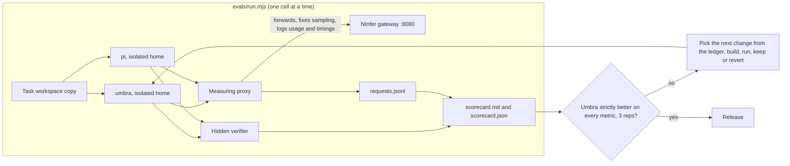
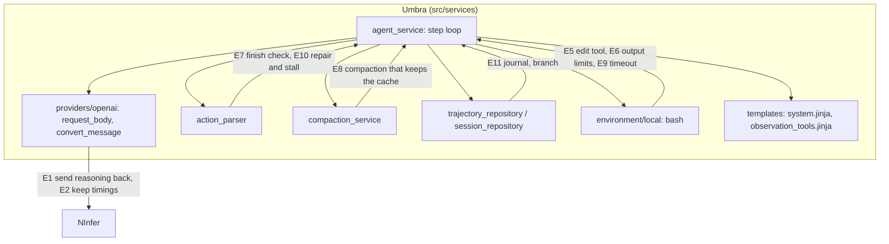
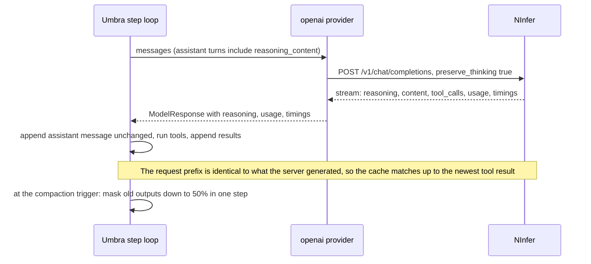

# Umbra hill climb: beat pi on every measured metric (task-2614)

## Introduction

Umbra should be the best coding agent harness for a local model. The reference is pi 1.3.0
(`@earendil-works/pi-coding-agent`), measured on the same model, `ninfer-qwen3.8-27b-coletti-v9`,
served by NInfer behind the gateway on port 8080.

Task-2614 built an eval suite in `evals/`, ran a baseline of both agents, and found the causes of
the gaps. This document records the baseline, defines what "exceeds pi" means as a test that can
pass or fail, and lists the changes to try, in order, with the measurement that decides whether
each change is kept. The implementation is a separate ticket for Opus 5.5.

## Baseline (measured 2026-11-10 and 2026-11-11, 33 tasks, 1 rep)

Source: `_agent_output/task-2614/eval-runs/baseline-0.5.2/scorecard.md` and
`baseline-0.6.2/scorecard.md`. All token numbers are the server's own `usage`, recorded by the proxy.

| Metric | Umbra 0.5.2 | pi 1.3.0 | Umbra 0.6.2 | pi 1.3.0 (second run) |
|---|---|---|---|---|
| Pass rate | 93.9% | 93.9% | 97.0% | 90.9% |
| Mean score | 96.5% | 99.1% | 99.9% | 99.4% |
| Prompt tokens, total | 4,777,085 | 6,868,431 | 4,915,887 | 6,871,463 |
| Uncached prompt tokens, total | 4,296,725 | 2,181,786 | 4,410,239 | 2,209,675 |
| Completion tokens, total | 98,455 | 288,269 | 105,002 | 294,506 |
| Requests, total | 479 | 652 | 498 | 652 |
| First request prompt tokens | 1,059 | 1,893 | 1,059 | 1,893 |
| Cache hit rate | 10.1% | 68.2% | 10.3% | 67.8% |
| Mean time to first content | 4,050 ms | 1,426 ms | 4,153 ms | 1,458 ms |
| Wall seconds per task | 83.2 | 93.4 | 90.1 | 78.6 |
| Total model seconds | 2,496 | 2,370 | 2,652 | 2,418 |
| Compaction pass rate (32,768 window) | 100% | 75% | 75% | 75% |
| Session scenarios passed | 4 of 4 | 4 of 4 | 4 of 4 | 4 of 4 |
| Malformed tool calls, runs with no tool call, HTTP errors | 0 | 0 | 0 | 0 |

What the baseline says:

1. **Umbra already uses fewer requests, fewer completion tokens and a smaller fixed prompt than
   pi.** Umbra has one tool (`bash`); pi has four (`read`, `bash`, `edit`, `write`).
2. **Umbra loses on uncached prompt tokens, cache hit rate, time to first content and total model
   time, and all four have one cause.** Umbra does not send the assistant's `reasoning_content`
   back to the server. With thinking on, the previous assistant turn then renders differently from
   what the server generated, and the server's cache only matches up to the end of the first user
   message (1,093 tokens on every request). Confirmed by experiment in
   `_agent_output/task-2614/cache-diagnosis/REPORT.md`: sending `reasoning_content` back raises
   cache coverage of the previous request from 83% to 99.9%. Different JSON formatting of tool
   arguments and `null` or empty `content` make no difference. pi sends `reasoning_content` and
   `chat_template_kwargs: {enable_thinking: true, preserve_thinking: true}`.
3. **Accuracy cannot be separated on this suite.** Both agents pass 91% to 97% and the two runs of
   pi differ by one task. One rep of 33 tasks has a noise band of about one task (3 points).
4. **The four failures are informative.** Umbra: `makefile-tab-recipe` (a Python text mode write
   turned every LF into CRLF on Windows) and `log-summary-cli` (two edge cases stated in the prompt
   were not implemented and nothing checked them before the final reply). pi: its `edit` tool
   inserted text before the last sentence when asked to append (`ledger-balance`), and a `find /`
   with no timeout hung until the 600 second limit (`tokenizer`).
5. **pi compacts badly on a small window.** With a 32,768 window pi's trigger is 16,384 tokens and
   it keeps 20,000 recent tokens, so it compacts on almost every turn (31 compactions in
   `records-threshold`), and its cache hit rate in the 5 requests after a compaction is 32%.
6. **Session scenarios do not separate the agents.** Resume, interrupt, fork and resume of a long
   session pass for both.

## Goals and Non-Goals

Goals:

- **G1, the finish line.** On the extended suite (below), 3 reps, same model, same sampling, Umbra
  is strictly better than pi on every row of the head to head table, by more than the measured
  noise band for that row. A row where both agents are at the best possible value (0 errors, 100%)
  counts as met. The scorecard's last section, "Metrics where Umbra is not strictly better than
  pi", is empty.
- **G2.** Cache hit rate at or above 85% and above pi's. Uncached prompt tokens per passed task
  below pi's.
- **G3.** Pass rate on the new hard tier above pi's by more than the noise band, with a paired sign
  test over tasks at p below 0.05.
- **G4.** No change is kept without a scorecard that shows its effect. Every experiment, kept or
  reverted, has a row in `evals/LEDGER.md`.
- **G5.** The work ends with a release (`pwsh tools/release.ps1` if the script exists in this
  repository, otherwise the release steps the last `Release 0.6.2` commit used).

Non-Goals:

- Changing, patching or configuring pi beyond its documented settings. pi runs as shipped.
- Tuning for the eval by reading verifiers. Verifiers and solutions stay hidden from both agents.
- Changing the model, the server or its sampling. The proxy fixes sampling for both agents.
- Terminal UI work (task-2611 owns it), MCP, skills, hosted model providers.
- Adding sub agents or planning modes. Neither is measured here.

## Problem statement

- Umbra processes about twice as many uncached prompt tokens as pi (4.3 million against 2.2
  million) because the server's prompt cache misses on every request after the first. Time to first
  content is 2.8 times pi's. On long tasks each step gets slower because the whole history is
  processed again.
- Umbra's accuracy equals pi's on tasks a 27B model mostly solves. There is no evidence yet that
  Umbra is more accurate on hard tasks, and the suite has no hard tasks.
- Umbra has no file edit tool. The model edits with `sed`, heredocs and Python, which on Windows
  can change line endings in bytes the task did not ask to change.
- Nothing in Umbra prompts the model to check its work against the request before the final reply.
- Compaction is designed for a 262,144 window: the mask pass starts at 80% of the window, so on the
  local model no output is ever pruned and a long session carries every tool output in full. When a
  mask or summary pass does run it rewrites earlier messages, which invalidates the server's cache
  from that point. A failed summary call can repeat before every later model call.
- Session storage rewrites the whole pretty printed trajectory after every step, with each tool
  output stored twice. There is no branch at an earlier message. The eval does not measure either.
- Umbra discards `timings` and `reasoning_tokens` from streamed responses, so its own accounting
  cannot report cache hit rate, speed or reasoning cost.

## Architectural Overview

The labels E1 to E11 are the experiments below.

## Detailed Technical Sections

### Phase 0: make the eval able to decide (do this first)

The current suite cannot show an accuracy win. Before any Umbra change:

| Item | Change in `evals/` |
|---|---|
| Hard tier | Add about 20 tasks in a new `hard` category, sized so that pi passes 40% to 70% of them on this model. Candidates: changes across 5 or more files with hidden tests; a bug whose cause is in a different module from its symptom; a refactor that must keep 40 existing tests passing; a task with 8 stated requirements where each is scored; tasks needing 40 or more steps; Windows specific traps (CRLF files, paths with spaces, a tab indented file). Calibrate by running pi, and drop or harden tasks pi passes 3 of 3. |
| Reps and noise | Run pi 3 reps on the full suite once and store it as the reference (`pi-1.3.0-ref`). pi does not change, so later runs are Umbra only. Compute the noise band per metric as the spread of pi's 3 reps, and print it in the scorecard. A difference inside the band is a tie. |
| Sign test | With 3 reps the paired sign test the scorecard already supports is computed for pass rate. |
| Compaction count | The scorecard counts a compaction when the message count drops. Umbra's mask pass keeps the count, so Umbra shows 0. Also read `info.compactions` from the Umbra trajectory and `compaction_start` events from pi, and report cache hit rate for the 5 requests after each. |
| Compaction quality | Add 2 tasks at a 16,384 window and 2 at 65,536, and one task of 150 steps, so the score shows whether facts from the start survive several compactions. |
| Session cost and features | Add scenarios: branch from an earlier message of a session and continue (pi has `/tree` and `--fork`); resume a session whose file was cut off in the middle of a write; resume a 300 step session and report startup milliseconds; report bytes written to the session store per step. |
| Isolation | Run each agent with a working folder on a path from which `evals/tasks` cannot be reached by an upward search, and fail a cell if the agent read a file under `evals/tasks` (check the transcript for the path). |
| Build under test | The runner already accepts `UMBRA_BIN`. Build with `cargo build --release --manifest-path <worktree>/Cargo.toml` and pass that binary. Record the git commit in the scorecard header. |

Runtime: one rep of the 33 tasks takes about 46 minutes for Umbra alone and about 50 for pi. The
server has one slot, so runs are sequential and nothing else may use the local model during a run.

### Hill climb protocol

1. One change per experiment, on its own commit. Build. Run the categories the change targets, 3
   reps. If the target metric does not improve by more than the noise band, revert and record it.
2. If it improves, run the full suite, 3 reps. Keep the change only if no row gets worse by more
   than its noise band. Record the before and after rows in `evals/LEDGER.md`: experiment id,
   commit, hypothesis, target metric, result, kept or reverted, run ids.
3. After every kept change, the new scorecard is the baseline for the next experiment.
4. Stop when G1 holds on a full 3 rep run. Then release.

Defaults for existing users change only where the experiment table says so, and every such change
is listed in the release notes.

### Experiments, in order

Order is by measured size of the gap, then by cost.

| Id | Change | Where | Target metric and expected result |
|---|---|---|---|
| E1 | Keep the streamed `reasoning_content` on the stored assistant message and send it back in `convert_message` as `reasoning_content`. Send `chat_template_kwargs.preserve_thinking: true` to servers that accept it. Store the text exactly as streamed. | `providers/openai.rs` (`StreamAssembler`, `convert_message`, `request_body`), `models/message.rs` | Cache hit rate from 10% to above 85%. Uncached prompt tokens per passed task below pi's 70,380. Time to first content below pi's 1,426 ms. The six turn test in the diagnosis report shows only the newest tool result is processed per request. |
| E2 | Keep `timings`, `completion_tokens_details.reasoning_tokens` and time to first token from streamed responses in `extra`, and total cached tokens in `model_stats`. | `openai.rs:337-389`, `agent_service.rs:748-752` | No scorecard change. Umbra's own numbers match the proxy within 1%. Needed so users can see the E1 result without the proxy. |
| E3 | Finish check. When the model sends a final reply after changing files, and no command ran after the last file change, send one message asking it to run the check that proves the change and to compare the result with each requirement in the request. Once per turn. | `agent_service.rs` near 769, new template | Hard tier pass rate, mean score. `log-summary-cli` class of failure. Cost: at most one extra request per task. |
| E4 | System prompt for Windows and byte safety: state that files must keep their existing line endings and encoding, that Python must open files with `newline=''`, and how Git Bash paths map to Windows paths. | `templates/system.jinja` | `edit-precision` score to 100%, 3 reps. First request tokens stay below pi's 1,893. |
| E5 | An `edit` tool: `path`, `old_text`, `new_text`, optional `replace_all`. Exact and unique match required; the error says how many matches there were and shows the closest lines. Writes bytes back with the file's own line endings and encoding untouched outside the match. Arm A: `bash` plus `edit`. Arm B: `bash` only with E4. | new tool in `agent_service.rs:941`, `action_parser.rs` | Keep arm A only if `edit-precision` and hard tier pass rate beat arm B and requests per passed task do not rise. The baseline shows the one tool design is cheaper, so the edit tool has to earn its place. |
| E6 | Tool output limits by lines and bytes: keep the last 2,000 lines or 50 KB for command output, write the full output to a file in the session folder, and tell the model the path and how to search it. Cut single lines over 2,000 characters. | `templates/observation_tools.jinja`, `environment/local.rs` | `large-output` pass rate and prompt tokens per passed task. Compare against the current 5,000 plus 5,000 characters. |
| E7 | Stall detection: the same command with the same output 3 times in a row adds one message saying so and asking for a different approach. Malformed tool call: keep the model's bad reply in history beside the error, and repair the common JSON faults (unescaped newline, trailing comma) before rejecting. | `agent_service.rs:781-791`, `action_parser.rs:80-95` | Both counts are 0 on the current suite. Run on the hard tier; keep only if hit limit runs or pass rate improve. |
| E8 | Compaction that keeps the cache. (a) A `context_window` override per model and a `compaction.max_context_tokens` cap, so a 262,144 window can be worked at a smaller size. (b) Mask in large rare steps: when the trigger is reached, mask down to 50% of the working size so the next rewrite is far away. (c) The summary call sends no tools, has an output budget, and after one failure is not retried until the context grows by 10%. (d) Arms for the cap: none, 96,000, 64,000. | `compaction_service.rs`, `config.rs:356-373`, `agent_service.rs:575-598` | Compaction score at 16,384, 32,768 and 65,536 windows at or above today's and above pi's. Cache hit rate after compaction above pi's 32%. For the cap arms: hard tier pass rate and uncached tokens on tasks over 60 steps. |
| E9 | Command timeout: default 120 seconds and an optional `timeout` argument on `bash` up to a configured maximum. The timeout message tells the model what happened and to run long jobs in the background with output to a file. | `config.rs:159`, `local.rs:131` | Hard tier tasks with slow test suites. pi has no default timeout and lost a run to a hung `find /`, so Umbra must keep a bound. |
| E10 | Persistent shell session arm: one shell kept for the turn so `cd` and `export` carry over, against today's new shell per command. | `environment/local.rs` | Requests and completion tokens per passed task. Keep only if both fall and no session scenario fails. |
| E11 | Session store: write each step as one appended line in a journal file and build the trajectory JSON on exit and on demand; tolerate a cut off last line on resume. Add `--resume <id> --at <message index> --fork` to branch from an earlier message. | `trajectory_repository.rs`, `session_service.rs`, `run_service.rs:322-347` | New session scenarios pass; bytes written per step and resume time below pi's. The trajectory JSON format read by other tools stays the same. |
| E12 | Thinking policy for local models: arms with thinking on, off, and on only for the first request of a turn. Run with the proxy's thinking override turned off for Umbra only, and report it as a separate table, because the main comparison fixes thinking for both agents. | `config.rs`, `openai.rs` `extra_body` | Pass rate against completion tokens. Published Aider results for Qwen3 show thinking off scoring higher; measure it here before changing a default. |

Notes for the implementer:

- E1 must store reasoning text byte for byte. The diagnosis showed the cache also matches when the
  field is named `reasoning` or the text is a `<think>` block inside `content`, so if a server
  rejects `reasoning_content` there are two fallbacks. Servers that do not accept
  `chat_template_kwargs` must not receive it: make it a provider setting that is on for the built
  in `local` provider.
- After E1, resend cost depends on compaction (E8). Measure E8 only after E1 is kept, because
  before E1 there is no cache to lose.
- E1 increases prompt tokens (reasoning is now part of history). The metric to watch is uncached
  prompt tokens and model seconds. If total prompt tokens rises above pi's, test dropping reasoning
  from turns older than the last compaction point during a mask pass.
- Masking after E1 breaks the cache at the first masked message. That is why E8 masks in large
  steps: one cache miss per large step.

### Data Flows and Security

Risks:

- **An agent reads the verifiers.** Covered by the isolation item in Phase 0.
- **A change tuned to these tasks.** The hard tier is written before the experiments start and is
  not edited to make a change pass. New tasks may be added; a task is removed only when its
  verifier is wrong, and the removal is recorded in the ledger.
- **The single model slot.** A second caller during a run changes timings and evicts the cache. The
  runner's server check stays, and the ticket asks for a quiet window on `gpu:1` for 3 rep runs.
- **Reasoning text in session files.** It is already stored in `extra.response`. No new exposure.
- **The `edit` tool writes files.** It goes through the same confirmation path as `bash`.
- **Default changes for existing users** (timeout, output limits, compaction cap). Each has a
  config key to restore the old value.

## Alternatives Considered

| Option | For | Against |
|---|---|---|
| Turn thinking off to fix the cache | The cache matches with no code change, fewer tokens | Changes model behavior for every user and loses accuracy on hard tasks if thinking helps; E12 measures it separately |
| Copy pi's four tools | Known design, the model has seen it | Baseline shows pi uses 36% more requests and 3 times the completion tokens; pi's `edit` caused its `ledger-balance` failure. Tested as E5 with a keep rule |
| Terminal-Bench 2 or SWE-bench Verified Mini as the suite | Public and comparable | Need Docker and hours per run on one slot; a 27B model scores low enough that noise dominates. Can be run once at the end as an outside check |
| Summarize every time the context passes a small threshold, as pi does | Small prompts | Measured on pi: 31 compactions in one task and a 32% cache hit rate after each |
| Judge accuracy with a model grader | Covers open ended tasks | Not reproducible; hidden tests are |

## Testing strategy

- `node evals/run.mjs selftest` must report every task ok before any run counts.
- Each experiment adds a functional test in `tests/` using the existing replay script suite:
  - E1: a replayed stream with reasoning produces a second request whose assistant message has the
    same `reasoning_content` bytes; a live test in `tests/live_local.rs` asserts `cached_tokens` on
    request 3 of a session is at least 90% of request 2's prompt tokens.
  - E3: a replay where the model edits and then replies gets exactly one finish check message.
  - E5: edits on LF, CRLF and UTF-8 files change only the matched bytes; 0 and 2 matches give the
    stated errors.
  - E6: a 40 MB output produces a result under the limit and a file containing all of it.
  - E8: a replay over the trigger masks once and not again for the next 20 steps; a failed summary
    is not retried on the next step.
  - E11: a journal cut in the middle of the last line resumes; a branch at message N has N messages.
- The acceptance test for the whole effort is G1: a full 3 rep scorecard with an empty "not
  strictly better" list, attached to the ticket.
