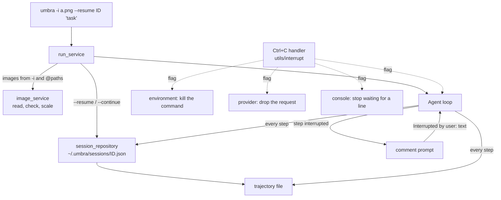

# Umbra: image input, session resume and Ctrl+C interrupts (task-2564)

## Introduction

Umbra 0.2.0 runs one task from start to finish. Three things a person expects from a coding agent
in a terminal are missing:

- **Images.** There is no way to show the model a screenshot or a diagram. MCP tools that return an
  image (a browser screenshot, for example) are replaced with the text `[image content, image/png,
  N base64 characters]`, so the model never sees the picture.
- **Resume.** The trajectory file has every message, but nothing reads it back. A run that ended,
  crashed or was stopped cannot be continued, and the person has to describe the work again.
- **Ctrl+C.** Pressing Ctrl+C kills the process. The command that was running, the reply the model
  was writing and the follow up conversation are lost. On Windows the same key press also reaches
  every MCP server Umbra started, because they share the console, so they die too.

mini-swe-agent, which Umbra is a port of, answers Ctrl+C with a comment prompt:
`Interrupted. Type a comment/command (/h for available commands)`. What the person types goes to
the model as `Interrupted by user: <text>` and the run continues. This design ports that prompt and
makes it safe for tool calls, adds image input from the command line, from the prompt text and from
MCP tools, and adds `--resume`, `--continue` and `umbra sessions`.

## Research: what other agents do

| Agent | Ctrl+C / interrupt | Resume | Images |
|---|---|---|---|
| mini-swe-agent (`agents/interactive.py`) | Catches `KeyboardInterrupt` in `step()`. Prompt `Interrupted. Type a comment/command (/h for available commands)` then `> `. The text becomes a user message `Interrupted by user: <text>` with `extra.interrupt_type = "UserInterruption"`. Empty input, or a bare `/y` `/c` `/u`, becomes `Interrupted by user: Temporary interruption caught.` The mode commands also switch the mode. | None. The trajectory is written, never read. | None. |
| Claude Code (`cli-reference`, `interactive-mode` docs) | Ctrl+C interrupts a running operation. With nothing running, the first press clears the input and a second press exits. Esc stops the current response or tool call and keeps the work done so far. | `--continue` / `-c` loads the most recent conversation in the current folder. `--resume` / `-r` takes a session id, a name, or the path of the `.jsonl` transcript, or shows a picker. `--fork-session` resumes into a new session id. | Paste with Ctrl+V (Alt+V on Windows), drag a file, or name a path. The Read tool also reads image files. |
| Codex CLI | Esc interrupts the turn; Ctrl+C quits. | `codex resume` (picker), `codex resume --last`, `codex resume <id>`, `codex exec resume --last "<prompt>"`. Sessions are JSONL files under `~/.codex/sessions/YYYY/MM/DD/`. | `-i` / `--image <FILE>` attaches images to the first prompt; images can be pasted into the composer. |
| opencode | Esc interrupts. | `--continue`, `--session <id>`. | Drag or paste into the input. |

Anthropic's vision documentation (platform.claude.com, `build-with-claude/vision`):

- Media types: `image/jpeg`, `image/png`, `image/gif`, `image/webp`. Only the first frame of a GIF is used.
- At most 10 MB of base64 per image on the Claude API, at most 8000x8000 pixels, and each side at most
  3000 pixels when a request has more than 20 images.
- Cost is one token per 28x28 patch: `ceil(width / 28) * ceil(height / 28)`. The long edge Claude
  uses is 1568 pixels on most models; a bigger image is scaled down by the API, so sending it bigger
  only costs upload time.
- An image can be a block in a user message or inside a `tool_result`'s `content` array.

The OpenAI Chat Completions format takes images as `{"type": "image_url", "image_url": {"url":
"data:image/png;base64,..."}}` parts of a **user** message. A `tool` message can only hold text.
llama.cpp's server accepts the same parts when it runs with a vision projector.

Measured on this machine against the local model on :8080 (NInfer serving
`ninfer-qwen3.8-27b-coletti-v9`):

- A 320x200 PNG with "ZEBRA 47" and a red circle, sent as an `image_url` part: the reply was
  `Word: ZEBRA / Number: 47 / Circle color: Red`, 139 prompt tokens.
- `"stream": true` works and sends `reasoning_content` and `content` deltas as server sent events.
- `GET /props` has no `modalities` field, so Umbra cannot ask NInfer whether it accepts images.

## Goals and non goals

| Goal | How it is checked |
|---|---|
| `-i/--image <PATH>` attaches images to the task; `@path` and plain image paths typed in a task, a follow up task or a comment attach them too | Integration tests read what the replay provider was sent |
| Images are scaled down to a long edge of 1568 pixels, and files that are not images are refused with a clear message | Integration tests with a 3000x1500 PNG and a text file named `.png` |
| MCP tool results that contain images reach the model as images | Integration test with the fake MCP server |
| Both providers send images in their own format | Unit tests on the converted request bodies; live runs with the local model and Claude Haiku |
| `--resume <id or path>`, `--continue` and `umbra sessions` continue a saved session in the same trajectory file, with the model, cost and history it had | Integration tests; live run with the local model that asks about a fact from the first run |
| A session that ended in the middle of a step (crash, Ctrl+C, a killed terminal) can be resumed, and tool calls without a result get one | Integration test with a hand written trajectory |
| Ctrl+C while the model is answering or a command is running stops that work within a second and shows mini-swe-agent's comment prompt | Integration tests send a real console event to the binary |
| Ctrl+C never kills MCP servers, and a second Ctrl+C at the comment prompt ends the run with the session saved | Integration tests |
| A local model stops generating when the person interrupts | Fake server test that sees the connection close; live run |

Non goals: pasting an image from the clipboard (it needs a terminal UI library, which Umbra does not
have, and every terminal reports a paste differently), an image viewing tool for the model's own
files (the model can already run commands; a separate design if it is wanted), and interrupting a
call to an MCP server reached over HTTP (it still ends at its timeout, see Risks).

## Architectural overview



### Components

| File | New or changed | Responsibility |
|---|---|---|
| `src/utils/interrupt.rs` | new | Installs the Ctrl+C handler (the `ctrlc` crate). Keeps a pending flag and a press count. A third press that Umbra has not handled exits the process with code 130. |
| `src/utils/console.rs` | changed | Reads stdin on one background thread. `prompt_line` waits for a line or a Ctrl+C and returns `Line`, `Eof` or `Interrupted`. |
| `src/utils/http.rs` | changed | `post_json_interruptible` and `post_stream_interruptible` run the request on a worker thread and wait in 100 ms slices, checking the flag. |
| `src/models/image.rs` | new | `ImageData`: media type, base64 data, width, height, source. |
| `src/models/message.rs` | changed | `Message.images`, skipped in JSON when empty. |
| `src/services/image_service.rs` | new | Reads a file, checks its magic bytes, scales it down, finds image paths in typed text, converts MCP image content. |
| `src/repositories/session_repository.rs` | new | Session index files, lookup by id or prefix, the newest session for a folder, loading a trajectory back into messages. |
| `src/services/session_service.rs` | new | Prepares a resumed session: repairs unanswered tool calls, picks the model and folder, adds the new task. |
| `src/services/agent_service.rs` | changed | Checks the flag between steps, after each action and around the model call; runs the comment prompt; starts from a loaded session. |
| `src/services/providers/openai.rs` | changed | Streams by default so an interrupt closes the connection; image parts; images from tool results go in one user message after the tool messages. |
| `src/services/providers/anthropic.rs` | changed | Image blocks in user messages and in `tool_result` content; the request runs on a worker thread. |
| `src/services/environment/local.rs` | changed | Polls the flag while a command runs and kills everything the command started on an interrupt. Starts commands in their own process group, and on Windows in a job object. |
| `src/utils/process.rs` | new | `own_process_group` for commands and MCP servers, and `ProcessJob`, the Windows job object that lets Umbra stop everything a command started. |
| `src/services/mcp/stdio.rs`, `client.rs` | changed | Servers start in their own process group; a call stops waiting on an interrupt and sends `notifications/cancelled`; image content is kept. |

## Detailed design

### 1. Ctrl+C

#### The signal

`interrupt::install()` runs once at startup for the `run` command. The handler does three things:
sets `PENDING`, adds one to `PRESSES`, and when `PRESSES` reaches 3 prints
`umbra: Ctrl+C pressed three times, exiting` and calls `std::process::exit(130)`. Umbra resets
`PRESSES` every time it handles an interrupt, so the forced exit only happens when the main thread is
stuck somewhere that does not check the flag. The trajectory is saved after every step, so even the
forced exit loses at most the step in progress.

Child processes must not receive the key press:

- **Windows**: every process attached to a console gets `CTRL_C_EVENT`. Shell commands and MCP
  servers are started with `CREATE_NEW_PROCESS_GROUP` (0x200), which turns Ctrl+C off for them.
  Umbra kills the command itself with `taskkill /F /T`, which it already uses for timeouts.
- **Unix**: the terminal sends `SIGINT` to the foreground process group. Shell commands already run in
  their own group (`process_group(0)`); MCP servers get the same.

#### Where the flag is checked

| Umbra is | What happens on Ctrl+C |
|---|---|
| waiting for the model | The request runs on a worker thread; the main thread stops waiting within 100 ms. With streaming on (the default for OpenAI compatible servers) the worker drops the response at the next chunk, which closes the connection, and llama.cpp and NInfer stop generating. No assistant message is added. |
| waiting between retries | The backoff sleep is cut into 100 ms slices and stops. |
| running a command | The wait loop polls every 100 ms, terminates the command's job object (see below), and returns the output so far with `exception_info` = `The user interrupted this command (Ctrl+C) after 3.2 seconds`. Actions after it in the same reply get `not executed because the user interrupted the run`, so every tool call still has a result. |
| calling a stdio MCP tool | Umbra stops waiting, sends `notifications/cancelled` with reason `interrupted by the user`, and records the call as interrupted. |
| at the confirm prompt | The actions are not run; each gets the not executed result. |
| writing a summary for compaction | The summary is abandoned and the history is left as it was. |

After any of these, the agent shows the comment prompt.

#### The comment prompt

```text
Interrupted. Type a comment/command (/h for available commands)
>
```

| Input | Result |
|---|---|
| text | User message `Interrupted by user: <text>`, `extra.interrupt_type = "UserInterruption"`. The run continues. |
| Enter alone | `Interrupted by user: Temporary interruption caught.` The run continues. Same as mini-swe-agent. |
| `/y`, `/c`, `/u` | Switches to yolo, confirm or human mode, prints `Switched to <mode> mode.`, and adds the temporary message. |
| `/compact [focus]` | Compacts now, then shows the prompt again. |
| `/h` | Prints the commands and shows the prompt again. |
| `/q`, Ctrl+C again, or end of input | Ends the run with exit status `Interrupted`, exit code 130, and prints the command that resumes it. |

When stdin is not a terminal (`--yolo` with a pipe, a script, CI) there is no one to ask, so Ctrl+C
ends the run the same way as `/q`. `UMBRA_FORCE_INTERACTIVE=1` treats a piped stdin as a terminal; the
tests use it to type into the prompt.

A Ctrl+C at the other prompts: at the follow up task prompt it ends the run (the task was already
submitted); at the raise limits prompt it ends the run with `LimitsExceeded`; at the human mode
command prompt it shows the comment prompt, as in mini-swe-agent.

#### Killing a command on Windows

Building this found a bug that was already in Umbra's timeout. Git Bash starts a program such as
`sleep.exe` from a process outside bash's own Windows process tree, so `taskkill /F /T` on bash
killed bash and left `sleep.exe` running. The leftover process also held the output pipe open,
so the run waited for it. Measured: Ctrl+C was handled 2.1 seconds into `sleep 30 && echo
finished`, and the process exited 28 seconds later. Each command now runs in a job object.
`TerminateJobObject` stops every process started inside the job, whatever its parent. The job is not
created with `KILL_ON_JOB_CLOSE`, so a server a command starts in the background on purpose still
outlives the command, as before.

#### Reading stdin

Today `read_line` blocks in `stdin().read_line`, which cannot be stopped by a flag. A single
background thread now owns stdin and sends each line, or end of input, through a channel.
`prompt_line(prompt)` prints the prompt and waits on the channel in 100 ms slices. If `PENDING` is set
it returns `Interrupted` and clears it. Lines typed while the agent is working wait in the channel and
are read by the next prompt, the same as a terminal's own type ahead.

A console event can end a pending read with an error or with no bytes. The reader does not take
that as the end of input when Ctrl+C was pressed in the same 100 ms; it reads again.

### 2. Images

#### Where images come from

1. `-i` / `--image <PATH>`, repeatable. Attached to the first user message, or to the new task when
   resuming.
2. Paths in typed text: the task, a follow up task, or a comment at the comment prompt. A word is taken as an image when, after removing a leading `@` and
   surrounding quotes, it names an existing file ending in `.png`, `.jpg`, `.jpeg`, `.gif` or
   `.webp`, relative to the working folder. Terminals paste a dragged file as its path, quoted when
   it has spaces, so dragging a screenshot into the terminal works. The text is sent unchanged, so
   the model can refer to the file by name. `[images] detect_paths = false` turns this off.
3. MCP tool results: `{"type": "image", "mimeType": ..., "data": ...}` items are kept as images on
   the tool result message. The text still says `[image 1: image/png 800x600]` so text mode and the
   trajectory show where it was.

#### Reading a file

`image_service::load_image(path, settings)`:

1. Read the bytes and identify the type from the magic bytes (`\x89PNG`, `FF D8 FF`, `GIF8`,
   `RIFF....WEBP`), not from the extension. Anything else: `<path> is not a PNG, JPEG, GIF or WebP image`.
2. Read the width and height from the header.
3. When the long edge is above `max_long_edge` (1568 by default, 0 means never), decode, scale with
   the Lanczos filter to fit, and encode JPEG as JPEG (quality 85) and the other types as PNG.
4. When the base64 text is still over `max_bytes` (default 10 MB, the Anthropic limit), refuse it.
5. Return `ImageData { media_type, data, width, height, source }`.

An image that fails is reported and left out: from `-i` the run stops before any model call; from
typed text Umbra prints a notice and sends the text without it.

Decoding uses the `image` crate with only the `png`, `jpeg`, `gif` and `webp` features, all pure Rust,
so it builds without a C compiler (which matters here: `ring` does not build in this cargo setup).

#### Sending images

| Message | Anthropic | OpenAI compatible |
|---|---|---|
| user | `image` blocks with a base64 `source`, then the `text` block | content array: `image_url` parts with a data URL, then the `text` part |
| tool result | `tool_result.content` = `[text block, image blocks]` | the `tool` message keeps the text; one user message with all of that step's tool images follows the last tool message, starting `Images returned by the tools above:` |

The replay provider records `images` for each message (media type, size, width, height) so tests can
check what was sent without the base64.

#### Compaction and trajectories

- Each image adds `ceil(w/28) * ceil(h/28)` tokens to the estimate.
- The mask pass also removes the images of an output it masks; the placeholder says how many.
- The base64 data is stored in the trajectory, so a resumed session sends the same pictures even if
  the files were moved. A 1 MB screenshot adds about 1.3 MB to the file.

### 3. Sessions

#### Session ids and the index

A session id is the start time in milliseconds, which is already the default trajectory file name
(`~/.umbra/trajectories/<id>.traj.json`). After every save Umbra also writes a small index file,
`~/.umbra/sessions/<id>.json`:

```json
{ "id": "1794183406123", "trajectory": "C:/Users/jason/.umbra/trajectories/1794183406123.traj.json",
  "cwd": "C:/jason/dev/umbra", "model": "local/ninfer-qwen3.8-27b-coletti-v9",
  "task": "add a --verbose flag", "started_at": 1794183406.1, "updated_at": 1794183533.9,
  "exit_status": "Submitted", "api_calls": 7, "cost": 0.0, "messages": 18 }
```

The index exists because a trajectory with screenshots can be many megabytes, and `umbra sessions`
should not read every one of them to print a list. It also covers runs saved with `-o` somewhere else.
The trajectory gets the same block as `info.session`, so a trajectory copied to another machine can
still be resumed by its path.

#### Commands

| Command | Behavior |
|---|---|
| `umbra --resume <ID>` / `-r <ID>` | The session with that id, or the only one whose id starts with it. |
| `umbra --resume <PATH>` | A trajectory file, even one with no index entry. |
| `umbra --resume` | In a terminal, a numbered list of this folder's ten newest sessions to pick from. |
| `umbra --continue` | The newest session whose folder is the current folder. |
| `--fork` | With either: the history is copied into a new session and the old file is left alone. |
| `umbra sessions [--all] [--json]` | This folder's sessions, or all of them, newest first. |

A task on the command line becomes the next message. Without one, a terminal asks `Resuming session
<id> (<n> messages). What next? `; without a terminal it is an error.

#### Loading a session

`session_service::prepare_resume`:

1. Read the trajectory's `messages` and `info` (`model_stats`, `compactions`, `session`).
2. Remove the trailing `exit` messages.
3. Find assistant tool calls with no tool message for their id, and add one right after the last
   result of that step: `This action was not run: the session ended before it finished.` The
   Anthropic API refuses a `tool_use` without its `tool_result`, so this repair is required for any
   session that was interrupted mid step.
4. Pick the model: `-m`, else the session's model, else the config. Pick the folder: `--cwd`, else
   the session's folder when it still exists, else the current folder.
5. Append `The user added a new task: <task>` (`interrupt_type = "UserNewTask"`, the same text as a
   follow up task), with any images.

The system prompt is kept from the session rather than rendered again. The model has already acted
on it, and a byte identical prefix keeps the provider's prompt cache. The run's totals continue from
the saved ones, and the step and cost limits count from the resume point, so a session that used 240
of 250 steps does not stop at its first step. Each resume is listed in `info.resumes` with its time and
model.

### Config

```toml
[images]
max_long_edge = 1568   # scale bigger images down; 0 never scales
max_bytes = 10485760   # refuse images whose base64 is bigger
detect_paths = true    # attach image paths typed in a task or comment

[providers.local]
stream = true          # default for OpenAI compatible servers
```

### Risks

| Risk | Mitigation |
|---|---|
| A server rejects `stream` or `stream_options` | `stream = false` per provider; documented. |
| Anthropic keeps generating after the worker thread is abandoned, and the cost is not recorded | It ends at `max_tokens`. Documented. Streaming the Messages API is a later change. |
| The local model has no vision projector | The server's error is shown and the run ends with `ModelError`. Umbra cannot ask NInfer first, since its `/props` has no `modalities`. |
| Two Umbra processes resume one session and overwrite each other | Same as Claude Code. `--fork` avoids it. |
| A path in a sentence is taken as an image by mistake | Only existing files with an image extension, and the notice names each attached file. `detect_paths = false` turns it off. |
| HTTP MCP calls and Docker commands keep running after an interrupt | Umbra stops waiting immediately; the HTTP call ends at its timeout, and `docker exec` is killed but the process inside the container runs until the container is removed at the end of the run. |

## Results

Every number here was measured on this machine on 2026-11-08.

| Check | Result |
|---|---|
| Integration and unit tests (`cargo test`) | 90 pass. 26 of them are new: 7 for images, 10 for sessions, 7 for interrupts, and 2 for MCP images and an interrupted MCP call. |
| Interrupt tests repeated three times | 21 of 21 pass |
| Real console tests (`console_windows`, a console window, a real `CTRL_C_EVENT`, keys typed with `WriteConsoleInputW`) | 2 of 2 pass, twice |
| Local model reads an attached PNG of three stripes | Answered red, green, blue, in order |
| Local model, `--resume` | Remembered the code word `PINEAPPLE-73` from the first run |
| Local model, Ctrl+C while it writes a 3000 word essay, then a comment | No reply kept from the interrupted call; it submitted `REDIRECTED`. The whole run took about 8.5 seconds. NInfer has one slot, so the abandoned essay cannot still have been generating, or the next call would have waited for it. Three runs in a row passed. |
| Local model, Ctrl+C during `sleep 120` it ran, then a comment | The command's result says it was interrupted, `slept.txt` was never written, and it submitted `RECOVERED` |
| Fake streaming server, Ctrl+C mid stream | The server's next write failed within 5 seconds of the key press, so the connection was closed |
| Claude Haiku, PNG path typed in the task | Read `ZEBRA 47` and the red circle. Cost $0.0035. |
| The same Haiku session resumed on the local model with the PNG deleted | Read `ZEBRA 47` from the image stored in the trajectory |
| Resumed again on Haiku | Added 47 to 100 and submitted 147 |

The trajectories of the live runs are in `_agent_output/task-2564/` in the umbra checkout.

## Testing strategy

Integration tests run the real binary, as the existing ones do.

| File | Tests |
|---|---|
| `tests/images.rs` | `-i` attaches to the first message; `@path` and quoted paths attach, missing files and other extensions do not; a 3000x1500 PNG arrives as 1568x784; a text file named `.png` is refused; images reach the trajectory; the fake MCP server's image reaches the model; text mode |
| `tests/sessions.rs` | resume by id, by prefix and by path; `--continue` picks this folder's newest; the new task is the last message and the old history is sent; totals continue and limits count from the resume; tool calls without results are repaired; `--fork` leaves the old file alone; `umbra sessions --json`; unknown id error |
| `tests/interrupt.rs` | Ctrl+C during `sleep 30` with no terminal ends with `Interrupted` and exit code 130 in a few seconds and the shell is gone; with `UMBRA_FORCE_INTERACTIVE` the comment is sent as `Interrupted by user: ...` and the run finishes; an empty comment sends the temporary message; a second Ctrl+C quits; Ctrl+C during a model call to a fake streaming server closes the connection; the MCP server still answers after a Ctrl+C |
| `tests/console_windows.rs` (`--ignored`, Windows) | Umbra in a console window of its own; a real `CTRL_C_EVENT` stops `sleep 30` and typed keys reach the comment prompt; a second real Ctrl+C at the prompt ends the run |
| unit tests | stream assembly with tool call deltas, image parts for both providers, image path detection, magic bytes, tool call repair |
| `tests/live_local.rs` (`--ignored`) | Against the local model on :8080: reads a word from an image; remembers a code word across `--resume`; is interrupted mid answer and follows the comment |

The tests send a real console event. On Windows the test starts Umbra with
`CREATE_NEW_PROCESS_GROUP` and sends `CTRL_BREAK_EVENT` to that group with `GenerateConsoleCtrlEvent`,
which the `ctrlc` handler receives the same way as Ctrl+C. On Unix it sends `SIGINT`.

Live runs with Claude Haiku through the Claude Code login check the Anthropic image blocks and a
resumed session.
