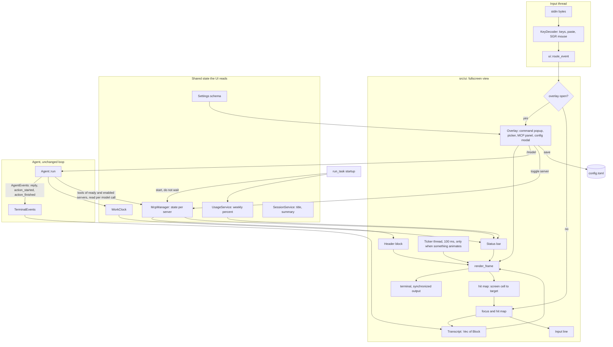
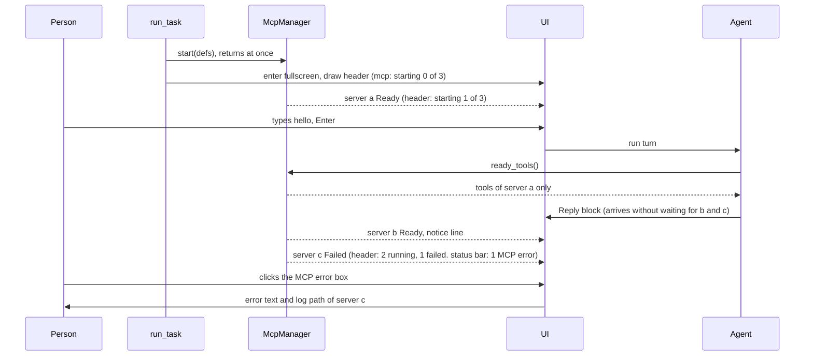
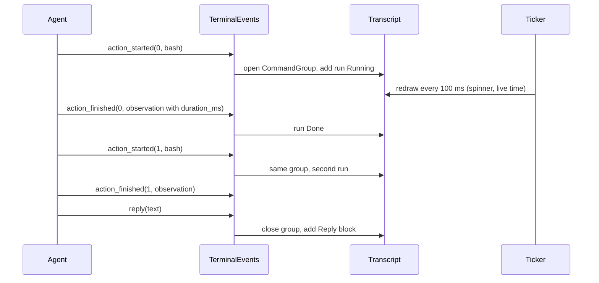

# Umbra Improvements v2: a structured, interactive terminal UI

Ticket: task-2607. Status: design only. Nothing in this document is built yet.

## Introduction

Umbra's fullscreen view stores the transcript as printed lines of text. A reply, a shell command and its output are all plain strings by the time they reach `src/utils/screen.rs`, so nothing on screen can be collapsed, clicked, updated in place or drawn again in a different form. The ticket asks for a header with live MCP state, a model picker, slash commands with autocomplete, a configuration modal, a shorter status bar with a running agent timer and a weekly usage bar, markdown rendering, grouped and collapsible shell commands, a session picker for resume, and working text selection on Windows. Every one of those needs the transcript to hold structured blocks and needs the screen to accept mouse and keyboard focus.

This design replaces the line list with a list of typed blocks, adds a small set of overlays (popup, picker, modal), adds a redraw ticker for spinners and timers, starts MCP servers in the background when Umbra starts, and adds the services the new UI reads from (MCP state, work clock, weekly usage, session titles, settings schema). The agent loop, the providers, the trajectory format and ACP keep working as they do today, with small additions that are listed below.

## Goals and Non-Goals

### Goals

| # | Goal | How it is checked |
|---|---|---|
| G1 | The header shows `mode` alone on its row. The instruction file count is gone. `skills` and `mcp` each have their own row. | Frame test on the header rows |
| G2 | MCP servers start when Umbra starts, in the background. A prompt typed before they finish gets a reply. | Test with an MCP server that never answers: the first reply arrives in under 2 seconds |
| G3 | The `mcp` header row shows a spinner while servers start, opens a panel listing every registered server, and each server can be turned on or off for the current session. | Frame test and trajectory test: a tool from a server turned off is absent from the next model request |
| G4 | A model picker lists the models configured before and switches the model for the current session. | Test: pick a second model, the next request goes to it |
| G5 | Typing `/` opens an autocomplete list of commands: built in commands, custom commands and skills. Commands work on every prompt, including follow up prompts. | Frame test and replay test |
| G6 | `/config` opens a modal with sections on the left and the fields of the selected section on the right. Every setting in `src/models/config.rs` is editable there. Known models are a list, a custom model can be typed, provider URLs can be edited, and a Test button checks a provider. | A test fails if a config key has no entry in the settings schema |
| G7 | The status bar has no phase text, no "left before compaction" text, no compaction count and no step count. It has the context bar, the agent time, the cost, the model, the weekly usage bar and, at the far right, an MCP error box. | Frame test |
| G8 | The agent time counts only while the agent is working, updates every second, and accumulates across turns. | Unit test on the clock, frame test with two turns |
| G9 | The `✔ Done · N steps · $cost` line is gone. | Frame test |
| G10 | Replies are rendered from markdown: headings, bold, italic, inline code, fenced code, lists, quotes, tables, links, rules. | Golden tests per construct at two widths |
| G11 | Shell commands in a row are one collapsed box, "Ran N shell commands" with a spinner while running and the total time as minutes:seconds. Expanding shows one row per command. Expanding a command shows the full command, output, exit code and time. | Frame test with clicks and with keys |
| G12 | No resume command is printed during or after a session. `umbra resume` and `/resume` show a list of sessions with a name and a short summary, chosen with Up, Down and Enter. | Frame test and CLI test |
| G13 | Text can be selected with a plain mouse drag on Windows, macOS and Linux, and the selection is copied to the clipboard. | Frame test for the highlight and the clipboard write, manual check in Windows Terminal, conhost, iTerm2 and Terminal.app |
| G14 | Every clickable element also works from the keyboard. | Each frame test has a keyboard variant |

### Non-Goals

- Streaming a reply to the screen token by token. A reply is still drawn when the model call returns. The block model makes streaming possible later.
- Syntax highlighting inside code blocks.
- Changing ACP's behavior, other than the shared code it already uses.
- Changing the inline display (used with a pipe, `-q` or `--no-fullscreen`) beyond removing the same lines G7, G9 and G12 remove. Collapsing and clicking need the fullscreen view.
- Umbra signing in to Claude or ChatGPT itself. Umbra keeps reading the tokens Claude Code and Codex already saved, and never refreshes them.
- Rewriting the UI on ratatui or crossterm. See Alternatives.

## Problem statement

Findings from reading the code at commit `65752f2` (file and line references are to that commit).

1. **The transcript has no structure.** `View.lines` is a `VecDeque<Entry>` where `Entry` is `Text(String)` or `Laid(closure)` (`src/utils/screen.rs:49`). `show_action` and `show_observation` in `src/services/interaction_service.rs` print lines and keep nothing. A command's duration is never recorded: `Observation` has no time field.
2. **There is no mouse input.** Mouse reporting was removed in commit `cdb1a8c` so the terminal could select text on macOS. `keys.rs` drops every click. Nothing can be clicked.
3. **Text selection fails on Windows** because `raw_console_mode` clears `ENABLE_QUICK_EDIT_MODE` on the console input handle (`src/utils/terminal_mode.rs:93`). In conhost that flag is what makes a mouse drag select text. The macOS fix only removed escape sequences and did not touch this code. Whether the flag also changes Windows Terminal's behavior was not verified.
4. **MCP servers start after the first prompt, on the main thread.** `run_task` calls `build_agent`, which calls `connect_mcp`, after `task_text` has read the first prompt (`src/services/run_service.rs:134-170`). `McpManager::connect_all` waits up to `startup_timeout_seconds + 2` (32 seconds by default) and does not check for Ctrl+C. During that wait nothing is printed, which is the "I typed hello and got no response" report. A server that fails is shown as one yellow line and is gone for the session. A stdio server that missed the deadline is never killed, because `StdioTransport` has no `Drop`.
5. **The header's fourth row** is `mode    confirm · 3 instruction files · 12 skills · 2 MCP servers` (`src/utils/banner.rs:247`). "Instruction files" counts the `CLAUDE.md`, `AGENTS.md`, `GEMINI.md`, `UMBRA.md` and rules files Umbra loaded into the system prompt. The MCP number counts definitions found on disk before any server is started, so it never shows a failure.
6. **There are no named models.** A model is the string `provider/model`. `models = [...]` exists in the config and only ACP reads it. The terminal cannot change the model during a session, although `Agent::set_provider` already exists for ACP.
7. **Slash commands are expanded on the first prompt only.** `expand_slash_command` runs once in `run_task`. A follow up prompt of `/my-command` goes to the model as literal text. There is no autocomplete: Tab inserts four spaces.
8. **The status bar redraws only when the agent changes phase.** There is no timer, so the elapsed time freezes during a long command. The elapsed time is measured from session start and includes the time Umbra waits for the person.
9. **Replies are printed as raw text.** `show_reply_text` wraps at spaces and prints `**bold**` and backticks as typed.
10. **A session has no name.** The index entry has `task`, the first 200 characters of the expanded first task. When the first task was a skill, `task` is the start of the skill's body. `umbra --resume` with no value prints a numbered list and asks for a number. `resume with umbra --resume <id>` is printed after every turn.
11. **Umbra has no ChatGPT login support.** The OpenAI provider sends an API key to `/chat/completions`. The weekly usage of a ChatGPT subscription is only meaningful for a session that uses that subscription, so the Codex usage bar needs a provider that uses the Codex login.

## Architectural Overview



### Screen layout

```
┌ header block (first block of the transcript, scrolls with it) ─────────────┐
│  [logo]   umbra v0.6.0                                                     │
│           model   anthropic/claude-opus-5-5  ▾        <- click or /model   │
│           folder  ~/dev/umbra                                              │
│           mode    confirm                                                  │
│           skills  12                                                       │
│           mcp     ⠋ starting 2 of 5                   <- click or /mcp     │
└────────────────────────────────────────────────────────────────────────────┘
❯ fix the failing test

● I found the cause. The **parser** drops the last token.      <- markdown block

▸ ✔ Ran 4 shell commands · 0:42                                <- command group
● Fixed. `cargo test` passes.

──────────────────────────────────────────────────────────────────────────────
 context ████████░░░░ 33% · 42.6k / 128k │ ⠋ 3:07 │ $0.43 │ opus-5-5 │ week ███░░░ 23% │ ▲ 1 MCP error
❯ _
```

The command popup, the pickers and the MCP error list are drawn in the rows directly above the status bar. The config modal is drawn centered over the transcript.

## Detailed Technical Sections

### Components and Interfaces

New code goes in a new `src/ui/` module. `src/utils/screen.rs` keeps the terminal enter and leave code, the size watcher and `wrap_ansi`. The new services follow the existing layering: `src/services`, `src/repositories`, `src/models`, `src/utils`.

| Module | New or changed | Responsibility |
|---|---|---|
| `src/ui/block.rs` | new | `Block` enum and the layout of each block at a width |
| `src/ui/transcript.rs` | new | The block list, scroll position, expand state, focus order |
| `src/ui/frame.rs` | new, takes over `render_frame` | Builds the rows of a frame and the hit map |
| `src/ui/markdown.rs` | new | Markdown source to styled rows |
| `src/ui/overlay/` | new | `command_popup.rs`, `picker.rs`, `mcp_panel.rs`, `config_modal.rs` |
| `src/ui/selection.rs` | new | Mouse selection, highlight, copy |
| `src/ui/header.rs` | replaces the text rows of `banner.rs` | Header rows from live state. The logo animation in `banner.rs` stays |
| `src/utils/status_bar.rs` | changed | New segment list |
| `src/utils/keys.rs` | changed | `Key::Mouse { kind, button, col, row, shift }` |
| `src/utils/terminal_mode.rs` | changed | Quick edit handling on Windows |
| `src/utils/clipboard.rs` | new | OSC 52 and the native clipboard |
| `src/services/mcp/mod.rs` | changed | Background start, state per server, toggle |
| `src/services/work_clock.rs` | new | Accumulating agent time |
| `src/services/usage_service.rs` | new | Weekly usage for Claude and Codex logins |
| `src/services/command_service.rs` | new | Built in command table, completion, dispatch |
| `src/services/settings_service.rs`, `src/models/settings_schema.rs` | new | Schema of every setting, read, validate, write |
| `src/services/session_title_service.rs` | new | Session name and summary |
| `src/services/providers/codex.rs` | new | ChatGPT login provider (phase 8) |
| `src/services/terminal_events.rs` | new | `AgentEvents` implementation that feeds the transcript |
| `src/models/model_catalog.rs` | new | Known models list |

#### 1. Blocks and the transcript

```rust
/// One item in the transcript. Each block lays itself out again when the width changes.
pub enum Block {
    Header,                                   // live rows from HeaderState
    UserPrompt { text: String },
    Reply { markdown: String },               // rendered by ui::markdown
    CommandGroup(CommandGroup),
    Notice { tone: Tone, text: String },      // warnings, compaction notes, stop reasons
    Text(String),                             // anything still printed as a plain line
}

pub struct CommandGroup {
    pub runs: Vec<CommandRun>,
    pub expanded: bool,
}

pub struct CommandRun {
    pub kind: RunKind,                        // Shell { command } or Mcp { server, tool, args }
    pub state: RunState,                      // Pending, Running { since }, Done, NotRun { reason }
    pub output: String,
    pub exit_code: Option<i32>,
    pub error: Option<String>,
    pub duration: Option<Duration>,
    pub expanded: bool,
}
```

- `BlockId` is the index of the block plus a generation counter. The hit map and the focus list refer to `BlockId` and, inside a group, a run index.
- The existing `console::emit` keeps working: it appends `Block::Text`. This lets the migration happen one printing function at a time.
- The transcript cap stays at 20,000 rows, counted on laid out rows. Blocks are dropped from the front.
- Layout results are cached per block and width. A block is laid out again only when its content, its expand state or the width changes. Today every frame wraps every line again; the cache keeps a frame cheap when a spinner redraws ten times a second.

**Grouping rule.** A `CommandGroup` collects consecutive commands. A reply that contains text closes the open group, so the order on screen always matches the order of events. A model that writes a sentence before every command therefore produces groups of one command. That is accepted: the group header then reads "Ran 1 shell command".

**Group header text.**

| State | Header |
|---|---|
| A command is running | `▸ ⠋ Running 3 shell commands · 0:12` (count includes the running one, time is live) |
| All finished | `▸ ✔ Ran 3 shell commands · 0:42` |
| At least one failed | `▸ ✖ Ran 3 shell commands, 1 failed · 0:42` |
| Shell and MCP calls mixed | `▸ ✔ Ran 2 shell commands and 1 MCP call · 0:42` |

The time is the sum of the run durations, formatted `m:ss` (and `h:mm:ss` from one hour).

**Expanded group.** One row per run: `  ▸ $ cargo test --lib            0:31  exit 0`. The command is cut to one row. Expanding a run shows the full command, the output and the exit code. Output is capped at 400 rows per run with a note that says how many rows were cut and names the trajectory file that has all of it.

**Confirm mode.** The command waiting for approval is shown in full in the rows above the input, with the existing prompt text. After the answer the run joins the group as `Running` or `NotRun`.

**Where the data comes from.** The terminal run passes a `TerminalEvents` implementation of `AgentEvents` to the agent, in place of `NoEvents`. `action_started(index, action)` adds a run in `Running`, `action_finished(index, action, observation)` fills it in, `action_not_run` marks it. `Observation` gains `started_at: Option<f64>` and `duration_ms: Option<u64>`, set in `environment/local.rs`, `environment/docker.rs` and `McpManager::call`. Both are written to the message `extra` with `#[serde(default)]`, so old trajectories still load.

#### 2. Redraw ticker

A thread wakes every 100 ms. It redraws only when at least one of these is true: a command is running, the agent is working (the status bar spinner and clock), an MCP server is starting, or a model call is in flight. When none is true the thread sleeps on a condition variable and uses no CPU. The spinner frame is computed from `Instant::now()`, so no state is mutated by the ticker. All drawing still goes through the one `VIEW` lock and the synchronized output wrapper that exist today.

#### 3. Mouse, focus and text selection

**Decision: Umbra turns mouse reporting on and does its own text selection.** The ticket asks for clickable elements and for text selection with the mouse. A terminal gives the mouse either to the application or to its own selection. With reporting on, a drag reaches Umbra, so Umbra draws the selection and copies it.

- Enter sequence adds `ESC[?1002h` (press, release and drag) and `ESC[?1006h` (SGR coordinates). `ESC[?1007h` stays for terminals that ignore mouse modes. Leave turns them off.
- `KeyDecoder` emits `Key::Mouse` for press, drag, release and wheel.
- **Click**: press and release on the same cell with no drag. The frame's hit map resolves the cell to a target: header model row, header mcp row, group header, run row, status bar MCP error box, overlay item, modal field.
- **Selection**: press, drag, release. `ui::selection` keeps an anchor and a head in transcript coordinates (block, row, column), so a selection survives scrolling. Dragging past the top or bottom edge scrolls. The selected cells are drawn in reverse video. On release the selected text is copied, with wrapped rows of one logical line joined and trailing spaces removed. Double click selects a word, triple click selects a line. Any key or click clears the selection.
- **Copy** (`src/utils/clipboard.rs`): write OSC 52 and also the native clipboard. Windows: `OpenClipboard` and `SetClipboardData(CF_UNICODETEXT)` through `windows-sys` (add the `Win32_System_DataExchange` and `Win32_System_Memory` features). macOS: `pbcopy`. Linux: `wl-copy`, then `xclip`, then `xsel`, whichever exists. The native write is needed because Terminal.app does not support OSC 52 and iTerm2 blocks it by default. A short "copied N characters" note appears in the status bar for two seconds.
- **The terminal's own selection** is still reachable by holding the terminal's modifier (Shift in Windows Terminal and most Linux terminals, Option in iTerm2, Fn in Terminal.app).
- **Setting**: `mouse = true` in the config, `--no-mouse` and `UMBRA_MOUSE=0`. With `mouse = false` Umbra sends no mouse modes, everything is keyboard only, and the terminal selects text itself.
- **Windows console mode** (`raw_console_mode`): with `mouse = false`, keep `ENABLE_QUICK_EDIT_MODE` as it was before Umbra started and set `ENABLE_EXTENDED_FLAGS`. This is the direct fix for finding 3. With `mouse = true`, clear quick edit as today, because conhost must not take the drag. `ENABLE_MOUSE_INPUT` stays unset in both cases: the mouse arrives as VT sequences through `ENABLE_VIRTUAL_TERMINAL_INPUT`. To verify during the build: that conhost on Windows 11 sends SGR mouse reports with these flags. If it does not, the fallback for conhost only is `mouse = false` behavior chosen automatically when `WT_SESSION` is not set.

**Keyboard focus.** Tab moves focus from the input to the newest focusable element and then backward through older ones (run rows of an expanded group, group headers, header rows, the MCP error box). Shift+Tab moves the other way. Enter or Space activates the focused element. Esc or typing a character returns to the input. The focused element is drawn with a `›` marker and bold text. Tab no longer inserts four spaces; a pasted tab is kept. When the command popup is open, Tab completes instead.

#### 4. Header

Rows, from `HeaderState` (model, folder, mode, skill count, MCP summary):

```
umbra v0.6.0
model   anthropic/claude-opus-5-5 ▾
folder  ~/dev/umbra
mode    confirm
skills  12
mcp     ⠋ starting 2 of 5
```

- The instruction file count is removed. Nothing replaces it. `umbra inspect` still lists the files.
- `mcp` row states: `⠋ starting 2 of 5` while any server is starting, `5 running`, `4 running · 1 failed` (the failed part in red), `3 running · 2 off`, `none` when no server is defined, `off` when `mcp.enabled = false`.
- The `model` row and the `mcp` row are click targets and focus targets. `/model` and `/mcp` open the same overlays when the header has scrolled away.
- The header is a `Block::Header`, so its rows are computed from live state at every frame. The logo animation keeps its 5 steps but runs on the ticker. It no longer blocks the main thread for 1.4 seconds, so the prompt accepts typing immediately.

#### 5. MCP: background start, state, toggle, errors

```rust
pub enum ServerState {
    Off,                                             // turned off for this session or by config
    Starting { since: Instant },
    Ready { tools: Vec<ToolDef>, protocol: String },
    Failed { error: String, log_path: PathBuf, at: Instant },
}

impl McpManager {
    /// Starts every selected server on its own thread and returns at once.
    pub fn start(defs: Vec<McpServerDef>, settings: &McpSettings) -> Arc<McpManager>;
    /// One entry per registered server, in name order.
    pub fn snapshot(&self) -> Vec<(String, ServerState)>;
    /// Tool definitions of every server that is Ready, read before each model call.
    pub fn ready_tools(&self) -> Vec<ToolDef>;
    /// Turns one server on or off for this session.
    pub fn set_enabled(&self, name: &str, on: bool);
    /// Starts a failed server again.
    pub fn restart(&self, name: &str);
    /// Waits until no server is Starting, or the deadline, or Ctrl+C.
    pub fn wait_settled(&self, deadline: Instant) -> bool;
}
```

- `run_task` calls `McpManager::start` right after `load_run_context`, before the header is drawn and before the first prompt is read. The manager is handed to `build_agent` in place of the `connect_mcp` call.
- **Interactive runs never wait.** The agent reads `ready_tools()` before each model call. A server that becomes ready during a turn is available from the next model call, and a dim notice `· mcp github ready, 31 tools` is added to the transcript. The `tool_search` index is rebuilt when the set of ready servers changes.
- **Runs that are not interactive wait as they do today.** With a pipe, `-q` or ACP, `build_agent` calls `wait_settled` with the same deadline as now, so scripted runs and `tests/mcp.rs` see the same tools on the first call. `wait_settled` polls the interrupt flag, so Ctrl+C ends the wait.
- **Per call timeout on start** stays `startup_timeout_seconds`. A server that passes it becomes `Failed("did not finish starting within 30 seconds")`. `StdioTransport` gets a `Drop` that kills the child process, so a failed or turned off server does not leave a process behind.
- **Toggle.** `set_enabled(name, false)` closes the server and sets `Off`. Its tools are absent from the next model call. `set_enabled(name, true)` starts it again. The set of names turned off is kept in the session index (`mcp_off: Vec<String>`), so `umbra resume` restores it. The config file is not changed.
- **A tool call to a server that is not Ready** returns the existing `MCP server 'x' is not connected` observation, with the state added: `(it is still starting)`, `(it failed to start: ...)` or `(it is turned off for this session)`.
- **MCP panel** (`/mcp`, click on the header row). One row per registered server: a toggle, the name, the state, the tool count, and for a failed server the first line of the error. Up and Down move, Space or a click toggles, `r` restarts a failed server, Enter on a failed server expands the full error and the log path, Esc closes.

```
 MCP servers                                   Space toggles · r restarts · Esc closes
 [x] github       running    31 tools
 [x] termoil      ⠋ starting
 [ ] blender      off
 [x] nikaya       ✖ failed   did not finish starting within 30 seconds
```

- **Status bar error box.** When at least one server is `Failed`, the far right segment is `▲ 1 MCP error` in red. A click, or Enter or Space when it has focus, expands a box above the status bar that lists each failed server with its full error text and its log path, and collapses on the same action. The yellow transcript line `MCP server x was not started` is removed in the fullscreen view. The inline view keeps it.

#### 6. Models: named models, catalog, picker

**Config.** A new table gives a model a short name:

```toml
model = "opus"                      # a name from [models], or provider/model as today

[models.opus]
provider = "anthropic"
model    = "claude-opus-5-5"
label    = "Opus 5.5"               # optional, shown in pickers

[models.qwen]
provider = "local"
model    = "qwen3.6-27b"
```

- `resolve_model(spec)` looks up `[models.<spec>]` first, then falls back to `provider/model`, then to the bare `claude...` rule. `-m opus` and `UMBRA_MODEL=opus` use the same function.
- The existing `models = [...]` list of `provider/model` strings is still read. Its entries appear in pickers under their full spec.
- **Known models** (`src/models/model_catalog.rs`): one static table of `{ label, provider, model, context_window }`. It starts with the Claude models (Fable 5.2 `claude-fable-5-2`, Opus 5.5 `claude-opus-5-5`, Sonnet 5.5 `claude-sonnet-5-5`, Haiku 5.5 `claude-haiku-5-5`) and the OpenAI and Codex models already present in the built in context window table in `src/services/providers`. The implementer takes the OpenAI ids from that table and from the provider documentation; this document does not list ids it has not verified.

**Picker** (`/model`, click on the header `model` row). It lists `[models.*]` entries, then `models = [...]` entries, then the current model if it is in neither. The current model has the filled marker. Up and Down move, Enter selects, Esc closes, typing filters. The last row is `Other...`, which opens a text field for a `provider/model` spec.

```
 ▾ Model: qwen
   ○ opus
   ● qwen
   ○ astra
   ○ Other...
```

Selecting a model runs `check_credentials`, `create_provider` and `Agent::set_provider`, the path ACP already uses. A failure (no key, expired login) is shown in the picker and the model does not change. The choice lasts for the session and is recorded in the session index so resume keeps it. It is not written to the config file. The picker is available at the prompt and while the agent works; a change made while the agent works applies from the next model call.

#### 7. Commands and autocomplete

**Built in commands** (`src/services/command_service.rs`):

| Command | Action |
|---|---|
| `/config` | Opens the configuration modal |
| `/model [name]` | Opens the model picker, or switches directly when a name is given |
| `/mcp` | Opens the MCP panel |
| `/mode [confirm, yolo, human]` | Switches the mode. With no argument, opens a picker |
| `/clear` | Saves the current session, starts a new session with empty history and clears the transcript. The old session stays in the resume list |
| `/compact [focus]` | As today |
| `/resume` | Opens the session picker |
| `/skills` | Opens a picker of skills. Enter inserts `/<skill> ` into the input |
| `/help` | Lists commands and keys |
| `/quit` | Ends the session |

The short commands inside the confirm, human mode and interrupt prompts (`/y`, `/u`, `/c`, `/q`, `/h`) keep working.

**Sources of the list.** Built in commands, then `context.commands` (custom commands), then `context.skills`. This is the same list ACP builds in `acp/session.rs:431`; that code moves into `command_service` and both callers use it. A built in name wins over a custom command or skill of the same name.

**Popup.** When the input starts with `/` and has no space yet, a list appears above the input with up to 8 rows: the name, the kind (command, custom, skill) and the description cut to the width. Matching is by prefix first, then by substring. Up and Down move, Tab or Enter completes the name into the input followed by a space, Enter on an exact match with no arguments runs it, Esc closes the popup and leaves the text.

**Dispatch on every prompt.** One function, `command_service::handle_line(line) -> LineAction`, is called for the first prompt, for follow up prompts and for lines typed while the agent works. It returns `RunBuiltin`, `SendToModel(expanded text)` or `SendToModel(line)` unchanged. This fixes finding 7. A built in typed while the agent works runs at once when it only touches the UI (`/config`, `/mcp`, `/model`, `/help`) and is refused with a one line notice when it needs the agent to be idle (`/clear`, `/resume`).

**Input line.** Add Up and Down history of earlier prompts when the input is on its first or last row and the transcript is at the bottom, Ctrl+A, Ctrl+E, Ctrl+K, Ctrl+W, and Alt+Left and Alt+Right for word movement. Transcript scrolling stays on PageUp, PageDown, the wheel, Ctrl+Home and Ctrl+End.

#### 8. Configuration modal

Layout: centered, 80 percent of the screen, at least 70 by 18. Sections on the left, fields of the selected section on the right, a footer with the keys.

```
┌ Configure Umbra ──────────────────────────────────────────── scope: User ▾ ┐
│ › Models        │ Default model     [ opus ▾ ]                             │
│   Providers     │ Named models                                             │
│   Compaction    │   opus    anthropic / claude-opus-5-5         [Edit]     │
│   MCP           │   qwen    local / qwen3.6-27b                 [Edit]     │
│   Behavior      │   [Add a model]                                          │
│   Display       │                                                          │
│   Environment   │                                                          │
│   Discovery     │                                                          │
│   Images        │                                                          │
│   Templates     │                                                          │
├─────────────────┴──────────────────────────────────────────────────────────┤
│ ↑↓ move · Tab switch pane · Enter edit · Ctrl+S save · Esc close           │
└────────────────────────────────────────────────────────────────────────────┘
```

**Sections and what they hold.**

| Section | Settings |
|---|---|
| Models | `model`, `[models.*]` (add, edit, remove). The model field of an entry is a list of known models for the chosen provider plus `Custom...`, which opens a text field |
| Providers | Every `[providers.*]`: `kind`, `base_url`, `auth`, `api_key_env`, `api_key`, `headers`, `max_tokens`, `temperature`, `effort`, costs, `extra_body`, `max_retries`, `stream`. Add a provider. A **Test** button on each provider |
| Compaction | Every key of `[compaction]`. Ratios are edited as percents |
| MCP | `mcp.enabled`, `only`, `disabled`, both timeouts, `defer_tools`, `defer_ratio`, and the list of discovered servers with the file each came from |
| Behavior | `mode`, `step_limit`, `cost_limit`, `wall_time_limit_seconds`, `max_consecutive_format_errors`, `confirm_exit`, `keep_open`, `whitelist_actions`, `action_format`, `finish` |
| Display | `fullscreen`, `banner`, `status_bar`, `verbose`, `mouse`, `sessions.auto_title`, `usage.enabled` |
| Environment | Every key of `[environment]` |
| Discovery | `[sources]`, `[instructions]`, `[skills]`, `[commands]` |
| Images | `[images]` |
| Templates | `[templates]` paths |

**Settings schema** (`src/models/settings_schema.rs`). One static table drives the modal:

```rust
pub struct SettingSpec {
    pub path: &'static str,            // "compaction.trigger_ratio"
    pub section: Section,
    pub label: &'static str,
    pub help: &'static str,
    pub kind: FieldKind,               // Toggle, Integer{min,max}, Percent, Text, Secret, Choice(&[..]), List, Map, Model, Url
    pub applies: Applies,              // Now, NextModelCall, NextSession
}
```

A test serializes `Config::default()` to TOML, walks every leaf key, and fails if a key has neither a `SettingSpec` nor an entry in a short documented exclusion list. That test is what keeps G6 true when a setting is added later.

**Field editing.** Toggle: Space. Choice: Enter opens a list. Number, text, URL: Enter edits in place, Enter confirms, Esc cancels. Secret: shown as dots with the last 4 characters; the modal recommends `api_key_env` and shows whether that environment variable is set. Invalid input shows a red message under the field and cannot be saved.

**Scope and saving.** The scope switch chooses `~/.umbra/config.toml` (User) or `<project>/.umbra/config.toml` (Project). Each field shows which file its current value comes from. Ctrl+S writes only the keys that changed, using the `toml_edit` crate so comments and key order in the file are kept. The write is to a temporary file followed by a rename. After saving, the running config is rebuilt with `load_config` and applied: `Applies::Now` settings take effect in the open session (mode, limits, compaction, display), a change to the current model or its provider goes through `Agent::set_provider`, and `Applies::NextSession` settings show "applies to the next session" next to the field. Esc with unsaved changes asks to save or discard.

**Test button.** Runs on a worker thread and shows a spinner, then one result line per step:

1. Credentials: which credential was found (API key from config, environment variable name, Claude Code login, Codex login) and, for a login, when it expires. The value is never shown.
2. Reachability: for `kind = "openai"`, `GET {base_url}/models`, showing the HTTP status, the time taken and how many models the server lists. For llama.cpp, `GET /props` is also tried and the loaded model and context size are shown.
3. Completion: the same one message request `umbra setup` sends ("Say hello."), using the model selected for that provider, showing the time taken and the first 60 characters of the reply, or the HTTP status and the first line of the error body.

`setup_service`'s test request moves into `settings_service::test_provider` and `umbra setup` calls it.

#### 9. Status bar

Segments, left to right. The right aligned group is pushed to the right edge.

| Segment | Text | Notes |
|---|---|---|
| Context | `context ████████░░░░ 33% · 42.6k / 128k` | Unchanged, including the compaction marker on the bar and the shorter variants |
| Agent time | `⠋ 3:07` while working, `3:07` when idle | From `WorkClock`. `m:ss`, `h:mm:ss` from one hour |
| Cost | `$0.43` | Hidden when zero, as today |
| Model | `opus-5-5` | As today |
| Weekly usage | `week ███░░░ 23%` | Only for a Claude or Codex login. See section 11 |
| MCP error box (right aligned) | `▲ 1 MCP error` | Only when a server failed. Clickable |

Removed: the phase segment (`● waiting for you`, `● thinking`, `● running cargo`), the room segment (`59.8k left before compaction at 80%` and its variants), the compactions segment and the step segment. During a compaction the context segment's label reads `compacting` in place of `context`, which is the only phase information that is not visible elsewhere. `Phase` stays in the code because the inline view and the spinner use it.

When the row is too narrow, segments shorten in this order: weekly usage to the percent alone, context bar shorter, model dropped, cost dropped. The agent time and the MCP error box are never dropped.

**WorkClock** (`src/services/work_clock.rs`):

```rust
pub struct WorkClock { accumulated: Duration, running_since: Option<Instant> }
// start(): no effect when already running. stop(): adds the running span to accumulated.
// elapsed(): accumulated plus the running span.
```

- `start()` when a prompt is handed to the agent and when a confirm prompt is answered.
- `stop()` when the turn ends, when a confirm prompt or the interrupt prompt is shown, and on exit.
- `accumulated` is saved in the session stats (`work_seconds`) and restored on resume.
- The value is read by the status bar at every tick, so it advances each second while running.

#### 10. Turn end and resume hints

- `show_turn_end` prints nothing for `Submitted` and `Replied` in the fullscreen view. For `Submitted`, the final output is still shown, as a `Reply` block.
- The other endings keep one `Notice` line each, because they tell the person why the agent stopped: `▲ Interrupted`, `✖ Stopped: the step or cost limit was reached`, and the rest of `turn_headline`. The step count, cost and time are removed from those lines; the status bar has the cost and the time.
- `resume with umbra --resume <id>` is removed from the turn end, from the exit text and from the resumed session prompt. The quiet mode message on stderr (`umbra: interrupted. Resume with: umbra --resume <id>`) stays, because a script has no other way to learn the id.
- The exit text on the main screen becomes the `trajectory <path>` line only.

#### 11. Weekly usage

`UsageService` runs one background thread that is started with the session and restarted when the model changes. It publishes `Option<WeeklyUsage { percent: f32, resets_at: SystemTime, stale: bool }>`.

**Which source applies** is decided from the credential the active provider is using:

| Active credential | Source |
|---|---|
| Anthropic provider using the Claude Code login or `ANTHROPIC_AUTH_TOKEN` | Claude usage endpoint |
| Codex provider (ChatGPT login, phase 8) | ChatGPT usage endpoint |
| Any API key, any local server | None. The segment is hidden |

**Claude.**

- `GET https://api.anthropic.com/api/oauth/usage` with `Authorization: Bearer <claudeAiOauth.accessToken>`, `anthropic-beta: oauth-2025-04-20`, `anthropic-version: 2023-06-01`. The token is read with the existing code in `credentials.rs`.
- The response has `five_hour`, `seven_day`, `seven_day_opus` and `seven_day_sonnet`, each `{ utilization, resets_at }` or null. `utilization` is a percent from 0 to 100. `resets_at` is an ISO 8601 time. The bar uses `seven_day`. Unknown fields are ignored.
- Between polls, the service also reads `anthropic-ratelimit-unified-7d-utilization` (a fraction from 0.0 to 1.0) and `anthropic-ratelimit-unified-7d-reset` (epoch seconds) from each `/v1/messages` reply, which `anthropic.rs:send` already has in `HttpReply.headers`. These headers are documented only by a third party write up, so they update the value when present and are never required.

**Codex.**

- `GET https://chatgpt.com/backend-api/wham/usage` with `Authorization: Bearer <tokens.access_token>`, `chatgpt-account-id: <account id>` and a `User-Agent`. Both values come from `~/.codex/auth.json` (`$CODEX_HOME/auth.json`).
- The response has `rate_limit.primary_window` and `rate_limit.secondary_window`, each `{ used_percent, limit_window_seconds, reset_after_seconds, reset_at }`. The weekly window is the one whose `limit_window_seconds` is within 10 percent of 604800. The position is not trusted.
- The same numbers arrive as `x-codex-secondary-used-percent`, `x-codex-secondary-window-minutes` and `x-codex-secondary-reset-at` on each `/codex/responses` reply. The Codex provider passes them to the service.
- Source: `codex-rs/backend-client/src/client/rate_limit_resets.rs`, `codex-rs/codex-api/src/rate_limits.rs` and `codex-rs/tui/src/chatwidget/rate_limits.rs` in `openai/codex`.

**Polling and failures** (the same intervals the existing usage cache in ai-service uses, because the Anthropic endpoint returns 429 when polled often):

| Event | Action |
|---|---|
| Session start, and after each turn ends | Poll, but never sooner than 180 seconds after the last poll |
| 200 | Publish. `stale = false` |
| 401 | The login expired. Hide the segment. Poll again after 5 minutes |
| 429 | Keep the last value with `stale = true` (the bar is dim). Wait 2, 5, 10, 20, then 30 minutes |
| Network error or 5xx | Keep the last value as stale. Poll again after 1 minute |
| Any other status, or JSON without the expected fields | Hide the segment for the session |

The bar is green below 70 percent, yellow below 90 percent and red from 90 percent. Focusing or clicking the segment shows `resets in 2d 4h` and, for Claude, the 5 hour window. `usage.enabled = false` turns the service off.

**Codex provider** (`src/services/providers/codex.rs`, `kind = "codex"`). The Codex bar can only exist for a session that uses the ChatGPT subscription, so a provider for it is part of this design.

- Credentials: `tokens.access_token` and the account id from `auth.json`. Umbra does not refresh the token. An expired token gives the same kind of message the Claude login gives: run `codex` once to refresh it.
- Requests: `POST https://chatgpt.com/backend-api/codex/responses`, the Responses API with streaming, tool calls mapped to and from Umbra's `Action`. `post_stream` in `src/utils/http.rs` is extended to return the response headers with the `Start` event.
- This endpoint is private to the Codex client and has no compatibility promise. The provider is built last, behind `kind = "codex"`, so nothing else depends on it. Decision needed from Jason before the first live request: this sends requests to the ChatGPT backend with his Codex login from a client that is not Codex, the same way Umbra already uses the Claude Code login. If he does not want that on his account, phase 8 is dropped and the usage bar ships for Claude only.

#### 12. Markdown

- Parser: the `pulldown-cmark` crate with default features off (tables and strikethrough options on). It is a parser only and adds no runtime dependencies.
- `ui::markdown::render(source, width) -> Vec<StyledRow>` walks the events and produces rows. The `Reply` block keeps the source, so a resize lays it out again.

| Construct | Rendering |
|---|---|
| Heading 1 to 3 | Bold, heading 1 also underlined, one blank row before |
| Bold, italic, strikethrough | SGR bold, italic, strikethrough |
| Inline code | Cyan |
| Fenced or indented code | A left border `│` in dim, the language name on the first row in dim, the code as written, long rows wrapped at the width with a dim `↪` continuation mark |
| Lists | `•` for bullets, numbers for ordered lists, nested by 2 columns, wrapped text aligned under the item text. Task items show `☐` and `☑` |
| Block quote | A dim `▎` on each row |
| Table | Box drawing borders, columns sized to content and shrunk in proportion to fit, cell text wrapped, alignment from the header row. A table that cannot fit with at least 6 columns of width per column is drawn as one `header: value` list per row |
| Link | Underlined text with an OSC 8 hyperlink. The URL is appended in dim when the text differs from the URL |
| Rule | A dim row of `─` |
| Raw HTML | Printed as text |

- With `NO_COLOR` set, the structure (indents, borders, bullets) stays and SGR codes are left out.
- The inline view uses the same renderer at the terminal width when stdout is a terminal, and prints the source unchanged to a pipe.
- Selection copies what is on screen. The source of a fenced code block is copied without the border.

#### 13. Resume picker and session names

**Session index gains** `title`, `summary` (both `#[serde(default)]`), `mcp_off`, `model` (already present) and `work_seconds`.

**Where the name comes from** (`session_title_service`):

1. When the first prompt is submitted, `title` is the first line of what the person typed (`user_text`, not the expanded task), cut to 60 characters.
2. When the first turn ends, a background thread sends one request to the session's model with the first prompt and the first reply, asking for a title of at most 6 words and a summary of one sentence, as JSON. The result replaces `title` and sets `summary`. A failure leaves the values from step 1. This request uses a second provider instance, is not added to the conversation, and its cost is added to the session cost.
3. When a compaction writes a summary, the first sentence of that summary replaces `summary`. No extra request is made.

`sessions.auto_title = false` turns off step 2.

**`umbra resume`** becomes a subcommand. `umbra resume` opens the picker, `umbra resume <id or prefix>` resumes directly, `--all` lists every folder. `umbra --resume` and `--continue` keep working. `/resume` opens the same picker inside a session.

```
 Resume a session                                  ↑↓ move · Enter resume · type to filter · Esc cancel
 › Fix the failing parser test                 2h ago · opus-5-5 · 14 calls
     The parser dropped the last token; fixed and tests pass.
   Add a model picker                          yesterday · qwen · 52 calls
     Named models in config and a /model command.
```

Two rows per session: the title with the age, model and call count, then the summary in dim. Old sessions with no title show the first 60 characters of the first `user_text`. The picker runs in the fullscreen view. When stdout is not a terminal, `umbra resume` prints the list as `umbra sessions` does and exits with a message that an id is required.

**After resuming**, the transcript is rebuilt from the trajectory: user prompts, `Reply` blocks and collapsed `CommandGroup` blocks, built by replaying the messages through the same code `TerminalEvents` uses. The line `↺ resuming session ...` stays as a `Notice` at the end.

### Data Flows and Security

#### Startup, and a prompt typed before MCP is ready



#### A command group



#### Error handling

| Failure | Behavior |
|---|---|
| A panic while the fullscreen view is up | The existing panic hook leaves the alternate screen. It now also turns mouse reporting off, so the shell is not left receiving mouse escape codes |
| Ctrl+C three times | Same path, `leave_now`, also turns mouse reporting off |
| The clipboard write fails | The status bar note says the copy failed and names the terminal's modifier for its own selection |
| Saving the config fails | The modal stays open with the error. The file on disk is unchanged because the write is a temporary file plus rename |
| A model switch fails its credential check | The picker shows the error. The session keeps its model |
| The title request fails | Ignored. The title from the first prompt stays |
| A layout function panics on odd input (markdown, table) | `render` catches the panic for that block and draws the source as plain text |

#### Security

- **Tokens.** The Claude and Codex access tokens are read from the files those tools wrote and are sent only to `api.anthropic.com` and `chatgpt.com`. They are never logged, never written to the trajectory, never shown in the modal and never included in an error message. The usage hosts are constants: a provider's `base_url` setting does not redirect the usage request, so a config file from a cloned repository cannot send a login token to another host.
- **Project config.** A project `.umbra/config.toml` can already set `base_url`. The modal shows which file each value comes from, so a URL set by the project is visible.
- **API keys in the modal.** A key typed into the modal is written to the config file as plain text, as `umbra setup` does today. The field recommends `api_key_env` and never displays more than the last 4 characters.
- **Clipboard.** Umbra writes to the clipboard only on a selection release. It never reads the clipboard. OSC 52 is write only.
- **Terminal escape injection.** Model output and command output can contain escape sequences. The markdown renderer and the command output view strip every control character except newline and tab before layout and keep SGR color codes only in command output. OSC 8 link targets are limited to `http`, `https` and `file` and are stripped of control characters, so a reply cannot place a hidden sequence in a link.
- **MCP toggle.** Turning a server off closes its process. A tool call the model sends for it afterwards is refused inside Umbra and never reaches the server.

## Alternatives Considered

| Decision | Alternative | Pros | Cons | Outcome |
|---|---|---|---|---|
| UI foundation | Move to `ratatui` and `crossterm` | Widgets, layout and mouse parsing exist already | A rewrite of `screen.rs`, `console.rs`, `keys.rs` and the Windows console code that was tuned over several tickets (raw mode being reset by child programs, Ctrl+C handling, synchronized output). Scrolling a transcript of mixed blocks still has to be written by hand | Rejected. Extend the existing code |
| UI foundation | Keep lines of text and patch each feature in | Smallest change | Collapsing, clicking, markdown at a new width and selection that follows scrolling all need to know what a row belongs to | Rejected |
| Mouse | Keep reporting off. Keyboard only. The terminal selects text | Selection works in every terminal with no code. Only the quick edit fix is needed on Windows | No clicking, which the ticket asks for in three places | Kept as the `mouse = false` setting |
| Mouse | Mode 1000 only (clicks, no drag). Selection through the terminal with Shift held | Less code than drawing a selection | A plain drag selects nothing. The modifier differs by terminal (Shift, Option, Fn). This is the state that commit `cdb1a8c` removed after it was reported as broken | Rejected |
| Mouse | Reporting on, selection drawn by Umbra, copy to the clipboard | Clicks and plain drag selection both work, the same on every platform. Selection can cross a scroll | Most code. Needs a native clipboard path because OSC 52 is not supported everywhere | Chosen |
| MCP start | Keep the blocking start but show a spinner | Tools are complete on the first call | The person still waits up to 32 seconds for one bad server | Rejected for interactive runs, kept for runs that are not interactive |
| MCP start | Background start, tools join when ready | No waiting. One bad server costs nothing | The first model call may not have every tool. The tool list changing between calls costs one prompt cache miss per change | Chosen for interactive runs |
| Markdown | Hand written parser | No dependency | CommonMark has many edge cases (nested lists, tables, code inside lists) | Rejected |
| Markdown | `termimad` or another crate that renders | Less code | Takes over wrapping and styling, so it cannot share the selection, link and width code | Rejected. `pulldown-cmark` parses, Umbra lays out |
| Config writes | `toml` crate, write the whole file | Already a dependency | Removes the person's comments and reorders keys | Rejected. `toml_edit` |
| Session names | First prompt text only | No model call | A session that starts with "hello" or a skill is named badly, and there is no summary | Used as the fallback |
| Session names | One small model request after the first turn | A real name and summary | A small cost and one extra request per session | Chosen, with a setting to turn it off |
| Codex usage | Show the Codex bar whenever `~/.codex/auth.json` exists | No new provider | Shows a subscription's usage in a session that is not using that subscription | Rejected |
| Grouping | One group per turn, replies shown after it | Fewer, larger groups | Text and commands would be shown out of order | Rejected |

## Testing strategy

### A way to test the fullscreen view from an integration test

Every integration test today runs over a pipe, so the fullscreen view is never exercised. Add:

- `UMBRA_FORCE_FULLSCREEN=1`, with `COLUMNS` and `LINES`, makes the fullscreen view run with piped stdin and stdout. Raw mode calls are skipped when stdin is not a console.
- Test input is bytes written to stdin: text, key escape sequences and SGR mouse reports (`ESC[<0;col;rowM` and `m`).
- `tests/common/screen.rs`: a small reader that takes the bytes on stdout, finds the last complete frame (between `ESC[?2026h` and `ESC[?2026l`), and returns the rows as plain text plus the SGR attributes per cell. Every frame is a full repaint, so no terminal emulation is needed.
- Helpers: `wait_for_row(text)`, `click(col, row)`, `click_text(text)`, `press(key)`, `drag(from, to)`.
- The replay provider drives the model side. `UMBRA_TICK_MS` lets a test slow or stop the ticker, and a fixed clock environment variable makes times deterministic.

### Functional tests (new file `tests/fullscreen.rs` unless named)

| Area | Test |
|---|---|
| Header | Rows are `model`, `folder`, `mode`, `skills`, `mcp`. No row contains "instruction". `mode` row is the mode word only |
| MCP start | With a fake server that sleeps forever: the reply to `hello` is on screen within 2 seconds, the header shows `starting`, and after the start timeout the header shows `1 failed` and the status bar shows `▲ 1 MCP error` |
| MCP start, not interactive | `tests/mcp.rs` passes unchanged: over a pipe the first request contains the server's tools |
| MCP error box | Click the box: the error text and log path appear. Click again: they are gone. Same with Tab to focus and Enter |
| MCP toggle | Open the panel, turn a server off, send a prompt: the recorded request has no tool from that server. Turn it on: the next request has them. Resume the session: the server is still off |
| MCP process | After a failed start and after a toggle off, the fake server's process has exited (checked by a pid file the fake server writes) |
| Model picker | Two `[models]` entries with two replay providers. Open with `/model`, Down, Enter: the next request goes to the second provider and the header row changes. A model with no credentials shows an error and the model is unchanged |
| Autocomplete | Type `/co`: the popup lists `/compact` and `/config`. Tab completes. A custom command and a skill appear with their kind |
| Commands on follow up | Second prompt `/my-command x`: the request contains the command body with `x`. This fails on the current code |
| `/clear` | The transcript is empty, a new session id is in the index, the old session is still listed by `umbra sessions` |
| Config modal | Open, go to Compaction, set the trigger to 70, Ctrl+S: the file has `trigger_ratio = 0.7`, a comment that was in the file is still there, and the status bar marker moved. Invalid input (`abc` in a number) cannot be saved |
| Config coverage | Unit test: every leaf key of `Config::default()` has a `SettingSpec` or is in the exclusion list |
| Provider test button | Against a local fake HTTP server: success shows the model count and reply text. A 401 shows the status and the first line of the body. A closed port shows a connection error. No output contains the key |
| Status bar | The row contains the context segment, a time and the model. It does not contain "waiting", "left before compaction", "compaction" as a count, or "step" |
| Agent time | With a fixed clock: the time advances during a turn, is unchanged while the prompt waits, and continues from the same value in the second turn. Unit test for `WorkClock` start, stop, start |
| Turn end | No row contains `✔ Done` or `--resume`. An interrupted turn shows `▲ Interrupted` |
| Markdown | Golden files per construct at widths 80 and 40: headings, emphasis, inline code, fenced code, nested list, quote, table, table too wide, link, rule. A reply containing `ESC ] 0 ; x BEL` is drawn with the control characters removed |
| Command group | Three commands in a row: one row `Ran 3 shell commands · m:ss`. While the second runs: `Running 2 shell commands` with a spinner cell. Click the header: three run rows. Click a run: full command, output, `exit 0`. The same with Tab, Enter. A failed command shows `1 failed` |
| Durations | The trajectory's observations have `duration_ms`. An old trajectory without the field loads and resumes |
| Resume | `umbra resume` with three sessions in the index: three titles and summaries, Down, Enter resumes the second, and the transcript shows its earlier prompts and collapsed groups. `umbra resume` over a pipe prints the list and exits with a nonzero status |
| Session title | With the replay provider answering the title request: the index has the title and summary after the first turn. With `auto_title = false`: no extra request is recorded |
| Selection | Drag across two rows: those cells have the reverse attribute and the copied text (captured through a `UMBRA_CLIPBOARD_FILE` test hook and the OSC 52 bytes on stdout) equals the logical text with the wrap joined. A click with no drag selects nothing |
| Mouse off | `--no-mouse`: the enter sequence has no `?1002h`, and Tab, Enter still expand a group |
| Usage, Claude | Fake endpoint (the usage host is overridable only by a test environment variable): 200 shows `week` and the percent, 401 hides the segment, 429 keeps the value and dims it, JSON with `seven_day: null` hides it. With an API key the endpoint is never called |
| Usage, Codex | Fake endpoint: the window with `limit_window_seconds` 604800 is used when it is the primary one and when it is the secondary one |
| Codex provider | Replay of a recorded Responses stream: text, a tool call and the rate limit headers are parsed |

### Windows console tests (`tests/console_windows.rs`, real console, ignored by default)

- Add a `getmode` action to the helper process. With `mouse = false`, `ENABLE_QUICK_EDIT_MODE` and `ENABLE_EXTENDED_FLAGS` are set while the fullscreen view is up. With `mouse = true`, quick edit is clear and `ENABLE_MOUSE_INPUT` is not set.
- Unit test on `raw_console_mode(previous, mouse)` for both settings.

### Existing tests that change

The assertions on these strings are updated or removed with the features they describe: `✔ Done · 1 step` (`tests/terminal_output.rs`, `screen.rs`), `● waiting for you`, `left before compaction at 80%`, `↻ N compactions`, `step 14` (`tests/status_bar.rs`, `status_bar.rs`), `umbra --resume {id}` on stdout (`tests/sessions.rs:123`, `tests/interrupt.rs:98`, `screen.rs` epilogue test), the banner row assertions in `banner.rs`. `tests/sessions.rs` reads the session id from the `trajectory` line or from `umbra sessions --json` after the change.

### Manual checks in real terminals

The implementer drives the installed build through the Termoil MCP tools (`termoil_send_text`, `termoil_send_key`, `termoil_screen`) and in Windows Terminal and conhost on the PC, and checks: drag selection and paste into another program, click to expand, the wheel, the modal at 80 by 24 and at 200 by 60, resize while a modal is open, and that leaving Umbra (normal exit, Ctrl+C three times, a forced panic) leaves the shell with mouse reporting off. iTerm2 and Terminal.app are checked on the MacBook. Visual checks are done on the released build.

## Build order

Each phase leaves `cargo test` passing and the binary usable.

1. **Foundation.** `src/ui` blocks, transcript, frame with hit map, layout cache, ticker, `Key::Mouse`, focus, the fullscreen test harness. `console::emit` feeds `Block::Text`. No visible change yet except Tab.
2. **Selection and Windows fix.** `ui::selection`, clipboard, `mouse` setting, `raw_console_mode` change, panic and exit cleanup.
3. **MCP.** Background start, state, `Drop`, header row, panel, toggle, status bar error box.
4. **Status bar, WorkClock, turn end, header rows.** Removal of the phase, room, compactions and step segments and of the Done and resume lines.
5. **Command groups and markdown.** `TerminalEvents`, durations in `Observation`, `ui::markdown`.
6. **Commands, autocomplete, named models, model picker, input line keys.**
7. **Config modal, settings schema, provider test, `toml_edit`.**
8. **Resume picker, session titles, transcript rebuild on resume.**
9. **Usage service for Claude. Then the Codex provider and Codex usage, after Jason's answer on the decision in section 11.**
10. **Docs** (`docs/configuration.md`, `docs/mcp.md`, `docs/providers.md`, `docs/architecture.md`, README), version bump to 0.6.0, release.

## Open decision for Jason

- **Codex provider (phase 9).** The Codex weekly bar needs Umbra to send requests to `chatgpt.com/backend-api` with the Codex login. If that is not wanted, the usage bar ships for Claude only and `kind = "codex"` is not built. Everything else in this design is independent of the answer.
